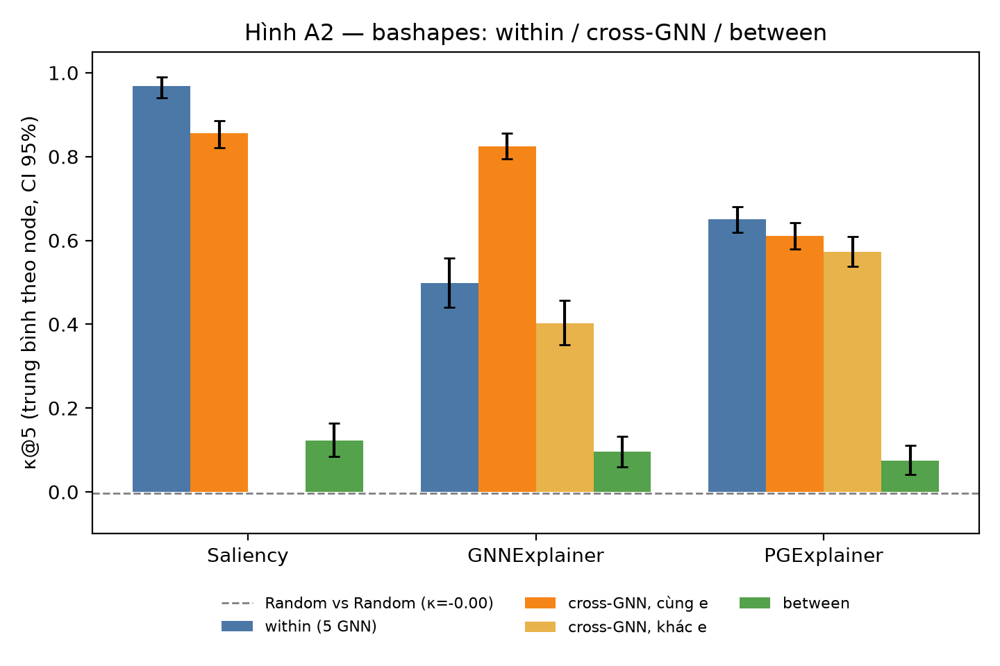
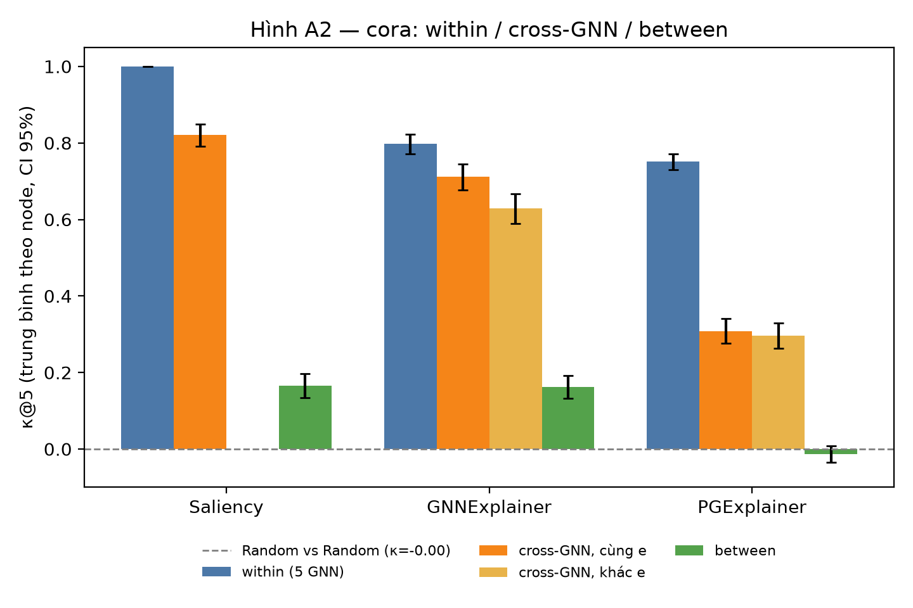
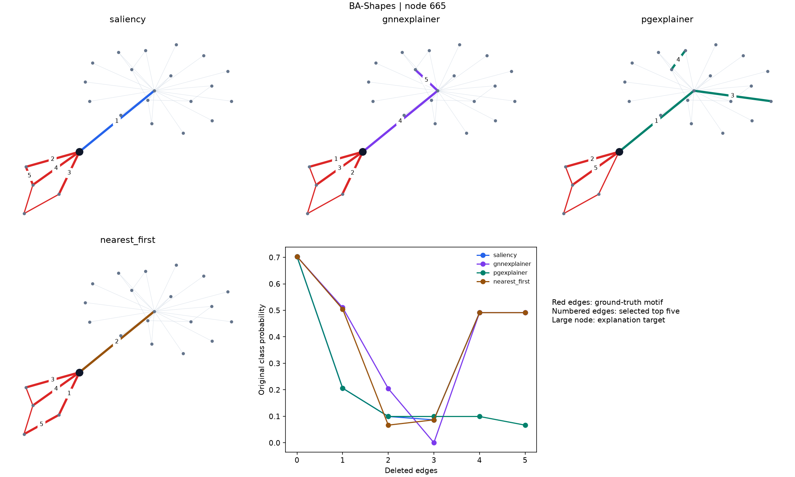
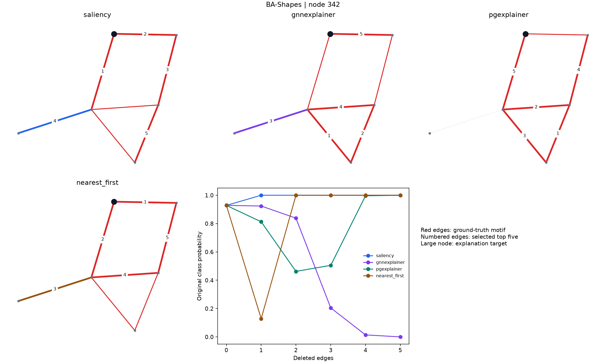
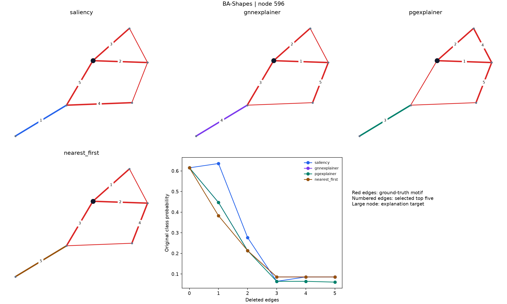

# GIẢI THÍCH MÔ HÌNH HỌC MÁY TRÊN ĐỒ THỊ: BẤT ỔN ĐỊNH, BẤT ĐỒNG VÀ ĐÁNH GIÁ CÓ THỂ TÁI LẬP

## 1. Mở đầu

### 1.1. Bài toán

Mạng nơ-ron đồ thị (GNN) dự đoán nhãn của một nút bằng cách tổng hợp thông tin từ các nút lân cận. Để biết vì sao mô hình dự đoán như vậy, người ta dùng *explainer*. Trong báo cáo này, explainer cho mỗi nút đích một điểm quan trọng trên từng cạnh trong lân cận 2-hop; một giải thích là tập $k$ cạnh có điểm cao nhất.

Ba phương pháp phổ biến (Saliency, GNNExplainer, PGExplainer) thường cho các tập cạnh khác nhau trên cùng một nút và một mô hình. Ở giữa kỳ, độ trùng Jaccard@5 giữa các cặp phương pháp chỉ khoảng 0,27–0,42 và có một mâu thuẫn giữa hai tiêu chí trên BA-Shapes: PGExplainer có Motif AUROC cao nhất (0,8000, trên 10/20 nút hợp lệ) nhưng Nearest-First, một baseline chỉ chọn cạnh gần nút đích, có Fidelity Drop@5 cao nhất (0,3728 so với 0,2195 của PGExplainer) (nguồn: `docs/BANG_SO_LIEU_MIDTERM_T06_DUC_KHA.md`).

### 1.2. Phản hồi của thầy và cách nhóm trả lời

Sau báo cáo giữa kỳ (29/10/2026), thầy nêu bốn điểm (`docs/KE_HOACH_CUOI_KY_FINAL.md`, Mục 1).

| Mã | Phản hồi (tóm tắt) | Nhóm trả lời bằng | Mục |
|:-:|---|---|:-:|
| FB-1 | Viết rõ quy trình tái lập: train GNN → chạy explainer → tính metric, trên đúng data và checkpoint | Chuỗi lệnh, SHA-256 của dữ liệu, checkpoint, CSV điểm; bộ kiểm tra hợp đồng dữ liệu | 4 |
| FB-2 | Phân biệt bất đồng giữa phương pháp với bất ổn định của chính từng phương pháp; giữ GNN, đổi seed explainer trước, rồi mới đổi seed GNN | Lưới 5 seed GNN × 5 seed explainer, phân tích theo thứ tự thầy dặn | 6 |
| FB-3 | Các metric mâu thuẫn; cần xác minh lại, rồi phân tích một số nút | Xác minh trên 25 cấu hình, quét toàn bộ nút test, 5 phép kiểm định cơ chế (T1–T5), case study | 7 |
| FB-4 | Làm kiểm chứng cốt lõi trước, rồi mới mở rộng nhiều dataset | Chỉ làm GCN và hai dataset; phần chưa làm ghi ở Mục 9 | 9 |

### 1.3. Ba câu hỏi nghiên cứu

Các câu hỏi bám Mục 7.1 của kế hoạch và EQ1–EQ3 của Mini-Proposal v2.

- **RQ1 (bất ổn định nội tại).** Giữ nguyên GNN, chỉ đổi seed của explainer: một phương pháp tự lệch với chính nó bao nhiêu?
- **RQ2 (nhạy theo mô hình).** Đổi seed huấn luyện GNN: giải thích đổi bao nhiêu, kể cả trên các nút mà hai GNN dự đoán cùng lớp?
- **RQ3 (bất đồng thực sự).** Hai phương pháp khác nhau lệch nhau nhiều hơn mức mỗi phương pháp tự lệch hay không?

Câu hỏi phụ (FB-3): vì sao Fidelity và Motif AUROC không chọn cùng một phương pháp tốt nhất, và mâu thuẫn đó còn không sau khi sửa lỗi và tăng cỡ mẫu.

### 1.4. Đóng góp

Nhóm không đề xuất thuật toán mới; đây là nghiên cứu thực nghiệm có kiểm soát (Mini-Proposal v2). Các đóng góp, kèm kết quả chính:

1. **Quy trình tái lập có kiểm tra băm** (dữ liệu, 10 checkpoint, CSV điểm), có bộ đánh giá và các script phân tích chạy lại được (Mục 4). Kiểm tra GATE 0 cho thấy số giữa kỳ của Saliency và GNNExplainer tái lập được, còn PGExplainer giữa kỳ thì không.
2. **Sửa và ghi lại các lỗi giữa kỳ** ảnh hưởng đến kết luận: thứ tự đặt seed của PGExplainer, forward 3-hop khi huấn luyện PGExplainer, công thức size-loss của GNNExplainer (Mục 3, 4).
3. **Tách ba nguồn biến thiên** (seed explainer, seed GNN, khác phương pháp) với quy tắc diễn giải đặt trước khi xem số (Mục 6). Kết quả: GNNExplainer và PGExplainer tự lệch đáng kể, nhưng độ đồng thuận giữa hai phương pháp khác nhau còn thấp hơn mức tự lệch ở cả 6 cặp (dataset × cặp phương pháp).
4. **Error analysis có kiểm định cơ chế trên toàn bộ nút test** (Mục 7). Mâu thuẫn Fidelity–AUROC vẫn còn (17/25 cấu hình); một cơ chế (mô hình không dựa vào motif) giải thích 95/208 nút mâu thuẫn, còn 113/208 nút chưa có cơ chế nào trong T1–T5 giải thích.
5. **Kết quả âm được ghi nhận:** gộp seed (D1) làm giải thích ổn định hơn nhưng không cải thiện chất lượng đáng kể và không giảm bất đồng giữa phương pháp (Mục 8); PGExplainer trên Cora không khác Random về Fidelity (Mục 5).

Phạm vi hẹp hơn Mini-Proposal: chỉ GCN, hai dataset (Mục 9).

## 2. Các nghiên cứu liên quan

Chúng tôi giải thích GCN 2 lớp của Kipf và Welling [1]. **GNNExplainer** [2] học, cho từng nút, một mask mềm trên cạnh sao cho dự đoán trên đồ thị đã che gần dự đoán gốc, kèm phạt kích thước và entropy; mỗi nút cần một lượt tối ưu. **PGExplainer** [3] thay các lượt tối ưu riêng bằng một mạng dùng chung dự đoán xác suất từng cạnh từ embedding của GNN; huấn luyện một lần rồi giải thích nút mới bằng suy luận. Một báo cáo tái lập PGExplainer trong ML Reproducibility Challenge 2020 [4] ghi nhận nhiều điểm không nhất quán giữa bài báo và mã gốc, một động lực để nhóm kiểm tra tái lập kỹ (Mục 4). Pope và cộng sự [5] và Baldassarre và Azizpour [6] đưa các kỹ thuật giải thích dựa trên gradient sang mạng đồ thị; Saliency của nhóm (đạo hàm logit lớp dự đoán theo trọng số cạnh, Mục 3.3) là cách nhóm định nghĩa, không phải bản cài đặt của một bài cụ thể.

Krishna và cộng sự [7] gọi *disagreement problem* là hiện tượng các phương pháp giải thích cho kết quả khác nhau trên cùng một mô hình; bài khảo sát thực nghiệm trên bốn tập dữ liệu và sáu phương pháp giải thích. Báo cáo này khảo sát hiện tượng tương tự cho giải thích cạnh của GNN, và tách riêng phần bất đồng khỏi bất ổn định của từng phương pháp. Về đánh giá, Faber và cộng sự [8] lập luận rằng so giải thích với "ground truth" do người thiết kế có rủi ro vì mô hình đã huấn luyện có thể không dựa vào các cạnh đó; đây là cơ sở của giả thuyết T2 (Mục 7). GInX-Eval [11] chỉ ra các metric dựa trên xóa cạnh có thể đo ngoài phân phối, liên quan đến giới hạn ở Mục 9.1. GraphFramEx [9] và GNNX-Bench [10] là các khung đánh giá và benchmark cho explainer của GNN. Báo cáo không khẳng định là nghiên cứu đầu tiên theo hướng này.

## 3. Phương pháp

### 3.1. Dữ liệu và mô hình

| | BA-Shapes | Cora |
|---|---|---|
| Số nút / đặc trưng / lớp | 700 / 10 / 4 | 2.708 / 1.433 / 7 |
| Chia tập | phân tầng 420 / 140 / 140 (seed 0) | Planetoid 140 / 500 / 1.000 |
| Nút đánh giá (test) | 140 (toàn bộ nút test) | 100 (lấy mẫu phân tầng theo nhãn thật, seed 0) |
| SHA-256 `data.pt` (12 ký tự đầu) | `8fbf94a7ce58…` | `f2846a82cdd1…` |
| Ground truth cạnh | có (motif ngôi nhà) | không |

*Nguồn: `configs/protocol_final.yaml`, `data/*/test_nodes.json`. Hash đầy đủ ở Mục 4.3.*

**GCN 2 lớp.** $Z=\hat A_w\,\mathrm{ReLU}(\hat A_w X W_1)\,W_2$, với $\hat A_w=\tilde D_w^{-1/2}\tilde A_w\tilde D_w^{-1/2}$ và $\tilde A_w$ là ma trận kề có trọng số cạnh $w$ cộng self-loop (`src/sna/models/gcn.py`). BA-Shapes: hidden 32, dropout 0, lr 0,01, weight decay $10^{-4}$, 600 epoch, class weights, chọn theo macro-F1 trên val. Cora: hidden 64, dropout 0,5, lr 0,01, weight decay $5\cdot10^{-4}$, 200 epoch, chọn theo accuracy trên val (`configs/datasets/*.yaml`). Lớp được giải thích là dự đoán của chính checkpoint, $\hat y_v=\arg\max_c Z_{v,c}$, không dùng nhãn thật.

### 3.2. Cạnh ứng viên và cách đưa trọng số cạnh vào GCN

Với nút đích $v$, $E_v$ là tập cạnh vô hướng trong lân cận 2-hop của $v$, bỏ self-loop, $m=|E_v|$; mọi explainer dùng chung $E_v$ và thứ tự `edge_id`. Các explainer gọi `model(x, edge_index, edge_weight=w)`; trong `GCNConv`, $w$ nằm trong cả $\tilde A_w$ lẫn bậc $\tilde D_w$, nên $w_{ij}=0$ cho kết quả đúng bằng xóa cạnh. Biên bản F10 (20 nút dev): lệch xác suất 0,0000 và 0/20 nút đổi dự đoán, trên cả hai dataset. Ngược lại, `set_masks` của PyG nhân mask sau bước chuẩn hóa bậc nên mask bằng 0 không tương đương xóa cạnh (BA-Shapes: lệch xác suất tối đa 0,4998, 6/20 nút đổi dự đoán; Cora: 0,7508 và 10/20) (`docs/BIEN_BAN_F10_GNNEXPLAINER_PYG.md`, Mục 4). Vì vậy nhóm dùng `edge_weight` để hàm mục tiêu của explainer trùng với phép xóa cạnh mà Fidelity đo.

### 3.3. Saliency

Đặt $\mathbf w=\mathbf 1$ có gradient, $g_{u\to w}=\left|\partial Z_{v,\hat y_v}/\partial w_{u\to w}\right|$, điểm cạnh vô hướng $s(e)=\max(g_{u\to w},g_{w\to u})$. Phương pháp tất định: hai lượt seed 0 và 1 cho điểm giống hệt (`max_diff = 0.0`), nên Saliency là mốc "không nhiễu seed explainer" ở Mục 6.

### 3.4. GNNExplainer

Với mỗi nút, tối ưu $\mathbf M\in\mathbb R^m$ (khởi tạo $M_i\sim\mathcal N(1,0{,}1^2)$ theo seed explainer), $\mathbf p=\sigma(\mathbf M)$, hai chiều của một cạnh dùng chung $p_i$:

$$\mathcal L(\mathbf M)=-\log P_\theta(\hat y_v\mid X,\mathbf w(\mathbf p))+\lambda_{\rm size}\,\mathrm{Agg}(\mathbf p)+\lambda_{\rm ent}\,\frac1m\sum_i H(p_i)$$

với 200 bước Adam, lr 0,01, $\lambda_{\rm size}=0{,}005$, $\lambda_{\rm ent}=0{,}1$; điểm cạnh là $\sigma(M_i)$. Bản giữa kỳ dùng $\mathrm{Agg}=\mathrm{mean}$, khiến mask dồn quanh 0,95 (trung vị 0,9481; 98,42% cạnh có điểm trên 0,9 ở BA-Shapes, 20 nút dev). **Quyết định đã chốt (nhóm trưởng xác nhận ngày 23/11/2026):** dùng $\mathrm{Agg}=\mathrm{sum}$ như PyG, theo biên bản F10 và quy tắc F10 của kế hoạch. Trên 20 nút validation, `sum` đưa trung vị xuống 0,2563 và tỷ lệ điểm trên 0,9 xuống 0,78%, trong khi Drop@5 gần như không đổi (0,3095 so với 0,3088) và Motif AUROC gần nhau (0,7350 so với 0,7392); $\kappa@5$ giữa hai bản là 0,9076 (BA-Shapes) và 0,2080 (Cora, 18 nút hợp lệ). Tăng $\lambda_{\rm ent}$ lên 1,0 làm AUROC giảm còn 0,5472 nên giữ 0,1. Các số này đo trên nút validation, không dùng nút test để chọn. Mọi lượt chạy cuối kỳ ghi `size_loss_mode = sum` trong `run_log.json`.

### 3.5. PGExplainer

PGExplainer [3] học một MLP dùng chung, nhận $[z_u\,\|\,z_v\,\|\,z_t]$ (embedding tầng 1 của hai đầu cạnh và nút đích $t$) và cho logit tồn tại của cạnh, đối xứng hóa giữa hai chiều. MLP huấn luyện trên nút thuộc tập train, hàm mất mát gồm cross-entropy giữ lớp dự đoán gốc, phạt kích thước và phạt entropy; mask lấy mẫu bằng Gumbel-Sigmoid, nhiệt độ giảm từ 5,0 xuống 0,5 trong 40 epoch, lr 0,005, chỉ đặt trên cạnh ứng viên. Khi giải thích, điểm cạnh là $\sigma$(logit) trên embedding của đồ thị đầy đủ (`docs/PHAN_BAO_CAO_PGEXPLAINER_THIEN.md`). Ba thay đổi so với giữa kỳ, đều vì tái lập:

- **F1 (seed).** Đặt seed trước khi tạo MLP. Bản giữa kỳ khởi tạo MLP trước khi đặt seed nên hai lượt cùng seed 42 lệch tới 0,885 về điểm cạnh (`docs/GATE0_TAI_LAP_GIUA_KY.md`, A.2).
- **Huấn luyện tất định** (chế độ tất định của PyTorch, CPU): trước khi sửa, hai lượt cùng seed lệch 0,30 về trọng số MLP; sau sửa, 0,0.
- **F9 (3-hop).** Forward khi huấn luyện chạy trên đồ thị con 3-hop, vì chuẩn hóa bậc của GCN cần đủ láng giềng của nút ở rìa. Với đồ thị con 2-hop, logit lệch tới 23,98 và 63/420 nút train BA-Shapes đổi dự đoán; với 3-hop, độ lệch tối đa 0,0 (BA-Shapes) và $7{,}2\cdot10^{-7}$ (Cora).

### 3.6. Baseline

**Random:** mọi cạnh cùng điểm, thứ hạng do hoán vị phá hòa có seed; mỗi nút lặp 5 seed phá hòa, trung bình trong nút trước khi tổng hợp. **Nearest-First:** điểm $-d(e)$, với $d(e)$ là khoảng cách BFS từ nút đích đến cạnh; cạnh trực tiếp đứng trước cạnh 2-hop, trong cùng mức do phá hòa quyết định. Baseline này trả lời: explainer có cho thêm thông tin ngoài việc chọn cạnh gần nút đích không?

### 3.7. Metric

$p(\cdot)$ là xác suất lớp $\hat y_v$ do GCN gán cho $v$ (đặc trưng giữ cố định, chỉ đổi tập cạnh); $S_k$ là $k_{\rm eff}=\min(k,m)$ cạnh đứng đầu; $k\in\{1,3,5,10\}$, bảng chính dùng $k=5$.

$$\mathrm{Drop}=p(G)-p(G\setminus S_k),\qquad \mathrm{Inv}=p(G)-p(G[S_k])$$

Drop càng cao thì các cạnh chọn càng cần cho dự đoán; Inv càng gần 0 thì càng đủ để giữ dự đoán; cả hai có thể âm và nhóm giữ nguyên giá trị âm. Nhóm dùng tên Drop/Inv thay cho Fid−/Fid+ vì các tài liệu đặt dấu +/− khác nhau. **Ground truth (chỉ BA-Shapes):** AUROC và AP tính trên điểm thô của toàn bộ $m$ cạnh với nhãn "thuộc motif", chỉ xác định khi nút có cả cạnh motif lẫn cạnh nền; Precision@5 là số cạnh motif trong top-5 chia $k_{\rm eff}$. **Độ đồng thuận** giữa hai giải thích $A,B$ của cùng một nút:

$$\mathrm{Jaccard}@k=\frac{|A\cap B|}{|A\cup B|},\qquad \kappa@k=\frac{|A\cap B|-k^2/m}{k-k^2/m}$$

$\kappa@k$ bằng 0 ở mức ngẫu nhiên, 1 khi trùng hoàn toàn, có thể âm, và không xác định khi $k_{\rm eff}=m$. Dùng $\kappa$ vì khi $m$ nhỏ Jaccard bị thổi phồng bởi trùng ngẫu nhiên: Jaccard@5 của cặp Random–Random là 0,316 (BA-Shapes) và 0,275 (Cora), trong khi $\kappa@5\approx0$. Metric phụ là Kendall $\tau_b$ (`src/sna/evaluation/core.py`).

### 3.8. Quy ước NaN, điểm hòa và thống kê

- **NaN:** metric không xác định ghi NaN kèm lý do và bị loại khỏi trung bình; mỗi bảng báo số nút hợp lệ (AUROC: 71/140 nút BA-Shapes).
- **Điểm hòa:** điểm thô giữ nguyên, thứ hạng phá hòa bằng hoán vị có seed dùng chung cho mọi $k$; độ nhạy kiểm tra bằng 5 seed phá hòa. Điều này quan trọng với PGExplainer: trên BA-Shapes, điểm thứ 5 bằng điểm thứ 6 ở 661/3.500 cặp (nút, cấu hình), tức 18,9% (`results/analysis/a3_final/t4_tie_sensitivity.csv`).
- **Thống kê:** so sánh cặp theo nút; CI 95% bằng bootstrap lấy mẫu lại nút (2.000 lần); Wilcoxon signed-rank với hiệu chỉnh Holm trong từng bảng; SD dùng ddof = 1; báo cáo kích thước hiệu ứng, không chỉ giá trị $p$.
- **Chống rò rỉ:** siêu tham số explainer giữ như giữa kỳ (trừ thay đổi ở Mục 4.5), không chỉnh trên tập test; PGExplainer chỉ huấn luyện trên nút train.

## 4. Quy trình tái lập (trả lời FB-1)

### 4.1. Chuỗi chạy

```text
data/{ds}/data.pt (SHA-256 trong protocol_final.yaml)
  -> scripts/make_node_lists.py      -> data/{ds}/test_nodes.json (có data_sha256)
  -> scripts/train_gnn.py (seed 1000..1004) -> results/checkpoints/{ds}/gcn_s{g}.pt + .json
  -> scripts/run_explainers.py (phương pháp x seed explainer 0..4) -> CSV điểm + run_log.json
  -> scripts/check_scores.py   (PASS mới được bàn giao)
  -> scripts/evaluate.py       (so hash; Fidelity, AUROC, agreement) -> results/eval/{ds}_test/
  -> scripts/analyze_variance.py (FB-2) | scripts/error_analysis.py (FB-3)
  -> scripts/summarize_main_results.py (Mục 5) | scripts/analyze_ensemble.py (D1)
```

Mọi script trên đều có trong repo và đã chạy để sinh số liệu của báo cáo. `scripts/reproduce_all.py` chạy gộp cả chuỗi (`--smoke`: 1 seed GNN, 5 nút mỗi dataset, ít epoch).

### 4.2. Lệnh tái lập

Python 3.12, Linux x86_64, CPU; dữ liệu và 10 checkpoint đã nằm trong Git. Mọi bước chạy **2 luồng** như `configs/protocol_final.yaml` (`torch_threads: 2`); cần đặt `OMP_NUM_THREADS=2 MKL_NUM_THREADS=2` vì PGExplainer rất nhạy với nhiễu số học (Mục 6.4). Lệnh lấy từ mục "Kết quả cuối kỳ và cách chạy lại" của `README.md`:

```bash
export PYTHONPATH=src OMP_NUM_THREADS=2 MKL_NUM_THREADS=2
# 1. Lưới 5 GNN x 5 seed explainer (mỗi dataset và mỗi seed GNN một lệnh)
python scripts/run_explainers.py --dataset bashapes --split test --gnn-seeds 1000 \
  --explainer-seeds 0 1 2 3 4 --methods saliency gnnexplainer pgexplainer \
  --protocol-saliency --primary-gnn-seed 1000 --gnn-size-loss-mode sum --device cpu --out-dir <thư mục>
python scripts/check_scores.py <thư mục>/bashapes            # phải in PASS
# 2. Bộ đánh giá (chia theo seed GNN rồi gộp)
python scripts/evaluate.py --dataset bashapes --scores-root <thư mục> --out <eval>/bashapes_test \
  --gnn-seeds 1000 1001 1002 1003 1004 --aggregate
# 3. Phân tích
python scripts/analyze_variance.py --eval-root <eval> --out results/analysis/a2
python scripts/error_analysis.py --scores <thư mục>/bashapes \
  --t2-t3 results/analysis/a3_t2_t3/t2_t3_by_node.csv --out results/analysis/a3_final
python scripts/summarize_main_results.py --eval-root <eval> --out results/analysis/main
```

(Lặp lại với `--gnn-seeds 1001…1004` và `--dataset cora`; bước 2 chạy `--parts-only` cho từng seed GNN trước; chi tiết trong README.) Các CSV điểm thô và bảng lớn (khoảng 500 MB) không nằm trên Git mà ở gói `PN2_final_results_20261123.zip` kèm `SHA256SUMS.txt`; `run_log.json` ghi SHA-256 của từng CSV nên kiểm tra được.

### 4.3. Mã băm, checkpoint và tính tái lập

SHA-256 của `data.pt`: BA-Shapes `8fbf94a7ce5850dbdae4a0cd13b178aaa3db1b7009a12efcef8e47306b2c3c73`; Cora `f2846a82cdd1e5b5a0804baad24c997a7720b27155a6c9655730bd6c42836268`. Năm checkpoint GCN mỗi dataset (seed 1000–1004) đạt test accuracy 0,9214–0,9571 (BA-Shapes) và 0,8150–0,8380 (Cora); bảng đầy đủ ở Phụ lục A (Bảng A.1). Mục tiêu đặt trước (BA-Shapes accuracy ≥ 0,90, recall lớp 3 ≥ 0,85; Cora ≥ 0,80) đạt về accuracy ở mọi checkpoint; recall lớp 3 là 0,8125 ở seed 1000 và 1001 (dưới 0,85 nhưng trên ngưỡng thay seed 0,50), nên cả năm seed được giữ (`results/checkpoints/bashapes/selection.json`). Mỗi dòng CSV điểm có cột `checkpoint_sha256`; `run_log.json` ghi `csv_sha256`, `data_sha256`, lệnh chạy; `check_scores.py` và bộ đánh giá dừng nếu hash lệch.

**Điều kiện tái lập.** (i) *Mốc tái lập là SHA-256 của file `.pt`*, không phải bảo đảm của lệnh train: train lại trên máy khác không cho cùng SHA-256, nên hash dùng để kiểm tra mọi bước sau dùng đúng checkpoint này, và 10 checkpoint chính thức được đưa vào Git (khoảng 18 MB). (ii) *Lượt chạy cuối kỳ dùng cây git sạch*: mọi `run_log.json` và `manifest.json` cuối kỳ ghi `git_dirty: false` (lưới điểm chạy ở commit `7d6e9c4`). (iii) *PGExplainer chỉ tái lập chính xác với cùng số luồng CPU.* Theo nhóm chạy lưới, lượt 22/11 dùng số luồng mặc định của torch trên máy chạy (6 luồng) và lượt cuối kỳ (23/11) dùng 2 luồng; điểm PGExplainer của hai lượt khác nhau (Mục 6.4; `results/analysis/a2/pg_thread_sensitivity.csv`). CSV của lượt 22/11 không ghi số luồng. Mọi kết quả trong báo cáo dùng lượt 23/11.

### 4.4. GATE 0: tái lập số liệu giữa kỳ

GATE 0 kiểm tra "kết quả giữa kỳ còn đúng không?" (`docs/GATE0_TAI_LAP_GIUA_KY.md`, `results/gate0/`). Kết quả: SHA-256 dữ liệu và checkpoint giữa kỳ khớp manifest T06; nạp lại checkpoint cho dự đoán khớp 700/700 (BA-Shapes) và 2.708/2.708 (Cora); chạy lại bộ đánh giá T06 trên CSV điểm T05 cho 2.080 dòng metric và 6.080 dòng agreement, 0 lỗi, mean và SD khớp 4 chữ số thập phân; Saliency và GNNExplainer (seed 42, 20 nút validation) tái lập với sai lệch tối đa dưới $10^{-6}$ (do notebook giữa kỳ làm tròn 6 chữ số; sau làm tròn cùng cách, 8.352/8.352 dòng khớp). **PGExplainer giữa kỳ không tái lập chính xác được** (hai lượt cùng seed 42 lệch tối đa 0,885 vì lỗi thứ tự đặt seed F1); đây là phát hiện được giữ nguyên, không che đi.

### 4.5. Thay đổi giữa kỳ (v1) → cuối kỳ (v2)

| Thay đổi | Lý do | Ảnh hưởng |
|---|---|---|
| F1: đặt seed trước MLP; huấn luyện tất định (PGExplainer) | Tái lập | Điểm PG giữa kỳ không tái lập chính xác |
| F9: forward 3-hop khi huấn luyện PGExplainer | Logit đồ thị con phải bằng đồ thị đầy đủ | Điểm PG đổi; lệch tối đa 0,98 (BA-Shapes), 0,53 (Cora) so với 2-hop (20 nút dev) |
| F10: size-loss `sum` thay `mean` (GNNExplainer) | Mask dồn quanh 0,95 | Điểm đổi; $\kappa@5$ so với bản cũ 0,9076 (BA-Shapes), 0,2080 (Cora) |
| 140 nút test (BA-Shapes), 100 nút test (Cora) thay 20 nút validation | Cỡ mẫu (giữa kỳ chỉ 10/20 nút có AUROC) | Có thể đổi thứ hạng |
| Thêm $\kappa@k$; CPU 2 luồng; 5 checkpoint GCN mới (seed 1000–1004), khóa hash | FB-1, FB-2 | Số cuối kỳ dùng checkpoint mới; checkpoint giữa kỳ chỉ dùng cho GATE 0 |

*Nguồn: `docs/KE_HOACH_CUOI_KY_FINAL.md` Mục 6.8; `docs/CHANGELOG_PROTOCOL.md`.*

### 4.6. Quyết định về dữ liệu

BA-Shapes ban đầu được tái dựng (20/11/2026) vì dữ liệu giữa kỳ bị mất, rồi thay lại bằng đúng BA-Shapes giữa kỳ khi nhóm tìm được file gốc (22/11/2026), kèm huấn luyện lại toàn bộ checkpoint. Cora giữ bản có SHA-256 khớp T06, checkpoint Cora cuối kỳ huấn luyện mới (`docs/CHANGELOG_PROTOCOL.md`).

## 5. Kết quả chính

Mỗi ô là trung bình theo nút qua mọi cấu hình $(g,e)$, kèm CI 95% bootstrap trên nút (2.000 lần, seed 0) (`results/analysis/main/main_by_method_budget.csv`); BA-Shapes 140 nút test, Cora 100 nút. Số liệu đã được tính lại độc lập từ `results/eval/*_test/metrics.csv` và khớp. Quy ước: Drop cao hơn là tốt hơn; Inv thấp hơn là tốt hơn (âm nghĩa là chỉ giữ top-$k$ còn làm xác suất tăng); AUROC, AP, Precision@5 cao hơn là tốt hơn. Mục này mô tả số liệu; nguyên nhân thuộc Mục 7.

**Bảng 5.1a. BA-Shapes, $k=5$.** AUROC và AP chỉ xác định ở 71/140 nút. Mỗi ô: trung bình [CI 95%].

| Phương pháp | Drop@5 | Inv@5 | AUROC | AP | Precision@5 |
|---|---|---|---|---|---|
| Saliency | 0,248 [0,198; 0,298] | 0,059 [0,031; 0,087] | 0,527 [0,456; 0,598] | 0,648 [0,573; 0,724] | 0,479 [0,410; 0,547] |
| GNNExplainer | 0,270 [0,219; 0,326] | 0,058 [0,022; 0,102] | 0,631 [0,580; 0,683] | 0,687 [0,602; 0,769] | 0,497 [0,426; 0,568] |
| PGExplainer | 0,185 [0,141; 0,228] | 0,265 [0,217; 0,317] | 0,731 [0,652; 0,808] | 0,767 [0,674; 0,860] | 0,549 [0,471; 0,627] |
| Nearest-First | 0,291 [0,232; 0,353] | 0,091 [0,062; 0,124] | 0,668 [0,649; 0,689] | 0,645 [0,562; 0,728] | 0,491 [0,421; 0,562] |
| Random | 0,156 [0,121; 0,192] | 0,293 [0,252; 0,340] | 0,500 [0,500; 0,500] | 0,578 [0,495; 0,658] | 0,463 [0,392; 0,531] |

**Bảng 5.1b. Cora, $k=5$** (không có ground truth).

| Phương pháp | Drop@5 | Inv@5 |
|---|---|---|
| Saliency | 0,074 [0,040; 0,108] | −0,079 [−0,098; −0,061] |
| GNNExplainer | 0,080 [0,055; 0,106] | −0,129 [−0,152; −0,106] |
| PGExplainer | 0,009 [−0,012; 0,031] | 0,022 [−0,003; 0,048] |
| Nearest-First | 0,039 [0,005; 0,074] | −0,078 [−0,096; −0,061] |
| Random | 0,003 [−0,015; 0,024] | 0,022 [−0,002; 0,047] |

*Nguồn: `results/analysis/main/main_by_method_budget.csv`. Saliency chạy 6 lượt (thêm $e=1$ trên GNN 1000), nên trung bình lấy theo seed explainer trong từng GNN rồi qua 5 GNN. Random không có điểm thô nên AUROC bằng đúng 0,5. Ở Cora, 14/100 nút có $m\le5$ nên top-5 là toàn bộ cạnh và mọi phương pháp cho cùng giá trị Fidelity ở các nút đó. Fidelity theo $k\in\{1,3,5,10\}$ ở Phụ lục A (Bảng A.2); ở $k=10$, 65/140 nút BA-Shapes và 29/100 nút Cora có $m\le10$, nên các đường cong xích lại gần nhau.*

**Bảng 5.2. $\kappa@5$ giữa các phương pháp.** Chi tiết và kiểm định so với mức tự lệch ở Mục 6.

| Cặp | BA-Shapes | Cora |
|---|---:|---:|
| Saliency – GNNExplainer | 0,143 | 0,342 |
| Saliency – PGExplainer | 0,102 | −0,010 |
| GNNExplainer – PGExplainer | 0,048 | −0,017 |
| Saliency – Nearest-First | 0,425 | 0,507 |
| GNNExplainer – Nearest-First | 0,146 | 0,283 |
| PGExplainer – Nearest-First | 0,066 | −0,013 |
| Random – Random (mốc ngẫu nhiên) | −0,004 | −0,001 |

*Nguồn: `results/eval/{bashapes,cora}_test/agreement_summary.csv`; $\kappa@5$ xác định ở 140/140 nút BA-Shapes và 86/100 nút Cora.*

### 5.1. So với giữa kỳ

Số giữa kỳ (`results/analysis/main/midterm_reference.csv`) chỉ để đối chiếu, không so trực tiếp được: nút đánh giá khác (20 nút validation so với 140/100 nút test), một GCN so với 5 GCN, PGExplainer và GNNExplainer đã đổi (Mục 4.5). Thứ hạng ở $k=5$ như sau.

| Metric | Giữa kỳ (20 nút val) | Cuối kỳ (nút test) |
|---|---|---|
| BA-Shapes Drop@5 | NF 0,373 > Sal 0,309 ≈ GNNE 0,309 > PG 0,220 > Random 0,167 | NF 0,291 > GNNE 0,270 > Sal 0,248 > PG 0,185 > Random 0,156 |
| BA-Shapes AUROC | PG 0,800 > GNNE 0,739 > NF 0,653 > Random 0,500 > Sal 0,421 | PG 0,731 > NF 0,668 > GNNE 0,631 > Sal 0,527 > Random 0,500 |
| Cora Drop@5 | Sal 0,044 > GNNE 0,032 > NF 0,011 > PG −0,008 > Random −0,013 | GNNE 0,080 > Sal 0,074 > NF 0,039 > PG 0,009 > Random 0,003 |

Nearest-First đứng đầu Drop@5 và PGExplainer đứng đầu AUROC trên BA-Shapes ở cả hai thời điểm; các đảo thứ tự còn lại là giữa các phương pháp có hiệu nhỏ so với CI. AUROC của PGExplainer giảm từ 0,800 xuống 0,731 và theo từng cấu hình $(g,e)$ dao động từ 0,488 đến 0,944.

### 5.2. Đọc kết quả

1. **BA-Shapes, Fidelity.** Về Drop@5, Nearest-First (0,291), GNNExplainer (0,270) và Saliency (0,248) có CI chồng lấn. Hiệu cặp theo nút (tính lại từ `metrics.csv`, bootstrap trên nút, chưa hiệu chỉnh Holm): Nearest-First − GNNExplainer = +0,021 [−0,048; 0,086]; Nearest-First − Saliency = +0,043 [0,017; 0,072]; GNNExplainer − Random = +0,114 [0,081; 0,149]. PGExplainer thấp hơn GNNExplainer 0,085 [0,047; 0,126] và chỉ cao hơn Random 0,029 [0,012; 0,046]. Về Inv@5, GNNExplainer (0,058) và Saliency (0,059) thấp nhất; PGExplainer (0,265) và Random (0,293) xa các phương pháp còn lại.
2. **BA-Shapes, khớp motif.** PGExplainer cao nhất ở AUROC, AP và Precision@5, nhưng CI rộng (AUROC [0,652; 0,808]) và chồng lấn với Nearest-First và GNNExplainer; chỉ Saliency và Random nằm hẳn dưới. Precision@5 của mọi phương pháp, kể cả Random (0,463), nằm trong 0,46–0,55 với CI chồng lấn. Nearest-First, không dùng mô hình, đạt AUROC 0,668 cao hơn GNNExplainer (0,631) và Saliency (0,527).
3. **Cora.** GNNExplainer và Saliency dẫn đầu và không phân biệt được (Drop: +0,006 [−0,017; 0,030]); Nearest-First thấp hơn GNNExplainer 0,041 [0,017; 0,066]. **PGExplainer không khác Random** về Drop (+0,006 [−0,002; 0,014]) và Inv (−0,001 [−0,011; 0,010]). Inv âm của ba phương pháp còn lại cho thấy chỉ giữ top-5 cạnh làm xác suất lớp dự đoán tăng so với đồ thị đầy đủ.
4. **Biến thiên theo GNN.** SD giữa 5 checkpoint của Drop@5 trên BA-Shapes là 0,005 (NF), 0,006 (PG), 0,010 (Random), 0,018 (GNNExplainer), 0,024 (Saliency); trên Cora 0,006–0,024 (`main_sd_over_gnn_seeds.csv`). Chênh lệch Nearest-First − GNNExplainer (0,021) cỡ SD giữa GNN của GNNExplainer (0,018), nên thứ hạng của hai phương pháp này không vững khi đổi checkpoint. AUROC của PGExplainer có SD giữa GNN lớn nhất (0,075; từ 0,659 đến 0,839). CI bootstrap trên nút không bao hàm nguồn biến thiên này.
5. **Hai metric không chọn cùng một phương pháp tốt nhất:** Nearest-First cao nhất về Drop@5 còn PGExplainer cao nhất về AUROC, AP, Precision@5. Mục 7 kiểm tra mâu thuẫn này.

## 6. Instability vs Disagreement (trả lời FB-2)

### 6.1. Thiết kế và đại lượng

Lưới gồm 5 seed GNN (1000–1004) × 5 seed explainer (0–4) × {GNNExplainer, PGExplainer}; Saliency chạy seed 0 trên mọi GNN và thêm seed 1 trên GNN 1000 để kiểm tra tính tất định. Theo thứ tự thầy dặn, **Bước 1** giữ GNN 1000 và chỉ đổi seed explainer, **Bước 2** mới đổi seed GNN. Đánh giá trên các nút test (Cora: 86 nút có $\kappa@5$ xác định). Agr = $\kappa@5$; mọi đại lượng tính cho từng nút rồi lấy trung bình, CI bằng bootstrap trên nút.

- $I_{\rm within}(M)$: Agr trung bình giữa $(g,e)$ và $(g,e')$ trên 10 cặp $e<e'$ (Bước 1: $g=1000$; Bước 2: trung bình 5 GNN). Phương pháp tự lệch bao nhiêu.
- $I_{\rm gnn}(M)$: Agr giữa $(g,e)$ và $(g',e)$, chỉ trên nút hai GNN dự đoán cùng lớp. $I_{\rm gnn}^{\rm diff\,e}$: ghép $(g,e)$ với $(g',e')$, $e'\ne e$ (đối chứng).
- $D_{\rm between}(A,B)$: Agr$(A_{g,e},B_{g,e})$ trung bình. $D_{\rm between\_avg}$: như trên nhưng sau khi gộp thứ hạng qua 5 seed explainer (D1).

**Quy tắc diễn giải (đặt trước khi xem số**; `docs/KE_HOACH_CUOI_KY_FINAL.md`, Mục 7.4). Đặt $\Delta_A=I_{\rm within}(A)-D_{\rm between}(A,B)$.

| Quan sát | Kết luận được phép viết |
|---|---|
| $D_{\rm between}$ thấp hơn rõ cả $I_{\rm within}(A)$ và $I_{\rm within}(B)$ (CI của $\Delta_A$, $\Delta_B$ đều > 0) | **Bất đồng thực sự**, không giải thích được bằng nhiễu seed |
| $I_{\rm within}(M)$ thấp và gần bằng $D_{\rm between}$ | Bất đồng phần lớn đến từ bất ổn định của $M$ |
| $D_{\rm between\_avg}$ cao hơn hẳn $D_{\rm between}$ | Một phần bất đồng là nhiễu seed; gộp seed giúp ích |
| $I_{\rm gnn}$ thấp hơn rõ $I_{\rm within}$ | Giải thích nhạy với việc huấn luyện lại GNN |
| Saliency có $I_{\rm within}=1$ nhưng $I_{\rm gnn}$ thấp | Tất định theo seed explainer nhưng vẫn phụ thuộc trọng số GNN |

Nhóm đọc "thấp hơn rõ" là CI 95% không giao nhau. Kế hoạch đã bỏ ý "trần tin cậy" của Mini-Proposal vì công thức Spearman–Brown không áp dụng cho Jaccard và $\kappa$.

### 6.2. Kết quả

**Bảng 6.1** ($\kappa@5$, trung bình theo nút [CI 95%]; `results/analysis/a2/a2_1_within_cross_gnn.csv`). "Cùng $e$" là $I_{\rm gnn}$ theo kế hoạch; "khác $e$" là đối chứng.

| Dataset | Phương pháp | $I_{\rm within}$, $g=1000$ | $I_{\rm within}$, 5 GNN | $I_{\rm gnn}$, cùng $e$ | $I_{\rm gnn}$, khác $e$ |
|---|---|---|---|---|---|
| BA-Shapes (140) | Saliency | 0,968 [0,940; 0,990] | 0,968 [0,940; 0,990] | 0,855 [0,821; 0,885] | — |
| | GNNExplainer | 0,488 [0,424; 0,552] | 0,499 [0,440; 0,558] | 0,825 [0,794; 0,855] | 0,403 [0,351; 0,457] |
| | PGExplainer | 0,640 [0,601; 0,675] | 0,650 [0,620; 0,680] | 0,611 [0,580; 0,642] | 0,574 [0,538; 0,609] |
| Cora (86) | Saliency | 1,000 [1,000; 1,000] | 1,000 [1,000; 1,000] | 0,821 [0,791; 0,849] | — |
| | GNNExplainer | 0,788 [0,749; 0,824] | 0,798 [0,771; 0,823] | 0,711 [0,677; 0,744] | 0,628 [0,590; 0,668] |
| | PGExplainer | 0,691 [0,654; 0,726] | 0,752 [0,730; 0,772] | 0,308 [0,276; 0,340] | 0,296 [0,263; 0,329] |

Tỷ lệ nút đổi dự đoán giữa hai GNN (trung bình 10 cặp): BA-Shapes 1,6% (tối đa 3,6%), Cora 4,5% (tối đa 6,0%) (`pred_change.csv`).

**Bảng 6.2** ($\kappa@5$; `results/analysis/a2/a2_2_between.csv`). Mọi $\Delta$ có $p_{\rm holm}<0{,}001$ (Wilcoxon cặp, Holm trong từng dataset).

| Dataset | Cặp | $D_{\rm between}$ | $D_{\rm between\_avg}$ | $\Delta_A$ [CI 95%] | $\Delta_B$ [CI 95%] |
|---|---|---|---|---|---|
| BA-Shapes | Saliency – GNNExplainer | 0,143 | 0,180 | 0,825 [0,767; 0,882] | 0,356 [0,287; 0,426] |
| | Saliency – PGExplainer | 0,102 | 0,098 | 0,865 [0,815; 0,915] | 0,548 [0,491; 0,605] |
| | GNNExplainer – PGExplainer | 0,048 | 0,044 | 0,451 [0,389; 0,513] | 0,603 [0,558; 0,646] |
| Cora | Saliency – GNNExplainer | 0,342 | 0,345 | 0,658 [0,608; 0,711] | 0,456 [0,408; 0,505] |
| | Saliency – PGExplainer | −0,010 | −0,005 | 1,010 [0,982; 1,038] | 0,762 [0,725; 0,797] |
| | GNNExplainer – PGExplainer | −0,017 | −0,021 | 0,815 [0,783; 0,847] | 0,769 [0,735; 0,801] |




*Hình 6.1. Within, cross-GNN (cùng $e$ và khác $e$) và between theo từng phương pháp, BA-Shapes (trái) và Cora (phải); thanh lỗi là CI 95% bootstrap trên nút, nét đứt là mức Random–Random. Nguồn: `docs/figures/final/a2_bashapes.png`, `a2_cora.png` (`scripts/analyze_variance.py`).*

### 6.3. Trả lời RQ1–RQ3

**RQ1: phương pháp có tự lệch không?** Có, trừ Saliency. Ở Bước 1, $I_{\rm within}$ của GNNExplainer là 0,488 (BA-Shapes) và 0,788 (Cora), của PGExplainer là 0,640 và 0,691; Saliency là 0,968 và 1,000. Qua 5 GNN các số gần như không đổi, trừ PGExplainer trên Cora tăng lên 0,752. Thứ tự giữa hai phương pháp ngẫu nhiên phụ thuộc dataset: trên BA-Shapes GNNExplainer bất ổn nhất (CI không giao PGExplainer); trên Cora PGExplainer thấp hơn nhưng CI gần chạm (0,752 [0,730; 0,772] so với 0,798 [0,771; 0,823]). Saliency tất định (chênh lệch 0,968 so với 1 trên BA-Shapes là do phá hòa các cạnh cùng điểm, Mục 6.4).

**RQ2: đổi seed train GNN thì giải thích đổi bao nhiêu?** (Chỉ tính nút hai GNN dự đoán cùng lớp.) Saliency tụt từ 0,968 và 1,000 xuống 0,855 và 0,821. PGExplainer trên Cora nhạy nhất: $I_{\rm gnn}=0{,}308$ so với $I_{\rm within}=0{,}752$; GNNExplainer trên Cora 0,711 so với 0,798. Trên BA-Shapes, độ nhạy của PGExplainer nhỏ (0,611 so với 0,650, CI chồng nhau), còn $I_{\rm gnn}$ cùng $e$ của GNNExplainer (0,825) cao hơn $I_{\rm within}$ vì hai lượt chung khởi tạo (số đối chứng là 0,403), nên với GNNExplainer chưa tách được tác động của GNN khỏi nhiễu seed. Theo cách đọc CI không giao nhau, dòng 4 của quy tắc thỏa ở 4/6 ô (Saliency ở hai dataset; GNNExplainer và PGExplainer trên Cora).

**RQ3: hai phương pháp lệch nhau nhiều hơn mức tự lệch không?** Có, ở cả 6 cặp: $D_{\rm between}$ thấp hơn $I_{\rm within}$ của cả hai phương pháp ($p_{\rm holm}<0{,}001$), nên dòng 1 của quy tắc thỏa (**bất đồng thực sự**). Dòng 2 không thỏa ở cặp nào ($\Delta_{\min}$ nhỏ nhất là 0,313). Dòng 3 thỏa yếu ở một cặp: Saliency – GNNExplainer trên BA-Shapes, $D_{\rm between\_avg}-D_{\rm between}=+0{,}037$ [0,022; 0,053]; năm cặp còn lại có CI chứa 0. Dòng 5 thỏa. Trên Cora, mọi cặp có PGExplainer có $D_{\rm between}\approx0$ (−0,010; −0,017), tức mức Random–Random (−0,001), và PGExplainer cũng không khác Nearest-First (−0,013). Kết luận chỉ áp dụng cho GCN, hai dataset, 5 GNN này.

### 6.4. Lưu ý phương pháp luận

1. **Saliency tất định**: $\tau_b$ giữa hai lượt bằng 1,000 ở cả hai dataset. $\kappa@5$ within của Saliency trên BA-Shapes là 0,968 chứ không phải 1 vì phá hòa ngẫu nhiên có seed giữa các cạnh cùng điểm (Saliency hòa ở 11,9% cặp); đó là hệ quả của điểm hòa, không phải bất ổn của thuật toán.
2. **Cross-GNN cùng $e$ bị thổi phồng với GNNExplainer** vì hai lượt dùng chung khởi tạo mask: 0,825 (cùng $e$) so với 0,403 (khác $e$) trên BA-Shapes; 0,711 so với 0,628 trên Cora. Nên diễn giải "nhạy theo GNN" bằng số đối chứng, tuy số này vẫn lẫn hai nguồn thay đổi.
3. **PGExplainer nhạy nhiễu số học.** So hai lượt chạy lưới PG trên BA-Shapes cùng seed nhưng khác số luồng CPU (22/11 và 23/11, 25 cấu hình): $\kappa@5$ trung bình giữa hai lượt chỉ 0,801 (nhỏ nhất 0,396, $g=1000,e=0$) và AUROC lệch trung bình 0,089, tối đa 0,474 ($g=1000,e=3$: 0,158 so với 0,632) (`pg_thread_sensitivity.csv`; chưa đo trên Cora). Chạy lại một ô trên cùng cấu hình cho điểm trùng tuyệt đối. Kết luận về PGExplainer vì vậy gắn với cấu hình 2 luồng; phép so này đo độ nhạy số học, không phải $I_{\rm within}$.
4. **Nút đổi dự đoán** (1,6% và 4,5%) bị loại khỏi $I_{\rm gnn}$, nên $I_{\rm gnn}$ không nói gì về chúng.
5. **Fidelity theo nút** (Bảng A.3, Phụ lục A): SD của Drop theo seed nhỏ so với chênh lệch giữa phương pháp ở mức trung bình, nhưng SD của PGExplainer vượt chênh GNNExplainer–PGExplainer ở 42,1% nút BA-Shapes (8,0% ở Cora), nên thứ hạng ở mức nút có thể đảo theo seed (chưa có kiểm định thống kê).
6. **Thống kê:** bootstrap theo nút, Wilcoxon cặp, Holm trong từng dataset (12 phép so sánh mỗi dataset); kích thước hiệu ứng là CI của $\Delta$.

## 7. Error Analysis (trả lời FB-3)

Phạm vi: BA-Shapes, GCN, 140 nút test, 5 GNN × 5 seed explainer = 25 cấu hình, bốn phương pháp (Saliency, GNNExplainer, PGExplainer, Nearest-First); Fidelity là Drop@5. Một "cặp nút–GNN" là một nút trên một checkpoint; các cặp không độc lập nên tỷ lệ chỉ là số đếm mô tả. Nguồn: `results/analysis/a3_final/`; bảng đầy đủ ở `docs/PHAN_TICH_LOI_ERROR_ANALYSIS.md`.

### 7.1. Xác minh lại mâu thuẫn

**Bảng 7.1.** Trung bình qua 25 cấu hình (min–max) (`a3_0_metrics.csv`; Drop@5 khớp Bảng 5.1a).

| Phương pháp | Drop@5 (140 nút) | AUROC (71/140 nút) |
|---|---:|---:|
| Saliency | 0,248 (0,225–0,285) | 0,527 (0,511–0,545) |
| GNNExplainer | 0,270 (0,247–0,303) | 0,631 (0,554–0,698) |
| PGExplainer | 0,185 (0,128–0,226) | 0,731 (0,488–0,944) |
| Nearest-First | 0,291 (0,286–0,299) | 0,668 (hằng số) |

Ở **17/25 cấu hình (68%)**, phương pháp đứng đầu Drop@5 khác phương pháp đứng đầu AUROC. Drop@5 do Nearest-First dẫn ở 20 cấu hình và GNNExplainer ở 5; AUROC do PGExplainer dẫn ở 17 và Nearest-First ở 8; kết quả giống hệt với cả 5 seed phá hòa. Số cấu hình mâu thuẫn theo GNN seed là 2, 3, 3, 4, 5 trên 5; ở 8 cấu hình không mâu thuẫn, AUROC của PGExplainer không vượt 0,668 của Nearest-First. Mâu thuẫn vì vậy **không biến mất** khi tăng mẫu.

### 7.2. Quét nút và bốn góc phần tư

Ngưỡng khóa trước: Drop@5 ≥ 0,10 và AUROC ≥ 0,75; 355 cặp nút–GNN có AUROC (5 GNN × 71 nút).

**Bảng 7.2.**

| Phương pháp | Q1 (cả hai cao) | Q2 (Fid cao, AUROC thấp) | Q3 (Fid thấp, AUROC cao) | Q4 (cả hai thấp) |
|---|---:|---:|---:|---:|
| Saliency | 56 | 169 | 66 | 64 |
| GNNExplainer | 128 | 156 | 0 | 71 |
| PGExplainer | 212 | 19 | 43 | 81 |
| Nearest-First | 115 | 125 | 20 | 95 |

Thứ tự định tính (PGExplainer chủ yếu ở Q1; Saliency và GNNExplainer ở Q2; GNNExplainer không có Q3) giữ nguyên với hai cặp ngưỡng (0,05; 0,70) và (0,20; 0,80); ngoại lệ là Nearest-First, Q1 giảm từ 32,4% xuống 1,4% ở (0,20; 0,80), nên vị trí góc phần tư của nó nhạy với ngưỡng. **Mâu thuẫn theo nút** (hai tập đồng hạng tốt nhất rời nhau) xảy ra ở **208/355 cặp nút–GNN (58,6%)**. Spearman giữa Drop@5 và AUROC trên các nút: GNNExplainer 0,20; PGExplainer 0,31; Nearest-First 0,07; Saliency **−0,53** (−0,65 đến −0,37 qua 5 GNN).

### 7.3. Kiểm định cơ chế T1–T5

Mẫu số là 208 cặp nút–GNN mâu thuẫn (trừ khi ghi khác).

**Bảng 7.3.**

| Mã | Kết quả | Kết luận |
|:-:|---|---|
| **T2** (mô hình không dựa vào motif) | Xóa toàn bộ cạnh motif 2-hop cho Drop < 0,01 ở **95/208 (45,7%)** nút mâu thuẫn, so với 30/147 (20,4%) nút có AUROC nhưng không mâu thuẫn; Drop trung bình 0,281 so với 0,546 | **Ủng hộ** |
| **T3** (đặc trưng bậc tĩnh) | Tính lại bậc sau khi xóa: Drop của xóa 1-hop tăng 0,274 → 0,521 (+0,248); xóa motif 0,281 → 0,303 (+0,021). Hiệu ứng có ở mọi nhóm nút | Ủng hộ như tính chất của metric, **không đặc thù cho mâu thuẫn** |
| **T1** (cạnh 1-hop) | Tỷ lệ 1-hop trong top-5 của phương pháp thắng Drop@5 là 0,531, của phương pháp thắng AUROC là 0,537 (77 nút lớn hơn, 59 bằng, 72 nhỏ hơn) | **Không ủng hộ** |
| **T4** (điểm hòa) | Khoảng cách điểm 5–6 bằng 0 ở 126/208 nút (PGExplainer) và 208/208 (Nearest-First); biên độ Drop@5 qua 5 seed phá hòa > 0,10 ở 199/1.040 lượt PGExplainer (19%), lớn nhất 0,999. Người thắng cấp cấu hình không đổi | Ủng hộ một phần: nhiễu từng nút, không tạo mâu thuẫn cấp cấu hình |
| **T5** (Fidelity âm) | Lượt có Drop@5 < 0 của PGExplainer: 1.849/5.200 (35,6%) trong nhóm mâu thuẫn, 38,4% trên toàn bộ; Saliency 25,0%, Nearest-First 25,7%, GNNExplainer 6,7% (nhóm mâu thuẫn) | Ủng hộ một phần |

- **T2 là cơ chế mạnh nhất.** 95 nút Drop < 0,01 gồm 45 nút lớp dự đoán 0 (xác suất gốc ≥ 0,99, bão hòa) và 50 nút lớp 2, ở đó xóa motif làm **tăng** xác suất (Drop trung bình −0,132). Trong các nút mâu thuẫn mà phương pháp thắng AUROC có Drop@5 < 0,10, **89/90** nút thuộc nhóm 95 này. Ở 113/208 nút còn lại, mô hình có dựa vào motif và phương pháp thắng AUROC hầu như cũng có Drop@5 ≥ 0,10 (1 ngoại lệ): hai metric chỉ chọn người thắng khác nhau trong số các phương pháp đều khá, và **không cơ chế T1–T5 nào giải thích**.
- **T3:** xóa toàn bộ cạnh 1-hop cô lập nút nhưng đặc trưng `[deg, √deg]` giữ nguyên. Trên 140 nút, Drop của can thiệp 1-hop tăng từ 0,29–0,38 lên 0,65–0,67 khi tính lại bậc (+0,26 đến +0,39 theo GNN seed), can thiệp motif gần như không đổi (−0,006 đến +0,014). Đây là phân tích độ nhạy, không đổi metric chính.
- **T1** có liên quan *bên trong* một phương pháp (Spearman giữa tỷ lệ 1-hop và Drop@5 là 0,59 ở PGExplainer, 0,53 ở GNNExplainer, 0,10 ở Saliency, 0,13 ở Nearest-First) nhưng không giải thích việc hai metric chọn người thắng khác nhau.
- **T5:** đếm dùng ngưỡng `< 0` nên có lẫn nhiễu số học.

### 7.4. Case study

Chọn theo quy tắc định trước: GNN seed 1000, góc phần tư theo PGExplainer ở (0,10; 0,75), lấy nút gần trung vị của mỗi góc (không chọn nút đẹp nhất): 665 (Q1), 596 (Q2), 342 (Q3), 106 (Q4); thêm 389, 535, 528 ở `docs/figures/final/`. Hình dùng explainer seed 0 và phá hòa 0.

**Bảng 7.4.**

| Nút | Bậc, xác suất gốc | Góc | Drop@5: Sal / GNNE / PG / NF | AUROC: Sal / GNNE / PG / NF |
|---|---|:-:|---|---|
| 665 | 4, 0,703 | Q1 | 0,212 / 0,212 / **0,480** / 0,212 | 0,951 / 0,963 / 0,862 / 0,806 |
| 596 | 3, 0,615 | Q2 | 0,529 / 0,529 / 0,525 / 0,529 | 0,000 / 0,633 / 0,633 / 0,750 |
| 342 | 2, 0,928 | Q3 | −0,072 / **0,928** / −0,033 / −0,072 | 0,500 / 0,467 / **0,867** / 0,583 |
| 106 | 9, 1,000 | Q4 | 0,000 / 0,000 / −0,000 / 0,002 | 0,756 / 0,476 / 0,005 / 0,629 |



*Hình 7.1. Node 665 (Q1): xác suất giảm rồi tăng lại khi top-5 cô lập nút. Nguồn: `docs/figures/final/a3_node_665.png`, `results/analysis/a3_final/case_*.csv`.*



*Hình 7.2. Node 342 (Q3): PGExplainer chọn đúng motif nhưng Drop âm. Hai nút còn lại, 596 (Q2) và 106 (Q4), ở Phụ lục A (Hình A.1, A.2).*

**Node 665.** Top-5 của Saliency, GNNExplainer và Nearest-First chứa cả 4 cạnh trực tiếp, cô lập nút: xác suất xuống 0,000–0,087 rồi **tăng lại 0,491 ở $k=4$**, nên Drop@5 chỉ 0,212; PGExplainer chừa lại một cạnh trực tiếp nên Drop@5 là 0,480. Đường Fidelity theo $k$ không đơn điệu, nên so Drop@5 phụ thuộc vào việc top-5 có cô lập nút hay không. **Node 342.** PGExplainer chọn 5 cạnh motif (Precision@5 0,96, AUROC 0,867) nhưng Drop@5 = −0,033; xóa toàn bộ 6 cạnh motif cho Drop −0,072 (xác suất lớp 2 tăng từ 0,928 lên 1,000). GNNExplainer có Drop@5 = 0,928 dù AUROC chỉ 0,467, kết quả của một tổ hợp cạnh cụ thể chứ không phải bằng chứng tìm ra motif. Nút này minh họa T2 và T5; node 692 của hình giữa kỳ (lớp 2, Drop −0,0966) cùng kiểu. **Node 596.** Bốn phương pháp có Drop@5 trong 0,525–0,529 nhưng AUROC từ 0,000 đến 0,750: nút bậc 3 nên $k=5$ phủ cả cạnh trực tiếp, kết quả bằng xóa toàn bộ 1-hop (Hình A.1), nên Fidelity không phân biệt phương pháp còn AUROC thì có. Quan sát bổ sung này không đặc thù cho mâu thuẫn ($k=5\ge$ bậc ở 94/140 nút test; 163/208 nút mâu thuẫn so với 117/147 nút không mâu thuẫn). **Node 106.** Xác suất gốc 1,000; xóa top-5 của mọi phương pháp, kể cả toàn bộ motif, không đổi xác suất, trong khi AUROC từ 0,005 đến 0,756: kiểu nút lớp 0 bão hòa của T2 (Hình A.2).

### 7.5. Kết luận và giới hạn

1. Mâu thuẫn là thật và bền: 17/25 cấu hình (68%), không đổi với 5 seed phá hòa; ở cấp nút 208/355 (58,6%).
2. Trên 208 nút mâu thuẫn, **T2 giải thích 95 nút (45,7%)**; T1 không giải thích; T4 và T5 làm nhiễu từng nút nhưng không đổi kết quả cấp cấu hình; T3 cho thấy Fidelity với đặc trưng cố định đánh giá thấp tác động của cạnh 1-hop khoảng gấp đôi ở mọi nhóm nút. **113/208 nút chưa có cơ chế T1–T5 nào giải thích.**
3. **Không nên chọn explainer theo một metric duy nhất.** Fidelity đo tác động lên mô hình (kể cả khi mô hình bão hòa hoặc dựa vào shortcut), AUROC đo độ khớp với motif do người thiết kế; hai thước đo tách nhau ở những nút mà mô hình không dựa vào motif. Trong nhóm mâu thuẫn, phương pháp thắng AUROC có AUROC trung bình 0,907 nhưng Drop@5 chỉ 0,232; phương pháp thắng Drop@5 có Drop@5 0,523 nhưng AUROC 0,540.

*Giới hạn:* chỉ BA-Shapes có ground truth; chỉ GCN 2 lớp; chỉ 71/140 nút (355/700 cặp) có AUROC. Các con số T1 theo người thắng, T2 theo nhóm mâu thuẫn và 89/90 được tính thêm từ CSV sau khi xem số, không phải phép thử định trước. T2 và T3 dùng can thiệp có số cạnh khác nhau.

## 8. D1 (Seed-Ensemble) và Tầng B

### 8.1. D1: Seed-Ensemble

Với mỗi cặp (GNN $g$, nút $v$), D1 lấy trung bình *thứ hạng* của cạnh qua 5 seed explainer rồi cắt top-$k$; D1 không cần chạy thêm explainer. Giả thuyết: gộp seed giảm nhiễu nên giải thích ổn định hơn và có thể tốt hơn. Bằng chứng gián tiếp từ Bảng 6.2: $D_{\rm between\_avg}-D_{\rm between}$ chỉ có ý nghĩa ở một cặp (Saliency – GNNExplainer, BA-Shapes, +0,037); năm cặp còn lại có CI chứa 0 và mọi $D_{\rm between\_avg}$ của cặp có PGExplainer ≤ 0,098. Vì vậy gộp seed không kéo hai phương pháp lại gần nhau.

**Bảng 8.1.** D1 so với trung bình các seed đơn ($k=5$; CI 95% bootstrap trên nút; $p$ Holm trong từng dataset × budget; `results/analysis/d1/d1_vs_single_seed.csv`).

| Dataset | Phương pháp | Metric | D1 | Seed đơn (TB) | Hiệu [CI 95%] | $p$ (Holm) |
|---|---|---|---:|---:|---|---:|
| BA-Shapes | GNNExplainer | Drop@5 | 0,272 | 0,270 | +0,002 [−0,002; 0,006] | 0,093 |
| | | Inv@5 | 0,037 | 0,058 | −0,021 [−0,035; −0,009] | 0,006 |
| | | AUROC | 0,633 | 0,631 | +0,002 [−0,009; 0,012] | 1,000 |
| | PGExplainer | Drop@5 | 0,192 | 0,185 | +0,007 [0,001; 0,013] | 1,000 |
| | | AUROC | 0,737 | 0,731 | +0,006 [−0,003; 0,015] | 0,460 |
| | | AP | 0,772 | 0,767 | +0,004 [0,003; 0,006] | < 0,001 |
| | | Precision@5 | 0,558 | 0,549 | +0,009 [0,006; 0,012] | < 0,001 |
| Cora | GNNExplainer | Drop@5 | 0,079 | 0,080 | −0,001 [−0,005; 0,003] | 1,000 |
| | PGExplainer | Drop@5 | 0,011 | 0,009 | +0,001 [−0,001; 0,003] | 1,000 |

**Độ ổn định** ($\kappa@5$ giữa hai giải thích gộp rời nhau, trung bình 5 GNN; 1v1 là một seed so với một seed, tức $I_{\rm within}$): BA-Shapes GNNExplainer 0,499 → 0,573 (2 so với 2) → 0,604 (2 so với 3), PGExplainer 0,650 → 0,680 → 0,697; Cora GNNExplainer 0,798 → 0,830 → 0,839, PGExplainer 0,752 → 0,785 → 0,798; mọi mức tăng có $p_{\rm holm}<0{,}001$.

**Đọc kết quả.** Gộp seed làm giải thích ổn định hơn ($\kappa@5$ tăng 0,03–0,11), nhưng đây là hệ quả cơ học của việc lấy trung bình, không chứng minh giải thích đúng hơn. Chất lượng gần như không đổi: trên BA-Shapes 3/10 so sánh có D1 tốt hơn có ý nghĩa (GNNExplainer Inv@5, PGExplainer AP và Precision@5; mức tăng lớn nhất 0,021, các hiệu còn lại trong ±0,011); trên Cora 0/4. D1 không vượt seed đơn tốt nhất (chọn hậu nghiệm) ở so sánh nào (0/14) và thua có ý nghĩa 2/14, cả hai ở PGExplainer trên BA-Shapes (AUROC và AP). Do đó D1 giảm phương sai nhưng không giải quyết bất đồng giữa phương pháp (Mục 6), mâu thuẫn Fidelity–AUROC (Mục 7) hay Drop thấp của PGExplainer trên Cora (Mục 5). Giới hạn: không chạy ablation $S\in\{1,3,5\}$ với seed 5–9; "tốt nhất/tệ nhất" chọn hậu nghiệm trên chính dữ liệu đánh giá; các nút coi là độc lập dù dùng chung GNN; Saliency không đưa vào vì tất định.

### 8.2. Tầng B: không thực hiện

B1 (BA-Shapes đặc trưng hằng với GCN 3 lớp), B2 (GAT 2 lớp) và B3 (Amazon Photo) **không được làm**: kế hoạch chỉ cho mở Tầng B sau GATE 2 và theo FB-4 nhóm ưu tiên kiểm chứng cốt lõi. Hệ quả: chỉ có GCN, chỉ BA-Shapes và Cora, và giả thuyết đặc trưng bậc (T3) chỉ được kiểm tra bằng tính lại bậc sau khi xóa cạnh, không bằng thí nghiệm đặc trưng hằng.

## 9. Hạn chế và kết luận

### 9.1. Hạn chế

**Phạm vi.** (1) *Chỉ GCN 2 lớp*; cách truyền `edge_weight` (Mục 3.2) đúng với `GCNConv`, còn GAT cần xử lý khác (cộng log trọng số vào logit attention) mà nhóm mới thiết kế, chưa cài đặt. (2) *Chỉ hai dataset* (BA-Shapes tổng hợp có ground truth; Cora không có), nên không suy rộng cho đồ thị loại khác. (3) *Tầng B không làm* (Mục 8.2). (4) *Error analysis chỉ chạy trên BA-Shapes*; với Cora chỉ có Fidelity và độ đồng thuận.

**Cỡ mẫu và thống kê.** (5) BA-Shapes dùng toàn bộ 140 nút test nhưng AUROC, AP chỉ xác định ở 71 nút; Cora dùng 100 nút lấy mẫu phân tầng (không phải 1.000 nút test) và $\kappa@5$ xác định ở 86 nút; ở $k=10$ top-$k$ là toàn bộ cạnh của 65/140 nút BA-Shapes và 29/100 nút Cora. (6) Các cấu hình $(g,e)$ dùng chung nút và dữ liệu nên không độc lập; CI bootstrap trên nút không phản ánh biến thiên giữa 5 GNN (SD giữa GNN của Drop@5 là 0,005–0,024, cỡ chênh Nearest-First − GNNExplainer); 5 seed GNN và 5 seed explainer đủ để mô tả bằng trung bình và CI, không đủ để suy diễn về phân phối. (7) Các hiệu cặp ở Mục 5.2 chưa hiệu chỉnh Holm (khác Bảng 6.2).

**Phương pháp giải thích.** (8) *Siêu tham số explainer không tinh chỉnh* (giữ như giữa kỳ, không chỉnh trên tập test); PGExplainer chưa tinh chỉnh và trên Cora không khác Random, nên báo cáo không kết luận gì về mức tốt nhất có thể của nó. (9) *Size-loss `sum` của GNNExplainer* là quyết định đã chốt (Mục 3.4); nếu đổi về `mean` phải chạy lại, và kết quả Cora sẽ đổi nhiều hơn BA-Shapes ($\kappa@5$ giữa hai công thức 0,208 so với 0,908 trên 20 nút validation). (10) *PGExplainer rất nhạy nhiễu số học*: chỉ tái lập chính xác khi giữ nguyên cấu hình CPU kể cả số luồng (Mục 4.3, 6.4); kết luận về PGExplainer gắn với cấu hình 2 luồng. (11) *Điểm hòa*: PGExplainer hòa ở điểm 5–6 ở 18,9% cặp; Nearest-First 75,7% (chỉ hai mức); Saliency 11,9%; nhóm đo độ nhạy bằng 5 seed phá hòa, không loại bỏ nguồn bất định này.

**Đánh giá và tái lập.** (12) Fidelity tính trên đồ thị con 3-hop quanh nút đích, tương đương toàn đồ thị với sai khác cỡ $10^{-7}$ với GCN 2 lớp (ghi trong `src/sna/evaluation/core.py` và `manifest.json`); chưa đo lại trên từng nút test. (13) *Xóa cạnh có thể ra ngoài phân phối* [11]: ở $k=5$, Drop < 0 chiếm 19–20% số lượt của Saliency, GNNExplainer, Nearest-First và 38,4% của PGExplainer trên BA-Shapes (`a3_2_mechanisms.csv`); nhóm giữ nguyên giá trị âm. Motif AUROC đo độ khớp với motif do người thiết kế, không bảo đảm mô hình dựa vào motif [8]. (14) *Không dùng GPU*; không biết kết quả có đổi trên GPU hay không. (15) *Tái lập giữa máy*: train lại không cho cùng SHA-256 (mốc là hash `.pt`, 10 checkpoint nằm trong Git); chưa kiểm tra tính tất định giữa hệ điều hành hoặc phiên bản thư viện (checkpoint do PN1 tạo trên Python 3.12.14, torch 2.15.0+cpu; lượt PGExplainer đầu tiên chạy trên Windows, Python 3.12.10).

### 9.2. Kết luận

1. **RQ1 (bất ổn định nội tại).** Có, trừ Saliency. Với 5 GNN, $\kappa@5$ tự lệch của Saliency là 0,968 (BA-Shapes) và 1,000 (Cora); của GNNExplainer 0,499 và 0,798; của PGExplainer 0,650 và 0,752. GNNExplainer trên BA-Shapes tự lệch nhiều nhất: hai lượt cùng GNN, khác seed, chỉ trùng ở mức $\kappa@5\approx0{,}5$.
2. **RQ2 (nhạy theo GNN).** Đổi checkpoint làm giải thích lệch rõ ở 4/6 ô (dataset × phương pháp), kể cả khi dự đoán không đổi (chỉ tính nút hai GNN cùng dự đoán; 1,6% và 4,5% nút đổi dự đoán). Rõ nhất là PGExplainer trên Cora: 0,308 so với mức tự lệch 0,752. Trên BA-Shapes, với PGExplainer sự chênh nhỏ (0,611 so với 0,650), còn với GNNExplainer chưa tách được tác động của GNN khỏi nhiễu seed khởi tạo chung.
3. **RQ3 (bất đồng thực sự).** Với cả ba cặp phương pháp trên cả hai dataset, $\kappa@5$ giữa hai phương pháp thấp hơn mức tự lệch của cả hai (CI của $\Delta_A$, $\Delta_B$ đều trên 0), nên theo quy tắc ghi trước đây là **bất đồng thực sự**, không giải thích được bằng nhiễu seed. Mức bất đồng nằm trong −0,017 đến 0,342, năm trong sáu giá trị không quá 0,15; hai cặp có PGExplainer trên Cora xấp xỉ mốc ngẫu nhiên. Gộp 5 seed (D1) chỉ tăng đồng thuận có ý nghĩa ở một cặp (+0,037). Kết luận này chỉ áp dụng cho GCN, BA-Shapes và Cora.
4. **FB-3 (mâu thuẫn metric).** Mâu thuẫn giữa kỳ vẫn còn trên tập test (17/25 cấu hình). Một cơ chế (mô hình không dựa vào motif hoặc bão hòa, T2) giải thích 95/208 nút mâu thuẫn; 113/208 nút chưa được giải thích. Nên không chọn explainer theo một metric duy nhất.
5. **FB-1 và FB-4.** Quy trình tái lập có kiểm tra băm và chạy trên cây git sạch; GATE 0 tái lập số giữa kỳ của Saliency và GNNExplainer, nhưng PGExplainer giữa kỳ không tái lập chính xác. Phạm vi giới hạn ở GCN và hai dataset. Ngoài ra, thứ hạng phương pháp theo Fidelity trên BA-Shapes không vững qua các checkpoint khi hiệu nhỏ (Mục 5.2), và thứ hạng PGExplainer gắn với cấu hình số luồng CPU.

### 9.3. Hướng tiếp theo

(1) GAT với trọng số cạnh đưa vào attention trước softmax, kiểm tra $w=0$ tương đương xóa cạnh như đã làm cho GCN. (2) Dataset khác (ví dụ Amazon Photo), toàn bộ 1.000 nút test của Cora và error analysis trên Cora. (3) Tinh chỉnh PGExplainer trên tập validation kèm kiểm tra độ nhạy với số luồng và thiết bị. (4) Seed-ensemble với ablation $S\in\{1,3,5\}$ và gộp điểm thay vì thứ hạng. (5) Thí nghiệm nhân quả cho giả thuyết đặc trưng bậc (B1).

## Tài liệu tham khảo

[1] T. N. Kipf, M. Welling. *Semi-Supervised Classification with Graph Convolutional Networks.* ICLR 2017. arXiv:1609.02907.

[2] R. Ying, D. Bourgeois, J. You, M. Zitnik, J. Leskovec. *GNNExplainer: Generating Explanations for Graph Neural Networks.* NeurIPS 2019. arXiv:1903.03894.

[3] D. Luo, W. Cheng, D. Xu, W. Yu, B. Zong, H. Chen, X. Zhang. *Parameterized Explainer for Graph Neural Network.* NeurIPS 2020. arXiv:2011.04573.

[4] L. Holdijk, M. Boon, S. Henckens, L. de Jong. *[Re] Parameterized Explainer for Graph Neural Network.* ML Reproducibility Challenge 2020 (2021).

[5] P. E. Pope, S. Kolouri, M. Rostami, C. E. Martin, H. Hoffmann. *Explainability Methods for Graph Convolutional Neural Networks.* CVPR 2019, tr. 10772–10781.

[6] F. Baldassarre, H. Azizpour. *Explainability Techniques for Graph Convolutional Networks.* ICML 2019 Workshop on Learning and Reasoning with Graph-Structured Data. arXiv:1905.13686.

[7] S. Krishna, T. Han, A. Gu, S. Wu, S. Jabbari, H. Lakkaraju. *The Disagreement Problem in Explainable Machine Learning: A Practitioner's Perspective.* Transactions on Machine Learning Research (TMLR). arXiv:2202.01602.

[8] M. Faber, A. K. Moghaddam, R. Wattenhofer. *When Comparing to Ground Truth is Wrong: On Evaluating GNN Explanation Methods.* KDD 2021.

[9] K. Amara, R. Ying, Z. Zhang, Z. Han, Y. Shan, U. Brandes, S. Schemm, C. Zhang. *GraphFramEx: Towards Systematic Evaluation of Explainability Methods for Graph Neural Networks.* Learning on Graphs Conference (LoG) 2022. arXiv:2206.09677.

[10] M. Kosan, S. Verma, B. Armgaan, K. Pahwa, A. Singh, S. Medya, S. Ranu. *GNNX-BENCH: Unravelling the Utility of Perturbation-based GNN Explainers through In-depth Benchmarking.* ICLR 2024. arXiv:2310.01794.

[11] K. Amara, M. El-Assady, R. Ying. *GInX-Eval: Towards In-Distribution Evaluation of Graph Neural Network Explanations.* arXiv:2309.16223, 2023.

## Phụ lục A. Bảng bổ sung

**Bảng A.1. Checkpoint GCN** (`results/checkpoints/checkpoint_table.csv`; SHA-256 đầy đủ nằm trong file này và trong `.json` đi kèm).

| Dataset | Seed GNN | Epoch tốt nhất | Val acc | Test acc | Test macro-F1 | Recall lớp 3 | SHA-256 (16 ký tự đầu) |
|---|---:|---:|---:|---:|---:|---:|---|
| BA-Shapes | 1000 | 504 | 0,9357 | 0,9214 | 0,9021 | 0,8125 | `26465138c327f1a2` |
| BA-Shapes | 1001 | 422 | 0,9357 | 0,9357 | 0,9175 | 0,8125 | `edec3f1e469b3b5d` |
| BA-Shapes | 1002 | 549 | 0,9357 | 0,9429 | 0,9297 | 0,8750 | `d7597424ea8e782e` |
| BA-Shapes | 1003 | 533 | 0,9357 | 0,9429 | 0,9297 | 0,8750 | `a41d45387f813f9d` |
| BA-Shapes | 1004 | 577 | 0,9357 | 0,9571 | 0,9527 | 1,0000 | `100c14dcd56ef8a3` |
| Cora | 1000 | 75 | 0,8160 | 0,8360 | 0,8246 | – | `9752ccdc224c08f7` |
| Cora | 1001 | 45 | 0,8160 | 0,8340 | 0,8217 | – | `a0486f9dcb75eec8` |
| Cora | 1002 | 75 | 0,8080 | 0,8150 | 0,8061 | – | `5508187655e01269` |
| Cora | 1003 | 71 | 0,8140 | 0,8380 | 0,8234 | – | `9e9de09b214e77d9` |
| Cora | 1004 | 161 | 0,8080 | 0,8250 | 0,8129 | – | `d35159b1ef592928` |

**Bảng A.2. Fidelity theo ngân sách $k$** (`results/analysis/main/main_by_method_budget.csv`; CI trong file). Drop: cao = tốt; Inv: thấp = tốt.

| BA-Shapes | Drop k=1 | k=3 | k=5 | k=10 | Inv k=1 | k=3 | k=5 | k=10 |
|---|---:|---:|---:|---:|---:|---:|---:|---:|
| Saliency | 0,125 | 0,179 | 0,248 | 0,341 | 0,310 | 0,168 | 0,059 | 0,072 |
| GNNExplainer | 0,109 | 0,232 | 0,270 | 0,190 | 0,248 | 0,130 | 0,058 | 0,099 |
| PGExplainer | 0,103 | 0,203 | 0,185 | 0,178 | 0,335 | 0,308 | 0,265 | 0,182 |
| Nearest-First | 0,151 | 0,210 | 0,291 | 0,340 | 0,246 | 0,070 | 0,091 | 0,042 |
| Random | 0,071 | 0,130 | 0,156 | 0,188 | 0,343 | 0,321 | 0,293 | 0,192 |

| Cora | Drop k=1 | k=3 | k=5 | k=10 | Inv k=1 | k=3 | k=5 | k=10 |
|---|---:|---:|---:|---:|---:|---:|---:|---:|
| Saliency | 0,058 | 0,082 | 0,074 | 0,064 | −0,071 | −0,079 | −0,079 | −0,068 |
| GNNExplainer | 0,013 | 0,058 | 0,080 | 0,090 | 0,013 | −0,078 | −0,129 | −0,144 |
| PGExplainer | −0,002 | −0,0003 | 0,009 | 0,016 | 0,036 | 0,033 | 0,022 | 0,014 |
| Nearest-First | 0,019 | 0,046 | 0,039 | 0,041 | −0,0007 | −0,069 | −0,078 | −0,075 |
| Random | −0,002 | −0,002 | 0,003 | 0,008 | 0,039 | 0,030 | 0,022 | 0,012 |

Do hiệu ứng $m\le k$ (Mục 5), bảng không nên đọc như đường cong đơn điệu theo $k$.

**Bảng A.3. SD của Drop@5 theo seed explainer so với chênh lệch giữa phương pháp** (`results/analysis/a2/a2_3_fid_sd_vs_method_diff.csv`).

| Dataset | SD: Sal / GNNE / PG | Chênh Sal–GNNE | Chênh Sal–PG | Chênh GNNE–PG | Nút có SD(PG) > chênh GNNE–PG |
|---|---|---:|---:|---:|---:|
| BA-Shapes (140) | 0 / 0,011 / 0,045 | 0,183 | 0,125 | 0,099 | 42,1% |
| Cora (100) | 0 / 0,019 / 0,013 | 0,080 | 0,109 | 0,083 | 8,0% |

**Bảng A.4. Can thiệp T2/T3 theo GNN seed** (`results/analysis/a3_t2_t3/t2_t3_summary.csv`; 140 nút; Drop với bậc cố định và bậc tính lại).

| GNN seed | Xóa 1-hop: cố định → tính lại | Xóa motif 2-hop: cố định → tính lại |
|---|---|---|
| 1000 | 0,381 → 0,646 | 0,219 → 0,213 |
| 1001 | 0,347 → 0,658 | 0,212 → 0,225 |
| 1002 | 0,333 → 0,652 | 0,207 → 0,220 |
| 1003 | 0,350 → 0,668 | 0,222 → 0,235 |
| 1004 | 0,289 → 0,674 | 0,234 → 0,241 |



*Hình A.1. Node 596 (Q2): Drop gần bằng nhau, AUROC khác nhau. Nguồn: `docs/figures/final/a3_node_596.png`.*


*Hình A.2. Node 106 (Q4): xác suất bão hòa ở 1,000. Nguồn: `docs/figures/final/a3_node_106.png`.*

**Case study phụ.** Node 389 (nhãn 3, dự đoán 1, bậc 3, xác suất gốc 0,477, Q1: Drop@5 0,391 / 0,429 / 0,404 / 0,391), node 528 và 535: xem `docs/figures/final/a3_node_{389,528,535}.png` và `docs/PHAN_TICH_LOI_ERROR_ANALYSIS.md`.

## Phụ lục B. Hỏi–đáp phản biện

Phần hỏi–đáp chuẩn bị cho buổi bảo vệ nằm ở `docs/PHU_LUC_HOI_DAP_PHAN_BIEN.md` (không đưa vào bản nộp để giữ độ dài).
