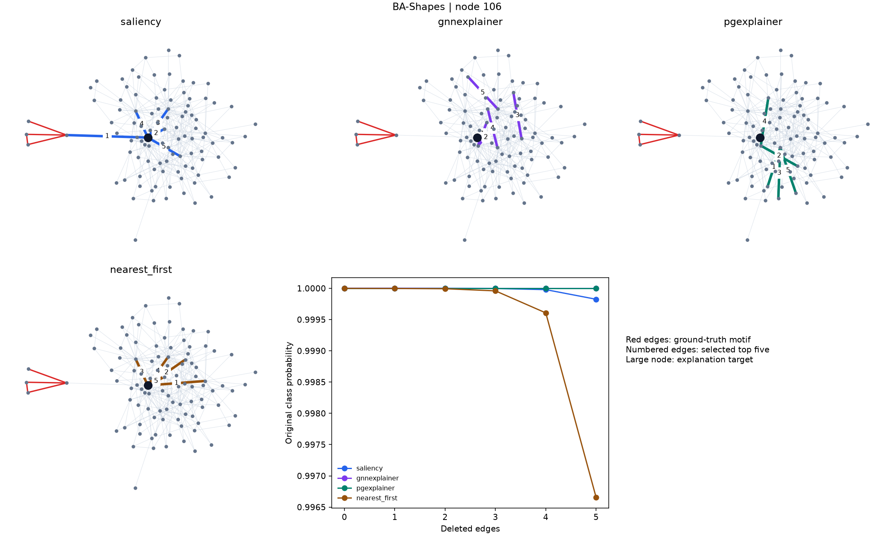

# GIẢI THÍCH MÔ HÌNH HỌC MÁY TRÊN ĐỒ THỊ: BẤT ỔN ĐỊNH, BẤT ĐỒNG VÀ ĐÁNH GIÁ CÓ THỂ TÁI LẬP

**Đề tài C.10 – Making Graph Machine Learning Models Explainable · Nhóm 09 · Môn Phân tích mạng xã hội (SNA), UIT**
**GVHD:** TS. Trần Hưng Nghiệp

> **TRẠNG THÁI: BẢN NHÁP.** Mục 1–4 và Mục 9 đã viết đủ. Mục 5–8 mới có khung; mọi chỗ đánh dấu `<!-- SỐ LIỆU SẼ ĐIỀN SAU -->` chưa có số. Mọi con số trong bản nháp đều kèm đường dẫn nguồn trong repo. Xem "Danh sách trích dẫn cần kiểm tra" và "Ghi chú cho người biên tập" ở cuối file.

---

## 1. Mở đầu

### 1.1. Bài toán

Mạng nơ-ron đồ thị (graph neural network, GNN) dự đoán nhãn của một nút bằng cách tổng hợp thông tin từ các nút lân cận. Muốn biết vì sao mô hình dự đoán như vậy, người ta dùng *explainer* (phương pháp giải thích). Trong báo cáo này, explainer cho mỗi nút đích một điểm quan trọng trên từng cạnh trong lân cận 2-hop của nút đó. Một giải thích là tập $k$ cạnh có điểm cao nhất.

Ba phương pháp phổ biến (Saliency, GNNExplainer, PGExplainer) thường cho các tập cạnh khác nhau trên cùng một nút và cùng một mô hình. Ở giữa kỳ, độ trùng Jaccard@5 giữa các cặp phương pháp chỉ khoảng 0,27–0,42 (nguồn: `docs/BANG_SO_LIEU_MIDTERM_T06_DUC_KHA.md`, mục "Agreement giữa ba explainer"). Giữa kỳ cũng có một mâu thuẫn giữa hai tiêu chí đánh giá trên BA-Shapes. PGExplainer có Motif AUROC cao nhất (0,8000, tính trên 10/20 nút hợp lệ). Nearest-First, một baseline chỉ chọn cạnh gần nút đích, có Fidelity Drop@5 cao nhất (0,3728), trong khi PGExplainer chỉ đạt 0,2195 (cùng nguồn).

### 1.2. Phản hồi của thầy và cách nhóm trả lời

Sau báo cáo giữa kỳ (29/10/2026), thầy nêu bốn điểm (nguồn: `docs/KE_HOACH_CUOI_KY_FINAL.md`, Mục 1).

| Mã | Phản hồi (tóm tắt) | Nhóm trả lời bằng | Mục |
|:-:|---|---|:-:|
| FB-1 | Viết rõ quy trình tái lập: train GNN → chạy explainer → tính metric, trên đúng data và checkpoint | Chuỗi lệnh, mã SHA-256 của data, checkpoint và CSV điểm; bộ kiểm tra hợp đồng dữ liệu | 4 |
| FB-2 | Chưa phân biệt bất đồng giữa các phương pháp với sự không ổn định của chính từng phương pháp; giữ nguyên GNN, chạy nhiều seed explainer trước, sau đó mới đổi seed huấn luyện GNN | Thiết kế lưới 5 seed GNN × 5 seed explainer, phân tích theo thứ tự thầy dặn | 6 |
| FB-3 | Các metric mâu thuẫn nhau; cần error analysis, xác minh lại kết quả rồi phân tích một số nút | Xác minh mâu thuẫn trên 25 cấu hình, quét toàn bộ nút test, 5 phép kiểm định cơ chế (T1–T5), case study | 7 |
| FB-4 | Làm các phân tích kiểm chứng cốt lõi trước, rồi mới xét mở rộng nhiều dataset | Chỉ mở rộng khi đã xong FB-1…FB-3; phần không làm được ghi ở mục Hạn chế | 9 |

### 1.3. Ba câu hỏi nghiên cứu

Các câu hỏi dưới đây bám Mục 7.1 của kế hoạch và các câu EQ1–EQ3 của Mini-Proposal v2 (`docs/SNA-Group09-C10-Mini-Proposal-v2.docx`).

- **RQ1 (bất ổn định nội tại).** Giữ nguyên GNN, chỉ đổi seed của explainer: một phương pháp tự lệch với chính nó bao nhiêu?
- **RQ2 (nhạy theo mô hình).** Đổi seed huấn luyện GNN: lời giải thích đổi bao nhiêu, kể cả trên các nút mà hai GNN dự đoán cùng lớp?
- **RQ3 (bất đồng thực sự).** Hai phương pháp khác nhau lệch nhau nhiều hơn mức mỗi phương pháp tự lệch hay không?

Ngoài ra, báo cáo kiểm tra một câu hỏi phụ gắn với FB-3: vì sao Fidelity và Motif AUROC không cùng chọn ra một phương pháp tốt nhất, và mâu thuẫn đó còn tồn tại hay không sau khi sửa lỗi và tăng cỡ mẫu.

### 1.4. Đóng góp

Nhóm không đề xuất thuật toán giải thích mới. Mini-Proposal v2 đã xác định đây là nghiên cứu thực nghiệm có kiểm soát. Các đóng góp là:

1. **Một quy trình tái lập** có kiểm tra băm (hash), gồm mã huấn luyện, runner explainer, bộ kiểm tra CSV và bộ đánh giá (Mục 4).
2. **Sửa và ghi lại các lỗi của bản giữa kỳ** có ảnh hưởng đến kết luận: thứ tự đặt seed của PGExplainer, forward 3-hop khi huấn luyện PGExplainer, công thức size-loss của GNNExplainer (Mục 3, 4).
3. **Thiết kế tách ba nguồn biến thiên** (seed explainer, seed GNN, khác phương pháp) với quy tắc diễn giải đặt ra trước khi xem số (Mục 6).
4. **Error analysis có kiểm định giả thuyết cơ chế trên toàn bộ nút test**, không chỉ trên vài nút minh họa (Mục 7).

Báo cáo cũng nêu rõ phạm vi hẹp so với Mini-Proposal: chỉ GCN, chỉ hai dataset (Mục 9).

---

## 2. Các nghiên cứu liên quan

*(Chỉ tóm tắt những gì đã đối chiếu với trang gốc của bài. Phần chưa kiểm chứng được đánh dấu `[CẦN KIỂM TRA]`.)*

**Mô hình được giải thích.** Chúng tôi dùng GCN 2 lớp của Kipf và Welling (ICLR 2017) [1].

**GNNExplainer.** Ying và cộng sự (NeurIPS 2019) [2] đề xuất học, cho từng nút, một mask mềm trên cạnh sao cho dự đoán trên đồ thị đã che gần với dự đoán gốc, kèm các hạng tử phạt kích thước và entropy. Mỗi nút cần một lượt tối ưu riêng.

**PGExplainer.** Luo và cộng sự (NeurIPS 2020) [3] thay các lượt tối ưu riêng lẻ bằng một mạng nơ-ron dùng chung, dự đoán xác suất của từng cạnh từ embedding của GNN. Mạng này được huấn luyện một lần, sau đó giải thích nút mới chỉ cần một lượt suy luận. Mini-Proposal ghi nhận một nghiên cứu tái lập, báo cáo sai khác giữa bài báo và mã gốc của PGExplainer (Boon et al., ML Reproducibility Challenge 2020) [4] `[CẦN KIỂM TRA: chưa mở bài gốc; thông tin lấy từ Mini-Proposal v2]`.

**Saliency và phương pháp dựa trên gradient.** Pope và cộng sự (CVPR 2019) [5] mở rộng các phương pháp saliency dựa trên gradient từ CNN sang mạng đồ thị. Baldassarre và Azizpour (ICML 2019 Workshop) [6] khảo sát việc áp dụng các kỹ thuật giải thích có sẵn cho mạng tích chập đồ thị. Chúng tôi dùng đạo hàm của logit lớp dự đoán theo trọng số cạnh (Mục 3.3), là một dạng saliency theo cạnh. Đây là cách nhóm định nghĩa, không phải bản cài đặt của một bài cụ thể.

**Bài toán bất đồng.** Krishna và cộng sự (TMLR) [7] gọi *disagreement problem* là hiện tượng các phương pháp giải thích cho kết quả khác nhau trên cùng một mô hình và cùng một mẫu. `[CẦN KIỂM TRA: Mini-Proposal ghi bài này làm trên dữ liệu bảng; chưa đọc nội dung bài nên không khẳng định phạm vi ở đây.]` Mini-Proposal viết rằng nhóm chưa thấy bản tương ứng cho GNN; đây là nhận định sơ bộ của nhóm, không phải kết luận về tài liệu.

**Đánh giá với ground truth.** Faber, Moghaddam và Wattenhofer (KDD 2021) [8] chỉ ra rủi ro khi so giải thích với "ground truth" do con người thiết kế: một GNN có thể không dựa vào các cạnh ground truth để dự đoán, khi đó explainer tốt cũng không thể tìm ra chúng `[CẦN KIỂM TRA: tóm tắt này dựa trên kết quả tìm kiếm thứ cấp, chưa đọc bài]`. Đây là cơ sở cho giả thuyết T2 của chúng tôi (Mục 7): mô hình có thật sự dùng motif hay không.

**Benchmark.** GraphFramEx (Amara và cộng sự, LoG 2022) [9] là khung đánh giá có hệ thống cho các phương pháp giải thích GNN. Kế hoạch của nhóm ghi rằng GraphFramEx dùng ký hiệu fidelity + / − ngược với cách nhóm gọi, nên báo cáo này dùng tên "Drop" và "Inv" (Mục 3.7). GNNX-Bench (Kosan và cộng sự, ICLR 2024) [10] là benchmark cho các explainer dựa trên nhiễu loạn (perturbation-based). `[CẦN KIỂM TRA: Mini-Proposal mô tả bài này đo độ ổn định giữa các seed trong bối cảnh graph classification; chưa đọc nội dung để xác nhận.]`

**Vị trí của báo cáo này.** Báo cáo tái lập các quan sát đã biết trên node classification với GCN, đồng thời tách rõ seed GNN và seed explainer và cung cấp quy trình có kiểm tra hash. Nhóm không khẳng định đây là nghiên cứu đầu tiên làm điều đó.

---

## 3. Phương pháp

### 3.1. Dữ liệu và mô hình

| | BA-Shapes | Cora |
|---|---|---|
| Số nút / đặc trưng / lớp | 700 / 10 / 4 | 2.708 / 1.433 / 7 |
| Chia tập | phân tầng 420 / 140 / 140 (seed 0) | Planetoid 140 / 500 / 1.000 |
| Nút đánh giá chính (test) | 140 (toàn bộ nút test) | 100 (lấy mẫu phân tầng theo nhãn thật, seed 0) |
| SHA-256 `data.pt` | `8fbf94a7ce58…` | `f2846a82cdd1…` |
| Ground truth cạnh | có (motif ngôi nhà) | không |

*(nguồn: `configs/protocol_final.yaml`, `configs/datasets/*.yaml`, `data/{bashapes,cora}/test_nodes.json`; hash đầy đủ ở Mục 4.3.)*

**GCN 2 lớp.** $H^{(1)}=\mathrm{ReLU}(\hat A_w X W_1)$, $Z=\hat A_w H^{(1)} W_2$, với $\hat A_w=\tilde D_w^{-1/2}\tilde A_w \tilde D_w^{-1/2}$ và $\tilde A_w$ là ma trận kề có trọng số cạnh $w$ cộng self-loop (cài đặt: `src/sna/models/gcn.py`, hai lớp `GCNConv`). BA-Shapes: hidden 32, dropout 0, lr 0,01, weight decay $10^{-4}$, 600 epoch, có class weights, chọn theo macro-F1 trên val. Cora: hidden 64, dropout 0,5, lr 0,01, weight decay $5\cdot10^{-4}$, 200 epoch, chọn theo accuracy trên val (nguồn: `configs/datasets/bashapes.yaml`, `configs/datasets/cora.yaml`, `results/checkpoints/bashapes/gcn_s1000.json`).

**Lớp được giải thích** là lớp mà chính checkpoint đang giải thích dự đoán: $\hat y_v=\arg\max_c Z_{v,c}$, không dùng nhãn thật (nguồn: `configs/protocol_final.yaml`, `target_class: checkpoint_prediction`).

### 3.2. Tập cạnh ứng viên và cách đưa trọng số cạnh vào GCN

**Cạnh ứng viên.** Với nút đích $v$, $E_v$ là tập cạnh vô hướng $(u,w)$, $u<w$, nằm trong lân cận 2-hop của $v$, bỏ self-loop. Có $m=|E_v|$ cạnh. Mọi explainer dùng chung $E_v$ với cùng thứ tự `edge_id` (nguồn: `src/sna/data/candidate_edges.py`; `docs/PHAN_BAO_CAO_MUC3_VA_QA_KHOI.md`).

**Truyền trọng số cạnh.** Các explainer gọi `model(x, edge_index, edge_weight=w)`. Trong `GCNConv`, trọng số $w$ nằm trong $\tilde A_w$ và cả trong bậc $\tilde D_w$. Do đó $w_{ij}=0$ cho kết quả đúng bằng xóa cạnh $(i,j)$ khỏi `edge_index`. Biên bản F10 đo trên 20 nút dev: lệch logit và xác suất bằng 0,0000, 0/20 nút đổi dự đoán, trên cả BA-Shapes và Cora (nguồn: `docs/BIEN_BAN_F10_GNNEXPLAINER_PYG.md`, Mục 4).

**Vì sao không dùng `set_masks` của PyG.** `set_masks` của PyG nhân mask vào thông điệp *sau* bước chuẩn hóa bậc (GCN) hoặc sau softmax của attention (GAT), nên mask bằng 0 không tương đương xóa cạnh. Cùng phép đo trên 20 nút dev cho kết quả sau (nguồn: cùng biên bản F10, Mục 4).

| Cơ chế (so với xóa cạnh thật, top-5) | Dataset | Lệch xác suất lớn nhất | Số nút đổi dự đoán |
|---|---|---:|---:|
| `edge_weight = 0` (nhóm dùng) | BA-Shapes và Cora | 0,0000 | 0/20 và 0/20 |
| PyG `set_masks = 0` | BA-Shapes | 0,4998 | 6/20 |
| PyG `set_masks = 0` | Cora | 0,7508 | 10/20 |

Đo lường Fidelity của nhóm xóa cạnh thật. Dùng `edge_weight` giữ cho hàm mục tiêu mà explainer tối ưu trùng với hàm phản hồi mà metric đo.

### 3.3. Saliency

Đặt $\mathbf w=\mathbf 1$ với `requires_grad`, tính $Z=f_\theta(X,\mathrm{edge\_index},\mathbf w)$, rồi lấy đạo hàm theo cạnh có hướng:

$$g_{u\to w}=\left|\frac{\partial Z_{v,\hat y_v}}{\partial w_{u\to w}}\right|_{\mathbf w=\mathbf 1},\qquad s_{\mathrm{Sal}}(e)=\max(g_{u\to w},g_{w\to u}).$$

Phương pháp không có thành phần ngẫu nhiên. Trên CPU, hai lượt với seed 0 và seed 1 cho điểm giống hệt (`max_diff = 0.0`, nguồn: `docs/TONG_KET_CONG_VIEC_KHOI.md`, mục 3.4). Saliency vì vậy là mốc "không nhiễu seed explainer" trong Mục 6.

### 3.4. GNNExplainer

Cho mỗi nút, tối ưu vector $\mathbf M\in\mathbb R^m$ (khởi tạo $M_i\sim\mathcal N(1,0{,}1^2)$ theo seed explainer), $\mathbf p=\sigma(\mathbf M)$. Hai chiều của một cạnh vô hướng dùng chung $p_i$; cạnh ngoài $E_v$ giữ trọng số 1. Hàm mất mát:

$$\mathcal L(\mathbf M)=-\log P_\theta(\hat y_v\mid X,\mathrm{edge\_index},\mathbf w(\mathbf p))+\lambda_{\rm size}\,\mathrm{Agg}(\mathbf p)+\lambda_{\rm ent}\frac1m\sum_i H(p_i).$$

Siêu tham số: 200 bước Adam, lr 0,01, $\lambda_{\rm size}=0{,}005$, $\lambda_{\rm ent}=0{,}1$ (nguồn: `configs/datasets/*.yaml`, `src/sna/explainers/gnnexplainer.py`). Điểm cạnh là $\sigma(M_i)$.

**Công thức size-loss.** Bản giữa kỳ dùng $\mathrm{Agg}(\mathbf p)=\frac1m\sum_ip_i$ (`mean`). Mask khi đó dồn quanh 0,95: trung vị 0,9481 và 98,42% cạnh có điểm lớn hơn 0,9 trên BA-Shapes (20 nút dev). Biên bản F10 so năm biến thể trên cùng checkpoint. Đổi riêng sang $\mathrm{Agg}(\mathbf p)=\sum_ip_i$ (`sum`, giống PyG) đưa trung vị xuống 0,2563 và tỷ lệ điểm trên 0,9 xuống 0,78%, còn Fidelity Drop@5 gần như không đổi (0,3095 so với 0,3088) và Motif AUROC giữ gần nhau (0,7350 so với 0,7392). Độ đồng thuận $\kappa@5$ giữa hai bản trên BA-Shapes là 0,9076. Tăng $\lambda_{\rm ent}$ lên 1,0 làm Motif AUROC giảm còn 0,5472. Kết luận của biên bản F10: không thay bằng `torch_geometric.explain.GNNExplainer` (vì `set_masks`), không đổi $\lambda_{\rm ent}$, và dùng `sum` cho đợt chạy chính (nguồn: `docs/BIEN_BAN_F10_GNNEXPLAINER_PYG.md`, Mục 2 và 5). Các số trên đo trên 20 nút validation, không dùng nút test để chọn. `<!-- CẦN XÁC NHẬN: quyết định sum được người giao việc cho là đã chốt "xem CHANGELOG", nhưng docs/CHANGELOG_PROTOCOL.md và configs/protocol_final.yaml trong repo chưa ghi; xem Ghi chú biên tập C.1 -->`

### 3.5. PGExplainer

*(Đoạn do Thiện soạn, nguồn: `docs/PHAN_BAO_CAO_PGEXPLAINER_THIEN.md`, Mục 4–5; số đo ở Mục 2 và 3b của file đó.)*

PGExplainer [3] học một MLP dùng chung, nhận vector $[z_u\,\|\,z_v\,\|\,z_t]$ (embedding tầng 1 của GCN của hai đầu cạnh và nút đích $t$) và cho ra logit tồn tại của cạnh $(u,v)$. Logit được đối xứng hóa giữa hai chiều cạnh. MLP được huấn luyện trên các nút thuộc tập train với hàm mất mát gồm cross-entropy giữ lớp dự đoán gốc, phạt kích thước (tổng mask của mỗi nút) và phạt entropy. Mask được lấy mẫu bằng Gumbel-Sigmoid với nhiệt độ giảm từ 5,0 xuống 0,5 trong 40 epoch, lr 0,005. Mask chỉ đặt trên cạnh ứng viên 2-hop. Khi giải thích, điểm cạnh là $\sigma$(logit) tính trên embedding của đồ thị đầy đủ.

Ba thay đổi so với giữa kỳ (đều nhằm tái lập, xem Mục 4.5):

- **F1 (seed).** Đặt seed trước khi tạo MLP. Ở bản giữa kỳ, MLP được khởi tạo trước khi đặt seed nên hai lượt cùng seed 42 lệch tới 0,885 về điểm cạnh (20 nút dev, BA-Shapes; nguồn: `docs/GATE0_TAI_LAP_GIUA_KY.md`, Phụ lục A.2).
- **Huấn luyện tất định.** Huấn luyện chạy trong chế độ tất định của PyTorch (CPU). Nếu không, các phép scatter song song làm hai lượt cùng seed lệch 0,30 về trọng số MLP; sau sửa, độ lệch bằng 0,0 (nguồn: `docs/PHAN_BAO_CAO_PGEXPLAINER_THIEN.md`, F1b).
- **F9 (3-hop).** Khi huấn luyện, forward chạy trên đồ thị con 3-hop (L+1 với GCN 2 lớp), vì chuẩn hóa bậc của GCN cần đủ láng giềng của nút ở rìa. Với đồ thị con 2-hop, logit của nút đích lệch tới 23,98 so với đồ thị đầy đủ và 63/420 nút train BA-Shapes bị đổi dự đoán; với 3-hop, độ lệch tối đa là 0,0 (BA-Shapes) và $7{,}2\cdot10^{-7}$ (Cora) (nguồn: cùng file, Mục 2).

### 3.6. Baseline

- **Random.** Mọi cạnh có cùng điểm (0), nên thứ hạng hoàn toàn do hoán vị phá hòa có seed. Mỗi nút lặp 5 lần phá hòa (seed 0–4); các lần lặp được trung bình trong từng nút trước khi tổng hợp qua nút (nguồn: `src/sna/evaluation/core.py`, `baseline_scores`; `configs/protocol_final.yaml`).
- **Nearest-First.** Điểm là $-d(e)$ với $d(e)$ là khoảng cách BFS từ nút đích đến cạnh trên đồ thị ứng viên. Cạnh nối trực tiếp với nút đích đứng trước, cạnh 2-hop đứng sau; trong cùng một mức, thứ tự do phá hòa quyết định. Baseline này trả lời câu hỏi: explainer có cho thêm thông tin gì ngoài việc chọn cạnh gần nút đích?

### 3.7. Metric

Ký hiệu $p(\cdot)$ là xác suất lớp $\hat y_v$ do GCN gán cho nút $v$ (đặc trưng giữ cố định; chỉ đổi tập cạnh). $S_k$ là $k_{\rm eff}=\min(k,m)$ cạnh đứng đầu. Ngân sách $k\in\{1,3,5,10\}$; bảng chính dùng $k=5$.

**Fidelity.**

$$\mathrm{Fid}_{-}^{\rm Drop}=p(G)-p(G\setminus S_k),\qquad \mathrm{Fid}_{+}^{\rm Inv}=p(G)-p(G[S_k]).$$

"Drop": càng cao thì các cạnh được chọn càng cần cho dự đoán. "Inv": càng gần 0 thì các cạnh được chọn càng đủ để giữ dự đoán. Cả hai có thể âm; nhóm giữ nguyên giá trị âm. Bản $G[S_k]$ giữ các cạnh được chọn cùng self-loop sẵn có (nguồn: `src/sna/evaluation/core.py`, `fidelity_selected`; công thức: `docs/KE_HOACH_CUOI_KY_FINAL.md`, Phụ lục A). **Lưu ý dấu:** GraphFramEx [9] dùng nhãn +/− theo chiều ngược lại (theo kế hoạch của nhóm, Phụ lục A; chưa đối chiếu bài gốc), vì vậy các bảng ghi "Drop" và "Inv" thay cho "Fid−" và "Fid+".

**Ground truth (chỉ BA-Shapes).** AUROC và AP tính trên điểm thô của toàn bộ $m$ cạnh với nhãn "thuộc motif"; chỉ xác định khi nút có cả cạnh motif lẫn cạnh nền. Precision@5 = số cạnh motif trong top-5 chia $k_{\rm eff}$ (nguồn: `src/sna/evaluation/core.py`, `ground_truth_metrics`).

**Độ đồng thuận giữa hai giải thích $A$, $B$ cùng nút** (tập top-$k_{\rm eff}$):

$$\mathrm{Jaccard}@k=\frac{|A\cap B|}{|A\cup B|},\qquad \kappa@k=\frac{|A\cap B|-k^2/m}{k-k^2/m}.$$

$\kappa@k$ bằng 0 ở mức ngẫu nhiên, bằng 1 khi trùng hoàn toàn, có thể âm; không xác định (NaN) khi $k_{\rm eff}=m$ hoặc $m=0$. Lý do dùng $\kappa$: khi $m$ nhỏ, Jaccard bị thổi phồng bởi trùng ngẫu nhiên (Mini-Proposal ghi nhận Jaccard@10 thô khoảng 0,88 ngay cả với Random trong pilot) (nguồn: `docs/KE_HOACH_CUOI_KY_FINAL.md`, Phụ lục A; Mini-Proposal, Mục 4). Metric phụ là Kendall $\tau_b$ giữa hai vector điểm trên toàn tập cạnh ứng viên.

### 3.8. Quy ước NaN, điểm hòa và thống kê

- **NaN.** Metric không xác định được ghi NaN kèm lý do và bị loại khỏi trung bình. Mỗi bảng báo số nút hợp lệ. Ví dụ AUROC chỉ xác định ở 71/140 nút test mỗi cấu hình trên BA-Shapes (nguồn: `docs/PHAN_TICH_LOI_ERROR_ANALYSIS.md`, mục "Kết quả sơ bộ").
- **Điểm hòa.** Điểm thô giữ nguyên; thứ hạng phá hòa bằng hoán vị ngẫu nhiên có seed, dùng chung một thứ tự cho mọi $k$. Độ nhạy với phá hòa kiểm tra bằng 5 seed phá hòa (nguồn: `src/sna/evaluation/core.py`, `rank_edges`; `configs/protocol_final.yaml`). Điều này quan trọng với PGExplainer: trên 140 nút test BA-Shapes, điểm thứ 5 bằng điểm thứ 6 ở 676/3.500 cặp (nút, cấu hình), tức 19,3% (nguồn: `docs/PHAN_TICH_LOI_ERROR_ANALYSIS.md`).
- **Thống kê.** So sánh theo cặp trên từng nút. Khoảng tin cậy 95% bằng bootstrap lấy mẫu lại nút (2.000 lần, phân vị 2,5% và 97,5%), kiểm định Wilcoxon signed-rank, hiệu chỉnh Holm trong từng bảng. Độ lệch chuẩn dùng ddof = 1. Báo cáo kích thước hiệu ứng (hiệu trung bình và CI), không chỉ giá trị p (nguồn: `configs/protocol_final.yaml`, `docs/KE_HOACH_CUOI_KY_FINAL.md` Mục 4).
- **Chống rò rỉ.** Siêu tham số explainer giữ nguyên như giữa kỳ, trừ các thay đổi đã ghi ở Mục 4.5; không chỉnh trên tập test. PGExplainer chỉ huấn luyện trên nút train.

---

## 4. Quy trình tái lập (trả lời FB-1)

### 4.1. Sơ đồ chuỗi chạy

```text
data/{ds}/data.pt  (SHA-256 ghi trong protocol_final.yaml)
      |  scripts/make_node_lists.py        -> data/{ds}/test_nodes.json (có data_sha256)
      v
scripts/train_gnn.py  (seed g = 1000..1004)
      v
results/checkpoints/{ds}/gcn_s{g}.pt + .json (metric, SHA-256, phiên bản thư viện, lệnh chạy)
      |        -> results/checkpoints/checkpoint_table.csv
      v
scripts/run_explainers.py  (phương pháp x seed explainer e = 0..4)
      v
results/scores/{ds}/gcn_s{g}/{method}_e{e}.csv   (cột checkpoint_sha256; run_log.json ghi csv_sha256)
      v
scripts/check_scores.py   (PASS mới được bàn giao)
      v
scripts/evaluate.py  (so hash; tính Fidelity, AUROC, agreement)   -> results/eval/{ds}_test/ + manifest.json
      v
scripts/analyze_variance.py (FB-2)   scripts/error_analysis.py (FB-3)   -> bảng và hình
```

Các bước tương ứng với kế hoạch (`docs/KE_HOACH_CUOI_KY_FINAL.md`, Mục 6.1–6.5). `scripts/evaluate.py` và `scripts/analyze_variance.py` chưa có trong repo tại thời điểm viết bản nháp này (xem Ghi chú biên tập C.2).

### 4.2. Lệnh tái lập

Từ thư mục gốc repo, Python 3.12, Linux x86_64 CPU (nguồn: `README.md`, mục "Quy trình cuối kỳ của PN1"; `docs/KE_HOACH_CUOI_KY_FINAL.md`, Mục 6.2; `docs/PHAN_BAO_CAO_PGEXPLAINER_THIEN.md`, Mục 3b):

```bash
python -m venv .venv && source .venv/bin/activate
python -m pip install -r requirements-lock.txt
python -m pip install -e . --no-deps
python scripts/prepare_datasets.py --bashapes-data /path/to/bashapes/data.pt --cora-data /path/to/cora/data.pt
python scripts/make_node_lists.py
python scripts/train_gnn.py --dataset bashapes
python scripts/train_gnn.py --dataset cora
python scripts/run_explainers.py --dataset bashapes --split test \
  --gnn-seeds 1000 1001 1002 1003 1004 --explainer-seeds 0 1 2 3 4 \
  --methods saliency gnnexplainer pgexplainer --device cpu --resume
python scripts/check_scores.py results/scores/bashapes
python scripts/evaluate.py --dataset bashapes --scores results/scores/bashapes --out results/eval/bashapes_test
python scripts/analyze_variance.py --eval results/eval/bashapes_test
python scripts/error_analysis.py --dataset bashapes --eval results/eval/bashapes_test
```

Lặp lại với `--dataset cora`. Lệnh gộp là `python scripts/reproduce_all.py`; bản kiểm tra nhanh là `python scripts/reproduce_all.py --smoke` (1 seed GNN, 5 nút mỗi dataset, ít epoch; nguồn: `docs/CHANGELOG_PROTOCOL.md`, 20/11/2026). Với GNNExplainer chạy chính, thêm `--gnn-size-loss-mode sum` (Mục 3.4). Môi trường được ghi: Python, torch, torch_geometric trong `requirements-lock.txt`; thiết bị CPU, 2 luồng (`configs/protocol_final.yaml`: `device: cpu`, `torch_threads: 2`).

### 4.3. Mã băm và bảng checkpoint

**SHA-256 của dữ liệu** (nguồn: `configs/protocol_final.yaml`, `data/*/test_nodes.json`):

| Dataset | `data.pt` SHA-256 |
|---|---|
| BA-Shapes | `8fbf94a7ce5850dbdae4a0cd13b178aaa3db1b7009a12efcef8e47306b2c3c73` |
| Cora | `f2846a82cdd1e5b5a0804baad24c997a7720b27155a6c9655730bd6c42836268` |

**Checkpoint GCN, 5 seed mỗi dataset** (nguồn: `results/checkpoints/checkpoint_table.csv`; SHA-256 đầy đủ nằm trong file này và trong file `.json` đi kèm từng checkpoint):

| Dataset | Seed GNN | Epoch tốt nhất | Val acc | Test acc | Test macro-F1 | Recall lớp 3 (BA-Shapes) | SHA-256 checkpoint (16 ký tự đầu) |
|---|---:|---:|---:|---:|---:|---:|---|
| BA-Shapes | 1000 | 504 | 0,9357 | 0,9214 | 0,9021 | 0,8125 | `26465138c327f1a2` |
| BA-Shapes | 1001 | 422 | 0,9357 | 0,9357 | 0,9175 | 0,8125 | `edec3f1e469b3b5d` |
| BA-Shapes | 1002 | 549 | 0,9357 | 0,9429 | 0,9297 | 0,8750 | `d7597424ea8e782e` |
| BA-Shapes | 1003 | 533 | 0,9357 | 0,9429 | 0,9297 | 0,8750 | `a41d45387f813f9d` |
| BA-Shapes | 1004 | 577 | 0,9357 | 0,9571 | 0,9527 | 1,0000 | `100c14dcd56ef8a3` |
| Cora | 1000 | 75 | 0,8160 | 0,8360 | 0,8246 | – | `9752ccdc224c08f7` |
| Cora | 1001 | 45 | 0,8160 | 0,8340 | 0,8217 | – | `a0486f9dcb75eec8` |
| Cora | 1002 | 75 | 0,8080 | 0,8150 | 0,8061 | – | `5508187655e01269` |
| Cora | 1003 | 71 | 0,8140 | 0,8380 | 0,8234 | – | `9e9de09b214e77d9` |
| Cora | 1004 | 161 | 0,8080 | 0,8250 | 0,8129 | – | `d35159b1ef592928` |

Mục tiêu nghiệm thu đặt ra trước là: BA-Shapes test accuracy ≥ 0,90 và recall lớp 3 ≥ 0,85; Cora test accuracy ≥ 0,80. Mọi checkpoint đạt mục tiêu accuracy. Với BA-Shapes, seed 1000 và 1001 có recall lớp 3 bằng 0,8125, dưới mục tiêu 0,85 nhưng trên ngưỡng thay seed (0,50); cả năm seed được giữ, không seed nào bị thay (nguồn: `docs/PN1_HANDOFF.md`, `results/checkpoints/bashapes/selection.json`).

**Trong CSV điểm.** Mỗi dòng có cột `checkpoint_sha256`; mỗi `run_log.json` ghi `csv_sha256` của từng CSV, `data_sha256`, `node_list_sha256` và lệnh chạy. `check_scores.py` từ chối bàn giao nếu hash lệch hoặc thiếu nút (nguồn: `docs/PHAN_BAO_CAO_MUC3_VA_QA_KHOI.md`, Câu hỏi 3). Bộ đánh giá phải dừng khi hash checkpoint không khớp CSV (yêu cầu F3 của kế hoạch; xem Ghi chú biên tập C.2 về trạng thái cài đặt).

**Lưu ý về tái lập hash.** Mã SHA-256 của file `.pt` là *mốc tái lập*, không phải bảo đảm của lệnh train. Train lại checkpoint trên máy khác **không** cho cùng SHA-256, nên hash không được dùng để kiểm tra lệnh train mà để kiểm tra rằng mọi bước sau dùng đúng file checkpoint này. Vì vậy repo đưa trực tiếp 10 file checkpoint chính thức vào Git (khoảng 18 MB), và các script dừng nếu hash không khớp JSON đi kèm (nguồn: `docs/CHANGELOG_PROTOCOL.md`, 22/11/2026; `README.md`, mục 3). Muốn tái lập kết quả, hãy dùng các checkpoint này; `train_gnn.py` sinh checkpoint mới, và mọi kết quả của checkpoint mới cần chạy lại từ bước explainer.

### 4.4. Kết quả GATE 0: tái lập số liệu giữa kỳ

GATE 0 trả lời câu hỏi "kết quả giữa kỳ còn đúng không?" (nguồn: `docs/GATE0_TAI_LAP_GIUA_KY.md`; bằng chứng: `results/gate0/verification.json`, `results/gate0/kha_t06_comparison.json`).

| Kiểm tra | Kết quả |
|---|---|
| SHA-256 dữ liệu và checkpoint gốc giữa kỳ so với manifest T06 | Khớp (một số file Cora cần khôi phục xuống dòng CRLF để khớp hash) |
| Nạp lại checkpoint giữa kỳ, so dự đoán | 700/700 (BA-Shapes), 2.708/2.708 (Cora) |
| Chạy lại bộ đánh giá T06 trên CSV điểm T05 | 2.080 dòng metric, 6.080 dòng agreement, 0 lỗi; mean và SD khớp 4 chữ số thập phân (240 dòng metric tổng hợp, 160 dòng agreement tổng hợp) |
| Saliency, seed 42, 20 nút validation: sai lệch tuyệt đối lớn nhất so với điểm thô đã lưu | BA-Shapes $8{,}82\cdot10^{-7}$; Cora $6{,}64\cdot10^{-7}$ |
| GNNExplainer, seed 42, 20 nút validation: như trên | BA-Shapes $5{,}75\cdot10^{-7}$; Cora $8{,}23\cdot10^{-7}$ |
| PGExplainer, hai lượt cùng seed 42 (BA-Shapes, 20 nút dev) | Lệch tối đa 0,885080: **không tái lập được** do lỗi thứ tự đặt seed (F1) |

Sai lệch cỡ $10^{-7}$ của Saliency và GNNExplainer là do notebook giữa kỳ lưu điểm đã làm tròn 6 chữ số; sau khi làm tròn cùng cách, 8.352/8.352 dòng khớp 0,0 (nguồn: `docs/GATE0_TAI_LAP_GIUA_KY.md`, Phụ lục A.1). Kết quả PGExplainer giữa kỳ là một phát hiện, không được che đi: số liệu PGExplainer giữa kỳ **không tái lập chính xác được**.

### 4.5. Bảng thay đổi giữa kỳ (v1) → cuối kỳ (v2)

| Thay đổi | Lý do | Ảnh hưởng tới số liệu giữa kỳ |
|---|---|---|
| F1: đặt seed trước khi khởi tạo MLP của PGExplainer; huấn luyện ở chế độ tất định | Tái lập (hai lượt cùng seed lệch tới 0,885 ở bản giữa kỳ) | Điểm PGExplainer giữa kỳ không tái lập chính xác được |
| F9: PGExplainer forward trên đồ thị con 3-hop khi huấn luyện | Logit trên đồ thị con phải bằng logit trên đồ thị đầy đủ (2-hop sai 63/420 nút train BA-Shapes) | Điểm PGExplainer đổi; lệch tối đa 0,98 (BA-Shapes) và 0,53 (Cora) so với điểm 2-hop trên 20 nút dev |
| F10: GNNExplainer dùng size-loss `sum` thay `mean` (Mục 3.4) | Mask dồn quanh 0,95 ở bản `mean` | Điểm GNNExplainer đổi; $\kappa@5$ so với bản giữa kỳ là 0,9076 (BA-Shapes, 20 nút dev) và 0,2080 (Cora, 18 nút hợp lệ) `<!-- CẦN XÁC NHẬN F10 đã chốt, xem C.1 -->` |
| Đánh giá trên 140 nút test (BA-Shapes) và 100 nút test (Cora) thay cho 20 nút validation | Cỡ mẫu: giữa kỳ chỉ 10/20 nút BA-Shapes có AUROC | Có thể đổi thứ hạng phương pháp; báo cáo cả hai tập |
| Thêm $\kappa@k$ | Jaccard bị thổi phồng khi $m$ nhỏ | Bổ sung, không thay Jaccard |
| Chạy trên CPU với 2 luồng | Giữ kết quả tất định | Không đổi định nghĩa; số học có thể khác nhỏ so với lượt chạy trên thiết bị khác |
| Dữ liệu, split và checkpoint cố định bằng SHA-256; 5 checkpoint GCN mới mỗi dataset (seed 1000–1004) | FB-1, FB-2 | Số liệu cuối kỳ dùng checkpoint mới; checkpoint giữa kỳ chỉ dùng cho GATE 0 |

Nguồn: `docs/KE_HOACH_CUOI_KY_FINAL.md` Mục 6.8; `docs/PHAN_BAO_CAO_PGEXPLAINER_THIEN.md` Mục 2, 5; `docs/BIEN_BAN_F10_GNNEXPLAINER_PYG.md` Mục 3; `docs/CHANGELOG_PROTOCOL.md`; `configs/protocol_final.yaml`.

### 4.6. Quyết định về dữ liệu đã ghi lại

BA-Shapes ban đầu được tái dựng vì dữ liệu giữa kỳ bị mất (20/11/2026), rồi được thay lại bằng đúng BA-Shapes giữa kỳ sau khi nhóm có file gốc (22/11/2026); toàn bộ checkpoint được huấn luyện lại. Cora giữ bản có SHA-256 khớp T06, và các checkpoint Cora cuối kỳ được huấn luyện mới (nguồn: `docs/CHANGELOG_PROTOCOL.md`).

---

## 5. Kết quả chính

Mục này báo cáo kết quả trên tập test cho 3 phương pháp giải thích và 2 baseline. Mỗi ô là trung bình theo nút qua mọi cấu hình (g, e), kèm khoảng tin cậy 95% bootstrap trên nút (2.000 lần, seed 0; nguồn: `results/analysis/main/main_by_method_budget.csv`). BA-Shapes có 140 nút test; Cora có 100 nút test. Bảng chính dùng ngân sách k = 5 (Mục 3.7). Mục này chỉ mô tả số liệu; nguyên nhân của các khác biệt thuộc Mục 7.

**Quy ước dấu.** Với p là xác suất lớp dự đoán ŷ:

- **Drop = p(ŷ | G) − p(ŷ | G∖top-k).** Cao hơn là tốt hơn: các cạnh được chọn càng cần cho dự đoán.
- **Inv = p(ŷ | G) − p(ŷ | chỉ giữ top-k).** Thấp hơn là tốt hơn: gần 0 nghĩa là top-k đủ để giữ dự đoán, âm nghĩa là chỉ giữ top-k còn làm xác suất tăng lên.
- AUROC, AP, Precision@5: cao hơn là tốt hơn (chỉ BA-Shapes).

GraphFramEx dùng nhãn +/− ngược với chúng tôi, nên bảng ghi Drop và Inv (Mục 3.7; Phụ lục A của kế hoạch).

### 5.1. Bảng chính trên tập test (k = 5)

**Bảng 5.1a. BA-Shapes, 140 nút test.** AUROC và AP chỉ xác định ở 71/140 nút (nút có cả cạnh motif lẫn cạnh nền); các cột còn lại dùng đủ 140 nút. Mỗi ô là `mean [CI 95%]`.

| Phương pháp | Drop@5 (cao = tốt) | Inv@5 (thấp = tốt) | AUROC | AP | Precision@5 |
|---|---|---|---|---|---|
| Saliency | 0,248 [0,198; 0,298] | 0,059 [0,031; 0,087] | 0,527 [0,456; 0,598] | 0,648 [0,573; 0,724] | 0,479 [0,410; 0,547] |
| GNNExplainer | 0,270 [0,219; 0,326] | 0,058 [0,022; 0,102] | 0,631 [0,580; 0,683] | 0,687 [0,602; 0,769] | 0,497 [0,426; 0,568] |
| PGExplainer | 0,185 [0,141; 0,228] | 0,265 [0,217; 0,317] | 0,731 [0,652; 0,808] | 0,767 [0,674; 0,860] | 0,549 [0,471; 0,627] |
| Nearest-First | 0,291 [0,232; 0,353] | 0,091 [0,062; 0,124] | 0,668 [0,649; 0,689] | 0,645 [0,562; 0,728] | 0,491 [0,421; 0,562] |
| Random | 0,156 [0,121; 0,192] | 0,293 [0,252; 0,340] | 0,500 [0,500; 0,500] | 0,578 [0,495; 0,658] | 0,463 [0,392; 0,531] |

**Bảng 5.1b. Cora, 100 nút test** (không có ground truth nên chỉ có Fidelity).

| Phương pháp | Drop@5 (cao = tốt) | Inv@5 (thấp = tốt) |
|---|---|---|
| Saliency | 0,074 [0,040; 0,108] | −0,079 [−0,098; −0,061] |
| GNNExplainer | 0,080 [0,055; 0,106] | −0,129 [−0,152; −0,106] |
| PGExplainer | 0,009 [−0,012; 0,031] | 0,022 [−0,003; 0,048] |
| Nearest-First | 0,039 [0,005; 0,074] | −0,078 [−0,096; −0,061] |
| Random | 0,003 [−0,015; 0,024] | 0,022 [−0,002; 0,047] |

*Ghi chú.* (i) Mỗi phương pháp trung bình qua 25 cấu hình (g, e), cân bằng theo GNN; riêng Saliency chạy 6 lượt (5 GNN với e = 0, thêm e = 1 trên GNN 1000), nên trung bình được lấy theo seed explainer trong từng GNN rồi qua 5 GNN để mỗi GNN có một trọng số (nguồn: `main_by_method_budget.csv`, `scripts/summarize_main_results.py`). (ii) Random không có điểm thô để xếp hạng nên AUROC bằng đúng 0,5 theo định nghĩa. (iii) Ở Cora, 14/100 nút có m ≤ 5 cạnh ứng viên; với các nút này top-5 là toàn bộ cạnh nên mọi phương pháp, kể cả Random, cho cùng một giá trị Fidelity (nguồn: `results/eval/cora_test/metrics.csv`).

### 5.2. Fidelity theo ngân sách k ∈ {1, 3, 5, 10}

**Bảng 5.2.** Giá trị trung bình (CI 95% ở `main_by_method_budget.csv`). Drop: cao = tốt; Inv: thấp = tốt. Giá trị tốt nhất mỗi cột k in đậm.

| BA-Shapes | Drop k=1 | k=3 | k=5 | k=10 | Inv k=1 | k=3 | k=5 | k=10 |
|---|---:|---:|---:|---:|---:|---:|---:|---:|
| Saliency | 0,125 | 0,179 | 0,248 | **0,341** | 0,310 | 0,168 | 0,059 | 0,072 |
| GNNExplainer | 0,109 | **0,232** | 0,270 | 0,190 | 0,248 | 0,130 | **0,058** | 0,099 |
| PGExplainer | 0,103 | 0,203 | 0,185 | 0,178 | 0,335 | 0,308 | 0,265 | 0,182 |
| Nearest-First | **0,151** | 0,210 | **0,291** | 0,340 | **0,246** | **0,070** | 0,091 | **0,042** |
| Random | 0,071 | 0,130 | 0,156 | 0,188 | 0,343 | 0,321 | 0,293 | 0,192 |

| Cora | Drop k=1 | k=3 | k=5 | k=10 | Inv k=1 | k=3 | k=5 | k=10 |
|---|---:|---:|---:|---:|---:|---:|---:|---:|
| Saliency | **0,058** | **0,082** | 0,074 | 0,064 | **−0,071** | **−0,079** | −0,079 | −0,068 |
| GNNExplainer | 0,013 | 0,058 | **0,080** | **0,090** | 0,013 | −0,078 | **−0,129** | **−0,144** |
| PGExplainer | −0,002 | −0,0003 | 0,009 | 0,016 | 0,036 | 0,033 | 0,022 | 0,014 |
| Nearest-First | 0,019 | 0,046 | 0,039 | 0,041 | −0,0007 | −0,069 | −0,078 | −0,075 |
| Random | −0,002 | −0,002 | 0,003 | 0,008 | 0,039 | 0,030 | 0,022 | 0,012 |

Trên BA-Shapes, 65/140 nút có m ≤ 10 cạnh ứng viên, nên ở k = 10 top-k là toàn bộ cạnh của các nút đó với mọi phương pháp; các đường cong vì vậy xích lại gần nhau ở k = 10 và Drop của GNNExplainer, PGExplainer và Random chênh nhau ít (0,190; 0,178; 0,188). Trên Cora, 29/100 nút có m ≤ 10. Bảng 5.2 do đó không nên đọc như một đường cong đơn điệu theo k.

### 5.3. Độ đồng thuận giữa các phương pháp

Bảng dưới tóm tắt κ@5 (nguồn: `results/eval/{bashapes,cora}_test/agreement_summary.csv`; κ@5 chỉ xác định khi m > 5, tức 140/140 nút BA-Shapes và 86/100 nút Cora). Phân tích đầy đủ, kèm kiểm định so với mức tự lệch của từng phương pháp, nằm ở Mục 6 (`results/analysis/a2/a2_2_between.csv`).

| κ@5 | BA-Shapes | Cora |
|---|---:|---:|
| Saliency – GNNExplainer | 0,143 | 0,342 |
| Saliency – PGExplainer | 0,102 | −0,010 |
| GNNExplainer – PGExplainer | 0,048 | −0,017 |
| Saliency – Nearest-First | 0,425 | 0,507 |
| GNNExplainer – Nearest-First | 0,146 | 0,283 |
| PGExplainer – Nearest-First | 0,066 | −0,013 |
| Random – Random (mốc ngẫu nhiên) | −0,004 | −0,001 |

Các κ@5 giữa hai phương pháp khác nhau đều thấp: không giá trị nào vượt 0,35, và năm trong sáu giá trị nằm trong khoảng ±0,15 quanh mốc Random (≈ 0); cao nhất là Saliency – GNNExplainer trên Cora (0,342). Saliency – Nearest-First cao hơn hẳn (0,425 và 0,507). Để so sánh, Jaccard@5 của cặp Random – Random là 0,316 (BA-Shapes) và 0,275 (Cora), tức Jaccard thô cao hơn nhiều so với mốc κ ≈ 0 (lý do dùng κ, Mục 3.7).

### 5.4. So sánh với kết quả giữa kỳ

Số giữa kỳ (`results/analysis/main/midterm_reference.csv`, từ bảng T06) chỉ để đối chiếu, không phải so sánh trực tiếp, vì bốn điều kiện đã đổi: (i) nút đánh giá: 20 nút validation, trong đó chỉ 10/20 nút BA-Shapes có AUROC, thay cho 140/100 nút test; (ii) checkpoint: một GCN giữa kỳ thay cho 5 GCN huấn luyện lại; (iii) PGExplainer: bản giữa kỳ không tái lập được và huấn luyện trên đồ thị con 2-hop, bản cuối kỳ đã sửa (Mục 4.5); (iv) GNNExplainer: size-loss `mean` thay bằng `sum`. Thứ hạng (k = 5):

| Metric | Giữa kỳ (20 nút val) | Cuối kỳ (nút test) |
|---|---|---|
| BA-Shapes Drop@5 | NF 0,373 > Sal 0,309 ≈ GNNE 0,309 > PG 0,220 > Random 0,167 | NF 0,291 > GNNE 0,270 > Sal 0,248 > PG 0,185 > Random 0,156 |
| BA-Shapes AUROC | PG 0,800 > GNNE 0,739 > NF 0,653 > Random 0,500 > Sal 0,421 | PG 0,731 > NF 0,668 > GNNE 0,631 > Sal 0,527 > Random 0,500 |
| BA-Shapes Inv@5 (thấp = tốt) | Sal 0,090 < NF 0,151 < GNNE 0,211 < PG 0,325 < Random 0,398 | GNNE 0,058 < Sal 0,059 < NF 0,091 < PG 0,265 < Random 0,293 |
| Cora Drop@5 | Sal 0,044 > GNNE 0,032 > NF 0,011 > PG −0,008 > Random −0,013 | GNNE 0,080 > Sal 0,074 > NF 0,039 > PG 0,009 > Random 0,003 |

Quan sát: (a) Nearest-First đứng đầu Drop@5 trên BA-Shapes ở cả hai thời điểm; PGExplainer đứng đầu AUROC ở cả hai thời điểm và đứng thứ tư về Drop@5; Random đứng cuối Drop@5. (b) Thứ tự giữa Saliency và GNNExplainer (Drop@5), giữa NF và GNNExplainer (AUROC) và giữa Saliency và GNNExplainer (Cora) đảo chỗ; các khác biệt này nhỏ so với CI (Mục 5.5). (c) Ở giữa kỳ, độ lệch chuẩn theo nút của Drop@5 BA-Shapes là 0,22–0,41 trên chỉ 20 nút (`midterm_reference.csv`), nên các thứ hạng giữa kỳ không có CI để so. (d) Giá trị AUROC của PGExplainer giảm từ 0,800 xuống 0,731 và, theo từng cấu hình (g, e), dao động từ 0,488 đến 0,944 (`results/analysis/a3_final/a3_0_metrics.csv`).

### 5.5. Đọc kết quả

1. **BA-Shapes, Fidelity.** Về Drop@5, Nearest-First (0,291), GNNExplainer (0,270) và Saliency (0,248) có CI chồng lấn nhau gần như hoàn toàn. Hiệu cặp theo nút (tính lại từ `results/eval/bashapes_test/metrics.csv`, bootstrap trên nút, chưa hiệu chỉnh Holm): Nearest-First − GNNExplainer = +0,021 [−0,048; 0,086], còn Nearest-First − Saliency = +0,043 [0,016; 0,073]. Cả ba cao hơn Random (0,156) rõ ràng (GNNExplainer − Random = +0,114 [0,082; 0,152]). PGExplainer (0,185) thấp hơn GNNExplainer 0,085 [0,048; 0,128] và chỉ cao hơn Random 0,029 [0,013; 0,046]. Về Inv@5, GNNExplainer (0,058) và Saliency (0,059) thấp nhất; Nearest-First 0,091; PGExplainer (0,265) và Random (0,293) có CI chồng lấn và đều cách xa ba phương pháp còn lại.
2. **BA-Shapes, khớp motif.** PGExplainer cao nhất ở AUROC (0,731), AP (0,767) và Precision@5 (0,549). Nhưng CI của PGExplainer rộng (AUROC [0,652; 0,808]) và chồng lấn với Nearest-First và GNNExplainer; chỉ AUROC của Saliency (CI trên 0,598) và của Random (0,5) nằm hẳn dưới CI của PGExplainer. Precision@5 của mọi phương pháp, kể cả Random (0,463), nằm trong khoảng 0,46–0,55 với CI chồng lấn. Nearest-First, không dùng mô hình, đạt AUROC 0,668 cao hơn GNNExplainer (0,631) và Saliency (0,527).
3. **Cora.** GNNExplainer (Drop 0,080; Inv −0,129) và Saliency (0,074; −0,079) dẫn đầu, hiệu của chúng +0,006 [−0,017; 0,030] không phân biệt được. Nearest-First (0,039) thấp hơn cả hai (so GNNExplainer: −0,041 [−0,065; −0,017]). **PGExplainer có Drop@5 = 0,009 [−0,012; 0,031] và Inv@5 = 0,022 [−0,003; 0,048], không khác Random (0,003; 0,022):** hiệu PGExplainer − Random về Drop là +0,006 [−0,002; 0,014] và về Inv là −0,001 [−0,012; 0,011]. Inv âm của GNNExplainer, Saliency và Nearest-First cho thấy chỉ giữ top-5 cạnh còn làm xác suất lớp dự đoán tăng so với đồ thị đầy đủ.
4. **Biến thiên theo GNN.** SD giữa 5 checkpoint GNN của Drop@5 (`main_sd_over_gnn_seeds.csv`): BA-Shapes 0,006 (PG), 0,006 (NF), 0,011 (Random), 0,019 (GNNE), 0,024 (Saliency); Cora 0,006–0,024. Chênh lệch Nearest-First – GNNExplainer (0,021) cỡ bằng SD giữa GNN của GNNExplainer (0,019), nên thứ hạng giữa hai phương pháp này không vững khi đổi checkpoint. AUROC của PGExplainer có SD giữa GNN lớn nhất (0,075; từ 0,659 đến 0,839 theo checkpoint). CI bootstrap trên nút của Mục 5.1 không bao hàm nguồn biến thiên này (Mục 9.1).
5. **Hai metric không chọn cùng một phương pháp tốt nhất.** Ở BA-Shapes, Nearest-First cao nhất về Drop@5 còn PGExplainer cao nhất về AUROC, AP và Precision@5. Mục 7 kiểm tra mâu thuẫn này trên 25 cấu hình; mục này không kết luận nguyên nhân.

## 6. Instability vs Disagreement (trả lời FB-2)

### 6.1. Thiết kế

Lưới đầy đủ gồm 5 seed GNN (1000–1004) × 5 seed explainer (0–4) × {GNNExplainer, PGExplainer}; Saliency chạy seed 0 trên mọi GNN và thêm seed 1 trên GNN 1000 để kiểm tra tính tất định. Phân tích theo thứ tự thầy dặn: **Bước 1** giữ GNN 1000 và chỉ đổi seed explainer; **Bước 2** mới đổi seed GNN (nguồn: `docs/KE_HOACH_CUOI_KY_FINAL.md`, Mục 7.2; `configs/protocol_final.yaml`). Tập đánh giá là các nút test: BA-Shapes 140 nút; Cora 100 nút, trong đó chỉ 86 nút có $\kappa@5$ xác định (14 nút có $m\le5$ cạnh ứng viên, Mục 3.7). Thiết kế dữ liệu và explainer ở Mục 3; cách đo và thống kê ở Mục 3.7–3.8. Vì chỉ có một cặp seed explainer cho Saliency, hai cột $I_{\rm within}$ của Saliency trong Bảng A2-1 là cùng một phép đo.

### 6.2. Đại lượng

Với nút $v$, seed GNN $g$, seed explainer $e$, phương pháp $M$; Agr = $\kappa@5$ (chính), Jaccard@5 và $\tau_b$ là phụ. Mọi đại lượng tính cho từng nút rồi mới lấy trung bình; CI 95% bằng bootstrap lấy mẫu lại nút.

| Đại lượng | Định nghĩa | Ý nghĩa |
|---|---|---|
| $I_{\rm within}(M)$ | Trung bình Agr giữa $(g,e)$ và $(g,e')$ trên 10 cặp $e<e'$. Bước 1: chỉ $g=1000$. Bước 2: trung bình trên 5 $g$ | Phương pháp tự lệch bao nhiêu |
| $I_{\rm gnn}(M)$ | Trung bình Agr giữa $(g,e)$ và $(g',e)$, chỉ trên nút có $\mathrm{pred}_g(v)=\mathrm{pred}_{g'}(v)$; báo kèm tỷ lệ nút đổi dự đoán | Nhạy theo GNN |
| $I_{\rm gnn}^{\rm diff\,e}(M)$ | Như $I_{\rm gnn}$ nhưng ghép $(g,e)$ với $(g',e')$, $e'\ne e$ (phép đối chứng, mục 6.6) | Nhạy theo GNN khi không dùng chung seed |
| $D_{\rm between}(A,B)$ | Trung bình trên $(g,e)$ của Agr$(A_{g,e},B_{g,e})$ | Hai phương pháp lệch nhau bao nhiêu |
| $D_{\rm between\_avg}(A,B)$ | Agr giữa $\bar A_g$ và $\bar B_g$, với $\bar A_g$ là trung bình thứ hạng qua 5 seed explainer (D1) | Bất đồng còn lại sau khi khử nhiễu seed |
| Mốc tham chiếu | Agr(explainer, Nearest-First); Agr(Random, Random) ($\kappa\approx0$) | Explainer có chỉ đang chọn cạnh gần nút đích không |

### 6.3. Quy tắc diễn giải (ghi trước khi xem số)

Quy tắc dưới đây được nhóm đặt ra trong kế hoạch (`docs/KE_HOACH_CUOI_KY_FINAL.md`, Mục 7.4) trước khi có số liệu lưới; báo cáo giữ nguyên văn. Đặt $\Delta_A(v)=I_{\rm within}(A,v)-D_{\rm between}(A,B,v)$, CI 95% bằng bootstrap trên nút.

| Quan sát | Kết luận được phép viết |
|---|---|
| $D_{\rm between}$ thấp hơn rõ cả $I_{\rm within}(A)$ và $I_{\rm within}(B)$ (CI của $\Delta_A$ và $\Delta_B$ đều > 0) | **Bất đồng thực sự**, không giải thích được bằng nhiễu seed |
| $I_{\rm within}(M)$ thấp và gần bằng $D_{\rm between}$ | Bất đồng quan sát được **phần lớn đến từ bất ổn định** của $M$ |
| $D_{\rm between\_avg}$ cao hơn hẳn $D_{\rm between}$ | Một phần bất đồng là nhiễu seed; gộp seed (D1) giúp ích |
| $I_{\rm gnn}$ thấp hơn rõ $I_{\rm within}$ | Giải thích **nhạy với việc huấn luyện lại GNN**, kể cả khi dự đoán không đổi |
| Saliency có $I_{\rm within}=1$ nhưng $I_{\rm gnn}$ thấp | Saliency tất định theo seed explainer nhưng vẫn phụ thuộc trọng số GNN |

Kế hoạch đã bỏ ý tưởng "trần tin cậy" $\sqrt{\mathrm{rel}_A\,\mathrm{rel}_B}$ của Mini-Proposal, vì công thức Spearman–Brown không áp dụng cho Jaccard và $\kappa$ (xem `docs/KE_HOACH_CUOI_KY_FINAL.md`, Mục 2.1, dòng 13). Quy tắc không định lượng "thấp hơn rõ" ở dòng 4; khi đọc số, nhóm hiểu là CI 95% của hai đại lượng không giao nhau (so CI riêng lẻ, không phải kiểm định cặp).

### 6.4. Kết quả

**Bảng A2-1** ($\kappa@5$, trung bình theo nút [CI 95%]; nguồn: `results/analysis/a2/a2_1_within_cross_gnn.csv`). "Cùng $e$" là $I_{\rm gnn}$ theo kế hoạch; "khác $e$" là đối chứng.

| Dataset | Phương pháp | $I_{\rm within}$, $g=1000$ | $I_{\rm within}$, 5 GNN | $I_{\rm gnn}$, cùng $e$ | $I_{\rm gnn}$, khác $e$ | $n$ |
|---|---|---|---|---|---|---|
| BA-Shapes | Saliency | 0,968 [0,940; 0,990] | 0,968 [0,940; 0,990] | 0,855 [0,821; 0,885] | — | 140 |
| | GNNExplainer | 0,488 [0,424; 0,552] | 0,499 [0,440; 0,558] | 0,825 [0,794; 0,855] | 0,403 [0,351; 0,457] | 140 |
| | PGExplainer | 0,640 [0,601; 0,675] | 0,650 [0,620; 0,680] | 0,611 [0,580; 0,642] | 0,574 [0,538; 0,609] | 140 |
| Cora | Saliency | 1,000 [1,000; 1,000] | 1,000 [1,000; 1,000] | 0,821 [0,791; 0,849] | — | 86 |
| | GNNExplainer | 0,788 [0,749; 0,824] | 0,798 [0,771; 0,823] | 0,711 [0,677; 0,744] | 0,628 [0,590; 0,668] | 86 |
| | PGExplainer | 0,691 [0,654; 0,726] | 0,752 [0,730; 0,772] | 0,308 [0,276; 0,340] | 0,296 [0,263; 0,329] | 86 |

Tỷ lệ nút đổi dự đoán giữa hai GNN, trung bình trên 10 cặp: BA-Shapes 1,6% (tối đa 3,6%); Cora 4,5% (tối đa 6,0%) (nguồn: `results/eval/*_test/pred_change.csv`). Mốc Random–Random: $\kappa@5=-0{,}004$ (BA-Shapes), $-0{,}001$ (Cora) (nguồn: `agreement_summary.csv`).

**Bảng A2-2** ($\kappa@5$; nguồn: `results/analysis/a2/a2_2_between.csv`). $\Delta_A$, $\Delta_B$ so với $I_{\rm within}$ (5 GNN) của từng phương pháp; $p_{\rm holm}<0{,}001$ cho mọi $\Delta$ (Wilcoxon cặp, Holm trong từng dataset).

| Dataset | Cặp (A – B) | $D_{\rm between}$ | $D_{\rm between\_avg}$ | $\Delta_A$ [CI 95%] | $\Delta_B$ [CI 95%] |
|---|---|---|---|---|---|
| BA-Shapes | Saliency – GNNExplainer | 0,143 | 0,180 | 0,825 [0,767; 0,882] | 0,356 [0,287; 0,426] |
| | Saliency – PGExplainer | 0,102 | 0,098 | 0,865 [0,815; 0,915] | 0,548 [0,491; 0,605] |
| | GNNExplainer – PGExplainer | 0,048 | 0,044 | 0,451 [0,389; 0,513] | 0,603 [0,558; 0,646] |
| Cora | Saliency – GNNExplainer | 0,342 | 0,345 | 0,658 [0,608; 0,711] | 0,456 [0,408; 0,505] |
| | Saliency – PGExplainer | -0,010 | -0,005 | 1,010 [0,982; 1,038] | 0,762 [0,725; 0,797] |
| | GNNExplainer – PGExplainer | -0,017 | -0,021 | 0,815 [0,783; 0,847] | 0,769 [0,735; 0,801] |


*Hình A2 (nguồn: `docs/figures/final/a2_bashapes.png`, `a2_cora.png`, sinh bởi `scripts/analyze_variance.py`). Thanh "between" của mỗi phương pháp là trung bình $D_{\rm between}$ của hai cặp có phương pháp đó; thanh lỗi là CI 95% bootstrap trên nút; đường nét đứt là mức Random–Random.*

**Bảng A2-3** (nguồn: `results/analysis/a2/a2_3_fid_sd_vs_method_diff.csv`). SD của Fid-@5 (Drop) theo seed explainer trong từng nút, so với chênh lệch giữa phương pháp:

| Dataset | SD: Saliency / GNNExp / PG | chênh Sal–GNNExp | chênh Sal–PG | chênh GNNExp–PG | Nút có SD(PG) > chênh GNNExp–PG |
|---|---|---|---|---|---|
| BA-Shapes (140) | 0 / 0,011 / 0,045 | 0,183 | 0,125 | 0,099 | 42,1% |
| Cora (100) | 0 / 0,019 / 0,013 | 0,080 | 0,109 | 0,083 | 8,0% |

### 6.5. Trả lời RQ1–RQ3

**RQ1: một phương pháp có tự lệch với chính nó không?** Có, trừ Saliency. Ở Bước 1 ($g=1000$), $I_{\rm within}$ của GNNExplainer là 0,488 (BA-Shapes) và 0,788 (Cora), của PGExplainer là 0,640 và 0,691. Saliency là 0,968 và 1,000. Qua 5 GNN, các số gần như không đổi trên BA-Shapes (0,499; 0,650) và PGExplainer trên Cora tăng lên 0,752. Thứ tự khác nhau giữa hai dataset: trên BA-Shapes GNNExplainer bất ổn nhất (CI không giao nhau với PGExplainer), trên Cora PGExplainer thấp hơn GNNExplainer nhưng CI gần chạm nhau (0,752 [0,730; 0,772] so với 0,798 [0,771; 0,823]).

**RQ2: đổi seed train GNN thì giải thích đổi bao nhiêu?** Tính trên nút hai GNN dự đoán cùng lớp (tỷ lệ nút đổi dự đoán 1,6% và 4,5%). Saliency tụt từ 0,968 và 1,000 xuống 0,855 và 0,821. PGExplainer trên Cora nhạy nhất: $I_{\rm gnn}$ = 0,308 (khác $e$: 0,296) so với $I_{\rm within}$ = 0,752. GNNExplainer trên Cora 0,711 (khác $e$: 0,628) so với 0,798. Trên BA-Shapes, độ nhạy của PGExplainer nhỏ (0,611 so với 0,650, CI chồng nhau); số $I_{\rm gnn}$ cùng $e$ của GNNExplainer (0,825) cao hơn $I_{\rm within}$ vì khởi tạo chung seed (mục 6.6); số đối chứng là 0,403. Theo cách đọc CI không giao nhau, dòng 4 của quy tắc 6.3 thỏa ở 4 trong 6 ô (dataset × phương pháp).

**RQ3: hai phương pháp lệch nhau có nhiều hơn mức chúng tự lệch không?** Có, ở cả 6 cặp. $D_{\rm between}$ thấp hơn $I_{\rm within}$ của cả hai phương pháp (CI của $\Delta_A$ và $\Delta_B$ đều dương, $p_{\rm holm}<0{,}001$), nên dòng 1 của quy tắc 6.3 thỏa: **bất đồng thực sự**, không giải thích được bằng nhiễu seed. Dòng 2 không thỏa ở cặp nào ($\Delta_{\min}$ nhỏ nhất là 0,313, GNNExplainer–PGExplainer trên BA-Shapes). Dòng 3 chỉ thỏa yếu ở một cặp: Saliency–GNNExplainer trên BA-Shapes, $D_{\rm between\_avg}-D_{\rm between}=+0{,}037$ [0,022; 0,053]; năm cặp còn lại CI chứa 0. Dòng 5 thỏa (Cora 1,000 so với 0,821; BA-Shapes 0,968 so với 0,855). Trên Cora, mọi cặp có PGExplainer có $D_{\rm between}\approx0$ (-0,010; -0,017), tức mức Random–Random (-0,001), và PGExplainer cũng không khác Nearest-First (-0,013 [-0,039; 0,011]).

### 6.6. Lưu ý và hạn chế phương pháp luận

1. **Saliency tất định.** τ_b giữa hai lượt (seed 0 và 1) bằng 1,000 trên cả hai dataset; `scripts/check_scores.py` dừng nếu `max_diff` giữa các seed lớn hơn 0 (các file điểm thô không có trong repo nên báo cáo chỉ dựa vào τ_b và mã kiểm tra). $\kappa@5$ within của Saliency trên BA-Shapes là 0,968 chứ không phải 1 vì phá hòa ngẫu nhiên có seed giữa các cạnh cùng điểm (Mục 3.8); đó là hệ quả của điểm hòa, không phải bất ổn của thuật toán. Trên Cora bằng 1,000.
2. **Cross-GNN cùng $e$ bị thổi phồng với GNNExplainer.** Theo định nghĩa của kế hoạch, cross-GNN ghép $(g,e)$ với $(g',e)$; GNNExplainer khởi tạo mask từ seed nên hai lượt cùng $e$ dùng chung khởi tạo: 0,825 (cùng $e$) so với 0,403 (khác $e$) trên BA-Shapes, 0,711 so với 0,628 trên Cora. Với PGExplainer chênh lệch nhỏ (0,611 và 0,574; 0,308 và 0,296). Khi diễn giải "nhạy theo GNN", nên dùng số đối chứng `cross_gnn_diff_e`. Số này vẫn lẫn hai nguồn thay đổi (GNN và seed explainer), nên không phải độ nhạy GNN thuần (nguồn: `src/sna/evaluation/runner_v2.py`).
3. **PGExplainer nhạy với nhiễu số học.** So hai lượt chạy lưới PG trên BA-Shapes cùng seed nhưng khác số luồng CPU (lượt 22/11 và lượt cuối kỳ): $\kappa@5$ trung bình giữa hai lượt chỉ 0,801 (nhỏ nhất 0,396), AUROC motif lệch trung bình 0,089 (tối đa 0,474); một cấu hình từng có AUROC 0,158 ở lượt cũ nhưng 0,632 ở lượt cuối kỳ (nguồn: `results/analysis/a2/pg_thread_sensitivity.csv`, 25 cấu hình; chưa đo trên Cora). PGExplainer chỉ tái lập chính xác khi giữ nguyên số luồng (2, theo `configs/protocol_final.yaml`); chạy lại một ô cho điểm trùng tuyệt đối ở cả hai dataset (`docs/PHAN_BAO_CAO_PGEXPLAINER_THIEN.md`, đo trên lượt 22/11). Phép so này cho thấy độ nhạy số học, không đo $I_{\rm within}$.
4. **Nút đổi dự đoán.** $I_{\rm gnn}$ chỉ tính trên nút hai GNN dự đoán cùng lớp, nên không nói gì về nút đã đổi dự đoán (1,6% và 4,5% nút trung bình).
5. **Bảng A2-3.** SD của Fid-@5 theo seed nhỏ so với chênh lệch giữa phương pháp ở mức trung bình, nhưng theo từng nút thì SD của PGExplainer vượt chênh GNNExplainer–PGExplainer ở 42,1% nút BA-Shapes; thứ hạng phương pháp theo Fid-@5 ở mức nút có thể đảo theo seed. Chưa có kiểm định thống kê cho điểm này.
6. **Thống kê.** Bootstrap theo nút (2.000 lần), Wilcoxon cặp, Holm trong từng dataset (họ: mọi phép so sánh của dataset, 12 phép mỗi dataset). Cột `p_holm` là $p$ đã hiệu chỉnh; bảng ghi "< 0,001" khi $p_{\rm holm}<0{,}001$ (mọi $\Delta_A$, $\Delta_B$, $\Delta_{\min}$ đều như vậy). Kích thước hiệu ứng là CI của $\Delta$.
7. **Giới hạn.** Mọi suy luận dựa trên 5 GNN × 5 seed explainer, 140 nút (BA-Shapes) và 100 nút (Cora; 86 nút có $\kappa@5$), chỉ kiến trúc GCN (GAT không làm). 5 GNN chỉ khác seed huấn luyện, nên không suy ra được cho kiến trúc khác. Bảng đầy đủ và cách đọc: `docs/BANG_SO_LIEU_FB2_INSTABILITY.md`.

## 7. Error Analysis (trả lời FB-3)

Câu hỏi của thầy: vì sao Fidelity và Motif AUROC không thống nhất? Phạm vi: BA-Shapes, GCN, 140 nút test, 5 GNN seed × 5 seed explainer = 25 cấu hình, bốn phương pháp (Saliency, GNNExplainer, PGExplainer, Nearest-First). Fidelity là Drop@5 (đặc trưng cố định). Một "cặp nút–GNN" là một nút test trên một checkpoint; các cặp này không độc lập nên các tỷ lệ dưới đây là số đếm mô tả. Mọi bảng và lệnh sinh lại ở `docs/PHAN_TICH_LOI_ERROR_ANALYSIS.md`; số lấy từ `results/analysis/a3_final/`.

### 7.1. Xác minh lại mâu thuẫn (Bảng A3-0)

| Phương pháp | Drop@5 (140 nút), TB qua 25 cấu hình (min–max) | AUROC (71/140 nút), TB (min–max) |
|---|---:|---:|
| Saliency | 0,248 (0,225–0,285) | 0,527 (0,511–0,545) |
| GNNExplainer | 0,270 (0,247–0,303) | 0,631 (0,554–0,698) |
| PGExplainer | 0,185 (0,128–0,226) | 0,731 (0,488–0,944) |
| Nearest-First | 0,291 (0,286–0,299) | 0,668 (hằng số) |

(Nguồn: `a3_0_metrics.csv`; Drop@5 khớp `results/analysis/main/main_by_method_budget.csv`.) Ở **17/25 cấu hình (68%)**, phương pháp đứng đầu Drop@5 khác phương pháp đứng đầu AUROC. Drop@5 do Nearest-First dẫn ở 20 cấu hình và GNNExplainer ở 5; AUROC do PGExplainer dẫn ở 17 và Nearest-First ở 8. Kết quả giống hệt với cả 5 seed phá hòa (`a3_0_conflicts.csv`). Số cấu hình mâu thuẫn theo GNN seed là 2, 3, 3, 4, 5 trên 5; AUROC của PGExplainer dao động mạnh giữa các cấu hình (độ lệch chuẩn 0,109), và ở 8 cấu hình không mâu thuẫn nó không vượt 0,668 của Nearest-First. Mâu thuẫn vì vậy **không biến mất** khi tăng mẫu: PGExplainer có AUROC cao nhất nhưng Drop@5 thấp nhất.

### 7.2. Quét nút và bốn góc phần tư (Bảng A3-1)

Ngưỡng khóa trước: Drop@5 ≥ 0,10 và AUROC ≥ 0,75. Số cặp nút–GNN trên 355 cặp có AUROC (5 GNN seed × 71 nút):

| Phương pháp | Q1 (cả hai cao) | Q2 (Fid cao, AUROC thấp) | Q3 (Fid thấp, AUROC cao) | Q4 (cả hai thấp) |
|---|---:|---:|---:|---:|
| Saliency | 56 | 169 | 66 | 64 |
| GNNExplainer | 128 | 156 | 0 | 71 |
| PGExplainer | 212 | 19 | 43 | 81 |
| Nearest-First | 115 | 125 | 20 | 95 |

Thứ tự định tính (PGExplainer chủ yếu ở Q1; Saliency và GNNExplainer chủ yếu ở Q2; GNNExplainer không có Q3) giữ nguyên với hai cặp ngưỡng còn lại (0,05; 0,70) và (0,20; 0,80). Ngoại lệ là Nearest-First: Q1 giảm từ 32,4% xuống 1,4% ở (0,20; 0,80), nên vị trí góc phần tư của phương pháp này nhạy với ngưỡng. **Mâu thuẫn theo nút** (hai tập đồng hạng tốt nhất rời nhau) xảy ra ở **208/355 cặp nút–GNN (58,6%)**. Spearman giữa Drop@5 và AUROC trên các nút (riêng từng phương pháp, trung bình 5 GNN seed): GNNExplainer 0,20; PGExplainer 0,31; Nearest-First 0,07; Saliency **−0,53** (từ −0,65 đến −0,37 qua 5 GNN seed). (Nguồn: `a3_1_counts.csv`, `a3_1_node_conflicts.csv`, `a3_2_mechanisms.csv`.)

### 7.3. Kiểm định cơ chế T1–T5 (Bảng A3-2)

Mẫu số là 208 cặp nút–GNN mâu thuẫn (trừ khi ghi khác).

| Mã | Kết quả | Kết luận |
|:-:|---|---|
| **T2** (mô hình không dựa vào motif) | Xóa toàn bộ cạnh motif trong 2-hop cho Drop < 0,01 ở **95/208 (45,7%)** nút mâu thuẫn, so với 30/147 (20,4%) nút có AUROC nhưng không mâu thuẫn. Drop trung bình 0,281 so với 0,546 | **Ủng hộ** |
| **T3** (đặc trưng bậc tĩnh) | Tính lại bậc sau khi xóa: Drop của xóa 1-hop tăng 0,274 → 0,521 (+0,248), xóa motif 0,281 → 0,303 (+0,021). Hiệu ứng +0,25 đến +0,36 có ở mọi nhóm nút | Ủng hộ như tính chất của metric, **không đặc thù cho mâu thuẫn** |
| **T1** (cạnh 1-hop) | Tỷ lệ cạnh 1-hop trong top-5 của phương pháp thắng Drop@5 là 0,531, của phương pháp thắng AUROC là 0,537 (77 nút lớn hơn, 59 bằng, 72 nhỏ hơn) | **Không ủng hộ** là nguyên nhân mâu thuẫn |
| **T4** (phạm vi metric, điểm hòa) | PGExplainer có khoảng cách điểm 5–6 bằng 0 ở 126/208 (61%) và Nearest-First ở 208/208; biên độ Drop@5 qua 5 seed phá hòa > 0,10 ở 199/1.040 lượt PGExplainer (19%), lớn nhất 0,999. Nhưng người thắng cấp cấu hình không đổi qua 5 seed phá hòa | Ủng hộ một phần: nhiễu từng nút, không tạo mâu thuẫn cấp cấu hình |
| **T5** (Fidelity âm) | Lượt có Drop@5 < 0 ở PGExplainer: 1.849/5.200 (35,6%) trong nhóm mâu thuẫn và 6.727/17.500 (38,4%) trên toàn bộ; Saliency 25,0%, Nearest-First 25,7%, GNNExplainer 6,7% (nhóm mâu thuẫn) | Ủng hộ một phần |

Chi tiết:

- **T2** là cơ chế mạnh nhất. 95 nút có Drop < 0,01 gồm 45 nút lớp dự đoán 0 (xác suất gốc ≥ 0,99, bão hòa) và 50 nút lớp dự đoán 2, ở đó xóa motif làm **tăng** xác suất (Drop trung bình −0,132); không nút lớp 1 hay 3 nào có Drop < 0,01. Trong các nút mâu thuẫn mà phương pháp thắng AUROC có Drop@5 < 0,10, **89/90** thuộc nhóm 95 nút này. Phần còn lại, 113/208 nút, mô hình có dựa vào motif và phương pháp thắng AUROC hầu như cũng có Drop@5 ≥ 0,10 (chỉ 1 ngoại lệ); ở đó hai metric chỉ chọn người thắng khác nhau trong số các phương pháp đều khá, và **không cơ chế T1–T5 nào giải thích**.
- **T3**: xóa toàn bộ cạnh 1-hop cô lập nút, nhưng đặc trưng `[deg, √deg]` giữ nguyên. Trên 140 nút, Drop của can thiệp 1-hop tăng từ 0,29–0,38 lên 0,65–0,67 khi tính lại bậc (+0,26 đến +0,39 theo GNN seed), còn can thiệp motif gần như không đổi (từ −0,006 đến +0,014) (`a3_t2_t3/t2_t3_summary.csv`, `a3_2_t2_t3.csv`). T3 chỉ là phân tích độ nhạy, không đổi metric chính.
- **T1**: có liên quan *bên trong* một phương pháp (Spearman giữa tỷ lệ 1-hop và Drop@5 là 0,59 ở PGExplainer và 0,53 ở GNNExplainer, nhưng 0,10 và 0,13 ở Saliency và Nearest-First); nhưng không giải thích việc hai metric chọn người thắng khác nhau.
- **T5**: đếm dùng ngưỡng `< 0` nên có lẫn nhiễu số học; bảng cạnh bị xóa (`t5_deleted_edges.csv`) không có trong repo nên chưa báo cáo lớp của nút ở hai đầu cạnh.

### 7.4. Case study

Chọn theo quy tắc định trước: GNN seed 1000, góc phần tư gán theo PGExplainer ở (0,10; 0,75), lấy nút gần trung vị của mỗi góc nhất (khoảng cách Euclid trong mặt phẳng Drop–AUROC, không chọn nút đẹp nhất), bổ sung để phủ các nhãn 1–3: 665 (Q1), 596 (Q2), 342 (Q3), 106 (Q4), thêm 389, 535, 528 ở phụ lục (`manifest.json`). Node 692 của hình giữa kỳ thuộc tập validation nên ở `docs/PHAN_TICH_LOI_ERROR_ANALYSIS.md`. Hình dùng explainer seed 0 và phá hòa 0.

| Nút | Bậc, xác suất gốc | Góc | Drop@5: Sal / GNNExp / PG / NF | AUROC: Sal / GNNExp / PG / NF |
|---|---|:-:|---|---|
| 665 | 4, 0,703 | Q1 | 0,212 / 0,212 / **0,480** / 0,212 | 0,951 / 0,963 / 0,862 / 0,806 |
| 596 | 3, 0,615 | Q2 | 0,529 / 0,529 / 0,525 / 0,529 | 0,000 / 0,633 / 0,633 / 0,750 |
| 342 | 2, 0,928 | Q3 | −0,072 / **0,928** / −0,033 / −0,072 | 0,500 / 0,467 / **0,867** / 0,583 |
| 106 | 9, 1,000 | Q4 | 0,000 / 0,000 / −0,000 / 0,002 | 0,756 / 0,476 / 0,005 / 0,629 |


**Node 665.** Top-5 của Saliency, GNNExplainer và Nearest-First chứa cả 4 cạnh trực tiếp (cô lập nút): xác suất xuống 0,000–0,087 rồi **tăng lại 0,491 ở k = 4**, nên Drop@5 chỉ 0,212. PGExplainer chừa lại một cạnh trực tiếp, nên Drop@5 là 0,480. T2/T3 riêng của nút: xóa 1-hop cho Drop 0,212 (đặc trưng cố định) và 0,703 (tính lại bậc). Đường Fid@k không đơn điệu theo k, nên so sánh Drop@5 giữa các phương pháp phụ thuộc vào việc top-5 có cô lập nút hay không.


**Node 342.** PGExplainer chọn 5 cạnh motif (precision@5 0,96, AUROC 0,867) nhưng Drop@5 = −0,033. Xóa toàn bộ 6 cạnh motif cho Drop −0,072: xác suất lớp 2 tăng từ 0,928 lên 1,000. GNNExplainer có Drop@5 = 0,928 dù AUROC chỉ 0,467; đó là kết quả của một tổ hợp cạnh cụ thể, không phải bằng chứng nó tìm ra motif. Nút lớp 2 này minh họa T2 và T5; node 528 (phụ lục) cùng kiểu, và node 692 giữa kỳ (lớp 2, Drop −0,0966) cũng vậy.


**Node 596.** Bốn phương pháp có Drop@5 trong 0,525–0,529 nhưng AUROC từ 0,000 đến 0,750. Nút có bậc 3 nên k = 5 phủ cả cạnh trực tiếp, kết quả bằng xóa toàn bộ 1-hop (0,529): Fidelity không phân biệt được phương pháp, còn AUROC thì có. Đây là quan sát bổ sung ngoài T1–T5; k = 5 ≥ bậc xảy ra ở 94/140 nút test và tỷ lệ này tương đương ở nhóm mâu thuẫn (163/208) và không mâu thuẫn (117/147), nên không đặc thù cho mâu thuẫn.



**Node 106.** Xác suất gốc 1,000; xóa top-5 của mọi phương pháp, kể cả toàn bộ motif, không đổi xác suất. AUROC từ 0,005 đến 0,756 mà không phương pháp nào ảnh hưởng dự đoán; đây là kiểu 45 nút lớp 0 bão hòa trong T2.

### 7.5. Kết luận

1. Mâu thuẫn là thật và bền: 17/25 cấu hình (68%), không đổi với 5 seed phá hòa; ở cấp nút 208/355 (58,6%).
2. Trên 208 nút mâu thuẫn, **T2 giải thích 95 nút (45,7%)** (mô hình không dựa vào motif hoặc bão hòa) và 89/90 nút mà phương pháp thắng AUROC có Drop@5 thấp. **T1 không giải thích** (hai nhóm thắng có cùng tỷ lệ 1-hop). T4 và T5 làm nhiễu từng nút (PGExplainer: 19% lượt có biên độ phá hòa > 0,10, 35,6% lượt Drop âm) nhưng không đổi kết quả cấp cấu hình. T3 cho thấy Fidelity với đặc trưng cố định đánh giá thấp tác động của cạnh 1-hop khoảng gấp đôi, ở mọi nhóm nút. **113/208 nút mâu thuẫn chưa có cơ chế nào trong T1–T5 giải thích.**
3. **Khuyến nghị: không chọn explainer theo một metric duy nhất.** Fidelity đo tác động lên mô hình (kể cả khi mô hình bão hòa hoặc dựa vào shortcut), còn AUROC đo độ khớp với motif do người thiết kế; số liệu cho thấy hai thước đo tách nhau đúng ở những nút mà mô hình không dựa vào motif. Trong nhóm mâu thuẫn, phương pháp thắng AUROC có AUROC trung bình 0,907 nhưng Drop@5 chỉ 0,232; phương pháp thắng Drop@5 có Drop@5 0,523 nhưng AUROC 0,540.

### 7.6. Giới hạn

Chỉ BA-Shapes có ground truth (Cora không có). Chỉ GCN 2 lớp. Chỉ 71/140 nút (355/700 cặp nút–GNN) có AUROC xác định, nên mâu thuẫn theo nút chỉ nói về nhóm này. Kết quả đúng với 5 GNN seed cụ thể (1000–1004) và 5 seed explainer. Các con số T2 theo nhóm mâu thuẫn, T1 theo người thắng và 89/90 được tính thêm từ các CSV (đoạn mã ở cuối `PHAN_TICH_LOI_ERROR_ANALYSIS.md`) và là quan sát suy ra từ CSV sau khi xem số, không phải phép thử định trước. T2 và T3 dùng can thiệp có số cạnh khác nhau, và xóa toàn bộ cạnh 1-hop cô lập nút.

## 8. D1 (Seed-Ensemble) và Tầng B

### 8.1. D1: Seed-Ensemble

**Phương pháp.** Với mỗi cặp (g, nút v), D1 lấy trung bình *thứ hạng* của cạnh qua 5 seed explainer (e = 0…4) để được một giải thích gộp, rồi cắt top-k như thường lệ. D1 không cần chạy thêm explainer: nó dùng lại 25 lượt đã có. Giả thuyết cần kiểm tra: gộp seed làm giảm nhiễu seed của explainer, nên giải thích gộp ổn định hơn và có thể có Fidelity hoặc AUROC tốt hơn bản một seed. Nếu D1 không cải thiện, báo cáo ghi đúng như vậy (kế hoạch, Mục 10).

**Bằng chứng gián tiếp có sẵn từ FB-2.** Mục 6 đã tính đại lượng $D_{\rm between\_avg}$, tức κ@5 giữa hai phương pháp sau khi mỗi phương pháp được gộp 5 seed. Hiệu $D_{\rm between\_avg}-D_{\rm between}$ cho biết gộp seed làm hai phương pháp đồng thuận thêm bao nhiêu (dòng `avg_minus_between` trong `results/analysis/a2/a2_2_between.csv`; CI 95% bootstrap trên nút, p Wilcoxon đã hiệu chỉnh Holm).

| Dataset (n nút) | Cặp | $D_{\rm between}$ | $D_{\rm between\_avg}$ | Hiệu [CI 95%] | p (Holm) |
|---|---|---:|---:|---|---:|
| BA-Shapes (140) | Saliency – GNNExplainer | 0,143 | 0,180 | +0,037 [0,022; 0,053] | 0,0016 |
| BA-Shapes (140) | Saliency – PGExplainer | 0,102 | 0,098 | −0,005 [−0,019; 0,008] | 0,36 |
| BA-Shapes (140) | GNNExplainer – PGExplainer | 0,048 | 0,044 | −0,004 [−0,019; 0,013] | 0,095 |
| Cora (86) | Saliency – GNNExplainer | 0,342 | 0,345 | +0,003 [−0,010; 0,015] | 0,48 |
| Cora (86) | Saliency – PGExplainer | −0,010 | −0,005 | +0,005 [−0,002; 0,012] | 0,48 |
| Cora (86) | GNNExplainer – PGExplainer | −0,017 | −0,021 | −0,004 [−0,016; 0,008] | 0,48 |

Theo quy tắc diễn giải đặt trước (Mục 6.3), "D_between_avg cao hơn hẳn D_between" mới cho phép kết luận gộp seed giúp ích. Số liệu chỉ có một trường hợp thỏa điều kiện thống kê (Saliency – GNNExplainer trên BA-Shapes, tăng 0,037). Năm cặp còn lại có CI chứa 0, và mọi $D_{\rm between\_avg}$ của cặp có PGExplainer đều ≤ 0,098 (mốc Random – Random: −0,004 trên BA-Shapes và −0,001 trên Cora, `agreement_summary.csv`). Vì vậy, ngoài một cặp trên BA-Shapes, gộp seed không kéo hai phương pháp lại gần nhau. Đây là bằng chứng gián tiếp về đồng thuận giữa phương pháp, chưa phải Fidelity hay AUROC của bản gộp.

**Kết quả D1** (nguồn: `results/analysis/d1/`, `docs/BANG_SO_LIEU_D1_SEED_ENSEMBLE.md`; k = 5; trung bình theo nút rồi qua 5 GNN; CI 95% bootstrap trên nút; Holm trong từng dataset × budget; phân tích chạy bằng `scripts/analyze_ensemble.py`, 41 s).

| Dataset | Phương pháp | Metric | D1 (gộp 5 seed) | Một seed (TB) | Hiệu [CI 95%] | p (Holm) |
|---|---|---|---:|---:|---|---:|
| BA-Shapes | GNNExplainer | Drop@5 | 0,272 | 0,270 | +0,002 [−0,002; 0,006] | 0,093 |
| BA-Shapes | GNNExplainer | Inv@5 | 0,037 | 0,058 | −0,021 [−0,035; −0,009] | 0,006 |
| BA-Shapes | GNNExplainer | AUROC | 0,633 | 0,631 | +0,002 [−0,009; 0,012] | 1,000 |
| BA-Shapes | PGExplainer | Drop@5 | 0,192 | 0,185 | +0,007 [0,001; 0,013] | 1,000 |
| BA-Shapes | PGExplainer | AUROC | 0,737 | 0,731 | +0,006 [−0,003; 0,015] | 0,460 |
| BA-Shapes | PGExplainer | AP | 0,772 | 0,767 | +0,004 [0,003; 0,006] | < 0,001 |
| BA-Shapes | PGExplainer | Precision@5 | 0,558 | 0,549 | +0,009 [0,006; 0,012] | < 0,001 |
| Cora | GNNExplainer | Drop@5 | 0,079 | 0,080 | −0,001 [−0,005; 0,003] | 1,000 |
| Cora | PGExplainer | Drop@5 | 0,011 | 0,009 | +0,001 [−0,001; 0,003] | 1,000 |

**Độ ổn định** (κ@5 giữa hai giải thích gộp rời nhau, trung bình 5 GNN; "1v1" là một seed so với một seed, tức $I_{
m within}$): BA-Shapes GNNExplainer 0,499 → 0,573 (2 seed vs 2 seed) → 0,604 (2 vs 3); BA-Shapes PGExplainer 0,650 → 0,680 → 0,697; Cora GNNExplainer 0,798 → 0,830 → 0,839; Cora PGExplainer 0,752 → 0,785 → 0,798. Mọi mức tăng so với 1v1 có p (Holm) < 0,001.

**Đọc kết quả.** Gộp seed làm giải thích ổn định hơn (κ@5 tăng 0,03 đến 0,11), nhưng đây là hệ quả cơ học của việc lấy trung bình và không chứng minh giải thích đúng hơn. Chất lượng gần như không đổi: trên BA-Shapes 3/10 so sánh có D1 tốt hơn có ý nghĩa thống kê (GNNExplainer Inv@5, PGExplainer AP và Precision@5), mức tăng lớn nhất là 0,021 và các hiệu còn lại nằm trong ±0,011; trên Cora 0/4 so sánh có ý nghĩa. D1 không vượt seed đơn tốt nhất (chọn hậu nghiệm) ở so sánh nào (0/14) và thua có ý nghĩa 2/14, cả hai ở PGExplainer trên BA-Shapes. D1 cũng không kéo hai phương pháp lại gần nhau (bảng $D_{
m between\_avg}$ ở trên), nên bất đồng giữa phương pháp (Mục 6) không phải do nhiễu seed. Do đó D1 giảm phương sai nhưng không giải quyết sự không thống nhất giữa Fidelity và AUROC (Mục 7) hay Fid- thấp của PGExplainer trên Cora (Mục 5). Giới hạn: không chạy ablation $S\in\{1,3,5\}$ với seed 5–9 nên không có hai bản gộp 5 seed rời nhau; so với seed đơn "tốt nhất/tệ nhất" chọn hậu nghiệm trên chính dữ liệu đánh giá; các nút được coi là độc lập dù dùng chung GNN; Saliency không đưa vào D1 vì tất định.

### 8.2. Tầng B: không thực hiện

Tầng B gồm B1 (BA-Shapes đặc trưng hằng với GCN 3 lớp), B2 (GAT 2 lớp) và B3 (Amazon Photo). Nhóm **không làm** mục nào. Lý do: kế hoạch (Mục 9) chỉ cho mở Tầng B sau GATE 2, và theo FB-4 của thầy, nhóm ưu tiên hoàn thành các kiểm chứng cốt lõi (tái lập, tách bất ổn định khỏi bất đồng, error analysis) trước khi mở rộng. Hệ quả được ghi ở Mục 9.1: báo cáo chỉ có GCN, chỉ có BA-Shapes và Cora, và giả thuyết đặc trưng bậc (T3) chỉ được kiểm tra bằng phép tính lại đặc trưng bậc sau khi xóa cạnh, không phải bằng thí nghiệm huấn luyện trên đặc trưng hằng (B1).

## 9. Hạn chế và kết luận

### 9.1. Hạn chế

**Phạm vi.**

1. **Chỉ GCN 2 lớp.** Mini-Proposal dự kiến GCN và GAT; báo cáo chỉ có GCN. Cách truyền `edge_weight` (Mục 3.2) đúng với `GCNConv`; GAT cần cách xử lý khác (cộng log trọng số vào logit attention trước softmax) mà nhóm mới có thiết kế, chưa cài đặt.
2. **Chỉ hai dataset.** BA-Shapes (đồ thị tổng hợp, có ground truth cạnh) và Cora (mạng trích dẫn, không có ground truth). Không suy rộng được cho đồ thị thuộc loại khác.
3. **Tầng B không làm** (B1 đặc trưng hằng với GCN 3 lớp, B2 GAT, B3 Amazon Photo): theo FB-4, nhóm làm kiểm chứng cốt lõi trước (Mục 8.2). Hệ quả: giả thuyết đặc trưng bậc (T3) chỉ có phép tính lại đặc trưng bậc sau khi xóa cạnh, không có thí nghiệm nhân quả bằng đặc trưng hằng.
4. **Error analysis (A3) chỉ chạy trên BA-Shapes**, không có bản tương ứng trên Cora (`results/analysis/a3_final/manifest.json` chỉ gồm nút BA-Shapes). Ở Cora không có ground truth nên không có góc phần tư theo AUROC; những gì nói về Cora chỉ dựa trên Fidelity và độ đồng thuận.

**Cỡ mẫu và thống kê.**

5. **Nút đánh giá.** BA-Shapes dùng toàn bộ 140 nút test, nhưng AUROC và AP chỉ xác định ở 71/140 nút (69 nút còn lại không có đồng thời cạnh motif và cạnh nền). Cora dùng 100 nút lấy mẫu phân tầng, không phải 1.000 nút test của Planetoid; lựa chọn này ghi ở giao thức (`configs/protocol_final.yaml`). Kế hoạch (Mục 7.2) chỉ ước tính GNNExplainer trên Cora mất 1,5–3 giờ cho 100 nút × 25 lượt; không tài liệu nào nêu riêng lý do chọn 100 nút. Ở Cora, κ@5 không xác định ở 14/100 nút vì có m ≤ 5 cạnh ứng viên (còn 86 nút). Ở k = 10, 65/140 nút BA-Shapes và 29/100 nút Cora có m ≤ 10, nên top-k là toàn bộ cạnh.
6. **Độc lập của mẫu.** Các cấu hình (g, e) dùng chung nút và dữ liệu, nên không độc lập. CI bootstrap trên nút (Mục 5) chỉ phản ánh biến thiên giữa các nút, không phản ánh biến thiên giữa 5 GNN: SD của Drop@5 giữa các GNN là 0,006–0,024 (`main_sd_over_gnn_seeds.csv`), cỡ bằng chênh lệch Nearest-First – GNNExplainer (0,021) trên BA-Shapes. Năm seed GNN và năm seed explainer đủ để mô tả bằng trung bình và CI, không đủ để suy diễn về phân phối.
7. **Kiểm định.** Các hiệu cặp ở Mục 5.5 được tính lại bằng bootstrap trên nút, chưa hiệu chỉnh Holm (khác với bảng A2).

**Phương pháp giải thích.**

8. **Siêu tham số explainer không tinh chỉnh.** Giữ như giữa kỳ (GNNExplainer 200 bước, lr 0,01, λ_size = 0,005, λ_ent = 0,1; PGExplainer 40 epoch, lr 0,005), không chỉnh trên tập test. PGExplainer chưa được tinh chỉnh và trên Cora không khác Random về Drop@5 (Mục 5.5); báo cáo không kết luận gì về mức tốt nhất có thể của PGExplainer.
9. **Size-loss của GNNExplainer.** Lượt chạy chính dùng `size_loss_mode = sum` theo biên bản F10 (đo trên 20 nút validation; `run_log.json` ghi `sum` ở mọi lượt), ghi vào `docs/CHANGELOG_PROTOCOL.md` ngày 23/11 và đang chờ nhóm trưởng xác nhận. Nếu đổi về `mean`, phải chạy lại GNNExplainer: κ@5 giữa hai công thức là 0,908 (BA-Shapes) và 0,208 (Cora) trên 20 nút validation (`docs/BIEN_BAN_F10_GNNEXPLAINER_PYG.md`), nên kết quả Cora sẽ đổi nhiều hơn BA-Shapes.
10. **PGExplainer rất nhạy nhiễu số học.** Huấn luyện PGExplainer chỉ tái lập chính xác khi giữ nguyên cấu hình CPU, kể cả số luồng (2 luồng, `OMP_NUM_THREADS=2`). Một ô (g = 1003, e = 2) chạy lại trên cùng cấu hình cho điểm trùng tuyệt đối (`docs/PHAN_BAO_CAO_PGEXPLAINER_THIEN.md`, Mục 3b). So hai lượt chạy khác số luồng theo `docs/CHANGELOG_PROTOCOL.md` (22/11 và 23/11, BA-Shapes, 25 cấu hình), κ@5 trung bình giữa hai lượt chỉ 0,80 (nhỏ nhất 0,40, ở g = 1000, e = 0) và AUROC của cùng một ô có thể lệch tới 0,47 (g = 1000, e = 3: 0,158 so với 0,632) (`results/analysis/a2/pg_thread_sensitivity.csv`). CSV không ghi số luồng của lượt 22/11. Mọi kết quả cuối kỳ dùng lượt 23/11. Kết luận về PGExplainer vì vậy gắn với cấu hình này.
11. **Điểm hòa.** Ở PGExplainer, điểm thứ 5 bằng điểm thứ 6 ở 661/3.500 cặp (nút, cấu hình) trên BA-Shapes, tức 18,9% (`t4_tie_sensitivity.csv`; lượt 22/11 là 19,3%). Nearest-First hòa ở 75,7% cặp vì chỉ có hai mức (cạnh 1-hop và 2-hop). Saliency tất định theo seed explainer nhưng hòa ở 11,9% cặp, nên κ@5 giữa hai lượt Saliency trên BA-Shapes là 0,968 chứ không phải 1 (trên Cora là 1,0), trong khi Drop@5 của hai lượt trùng nhau ở cả 140 nút (tính lại từ `metrics.csv`). Chúng tôi đo độ nhạy bằng 5 seed phá hòa, không loại bỏ nguồn bất định này.

**Đánh giá và tái lập.**

12. **Fidelity trên đồ thị con 3-hop.** Fidelity được tính trên đồ thị con 3-hop quanh nút đích. Với GCN 2 lớp, kết quả tương đương toàn đồ thị với sai khác khoảng 10⁻⁷ (ghi chú trong `src/sna/evaluation/core.py` và `manifest.json` của bộ đánh giá; với PGExplainer, độ lệch logit đã đo là 0,0 trên BA-Shapes và 7,2·10⁻⁷ trên Cora, Mục 3.5). Báo cáo không đo lại sai khác này trên từng nút test.
13. **Xóa cạnh có thể ra ngoài phân phối.** Ở k = 5, Drop < 0 chiếm 19–20% số lượt (nút, seed explainer, seed phá hòa) của Saliency, GNNExplainer, Nearest-First và 38,4% của PGExplainer trên BA-Shapes (`a3_2_mechanisms.csv`, tổng `t5_negative_runs` chia `t5_total_runs` trên 5 GNN); báo cáo giữ nguyên giá trị âm. Motif AUROC đo độ khớp với motif do người thiết kế, không bảo đảm mô hình dựa vào motif.
14. **Không dùng GPU.** Protocol khóa CPU để kết quả tất định (kế hoạch Mục 4, 14). Báo cáo không có số liệu GPU, nên không biết kết quả có đổi trên GPU hay không.
15. **Tái lập giữa các máy.** Train lại checkpoint trên máy khác không cho cùng SHA-256; mốc tái lập là hash của file `.pt` (mười checkpoint đã được đưa vào Git). Nhóm không kiểm tra tính tất định giữa các hệ điều hành hoặc phiên bản thư viện: checkpoint do PN1 tạo trên Python 3.12.14, torch 2.15.0+cpu; lượt PGExplainer đầu tiên chạy trên Windows, Python 3.12.10, torch 2.15.0+cpu; các manifest cuối kỳ ghi Python 3.12.14.
16. **D1.** Kết quả Fid/AUROC của bản gộp seed xem Mục 8.1; nếu không cải thiện, đó là kết quả được ghi nhận.

### 9.2. Kết luận

Các ý dưới đây gắn với câu hỏi nghiên cứu (Mục 1.3) và phản hồi của thầy (Mục 1.2). Con số lấy từ `results/analysis/a2/*.csv`, `results/analysis/a3_final/*.csv` và Mục 5. Các ý (1)–(3) cần đối chiếu lại với văn bản Mục 6; ý (4) với Mục 7.

1. **RQ1 (bất ổn định nội tại, FB-2 bước 1).** Mức tự lệch khác nhau rõ giữa các phương pháp. Với 5 GNN, κ@5 tự lệch của Saliency là 0,968 (BA-Shapes) và 1,000 (Cora); của GNNExplainer là 0,499 và 0,798; của PGExplainer là 0,650 và 0,752 (`a2_1_within_cross_gnn.csv`, cột `I_within_5gnn`). GNNExplainer trên BA-Shapes tự lệch nhiều nhất: hai lượt cùng GNN, khác seed, chỉ trùng ở mức κ@5 ≈ 0,5.
2. **RQ2 (nhạy theo GNN).** Đổi checkpoint GNN làm giải thích lệch rõ, kể cả khi dự đoán không đổi (chỉ tính cặp hai GNN cùng dự đoán; tỷ lệ nút đổi dự đoán trung bình là 1,6% ở BA-Shapes và 4,5% ở Cora). Trên Cora, κ@5 giữa hai GNN, cùng seed explainer, là 0,821 (Saliency), 0,711 (GNNExplainer) và 0,308 (PGExplainer), thấp hơn mức tự lệch (1,000; 0,798; 0,752), nên PGExplainer ở đó phụ thuộc mạnh vào việc huấn luyện lại GNN. Trên BA-Shapes, giá trị tương ứng là 0,855; 0,825; 0,611; riêng GNNExplainer cao hơn mức tự lệch vì hai lượt cùng seed dùng chung khởi tạo mask (khi khác seed là 0,403), nên với GNNExplainer chưa tách được tác động của GNN khỏi nhiễu seed.
3. **RQ3 (bất đồng thực sự).** Với cả ba cặp phương pháp trên cả hai dataset, κ@5 giữa hai phương pháp thấp hơn mức tự lệch của cả hai phương pháp, với CI 95% của hiệu đều nằm trên 0 (`a2_2_between.csv`, các dòng Delta_A và Delta_B). Theo quy tắc ghi trước ở Mục 6.3, đây là **bất đồng thực sự**, không giải thích được bằng nhiễu seed. Mức bất đồng (κ@5 giữa hai phương pháp) nằm trong khoảng −0,017 đến 0,342 và năm trong sáu giá trị không quá 0,15; hai cặp có PGExplainer trên Cora (−0,010 và −0,017) xấp xỉ mốc ngẫu nhiên. Gộp 5 seed (D1) chỉ làm tăng đồng thuận có ý nghĩa ở một cặp (Saliency – GNNExplainer trên BA-Shapes: +0,037; Mục 8.1).
4. **FB-3 (mâu thuẫn giữa metric).** Mâu thuẫn giữa kỳ vẫn còn trên tập test: trong 25 cấu hình (g, e) của BA-Shapes, phương pháp tốt nhất theo Drop@5 khác phương pháp tốt nhất theo AUROC ở 17/25 cấu hình (`a3_0_conflicts.csv`, dòng `average`). Nearest-First đứng đầu Drop@5 ở 20/25 cấu hình (GNNExplainer ở 5/25); PGExplainer đứng đầu AUROC ở 17/25 (Nearest-First ở 8/25). Do đó không nên chọn explainer theo một metric duy nhất. Cơ chế (T1–T5) và các nút minh họa là nội dung Mục 7; **cần đối chiếu câu kết luận về nguyên nhân với Mục 7 trước khi chốt**, vì Mục này không tự suy ra nguyên nhân từ số liệu.
5. **FB-1 và FB-4.** Quy trình tái lập có kiểm tra băm (dữ liệu, 10 checkpoint, CSV điểm; GATE 0 tái lập số giữa kỳ của Saliency và GNNExplainer, và chỉ ra PGExplainer giữa kỳ không tái lập chính xác được; Mục 4). Phạm vi bị giới hạn ở GCN và hai dataset theo FB-4; mọi kết luận ở trên không suy rộng ra GAT hay dataset khác. Ngoài ra, thứ hạng giữa các phương pháp theo Fidelity trên BA-Shapes không vững qua các checkpoint GNN khi các khác biệt nhỏ (Mục 5.5), và thứ hạng PGExplainer gắn với cấu hình số luồng CPU (Mục 9.1, ý 10).

### 9.3. Hướng tiếp theo

1. **GAT với trọng số cạnh** đưa vào attention trước softmax (cộng log trọng số vào logit), với kiểm tra w = 0 tương đương xóa cạnh (< 10⁻⁵) như đã làm cho GCN.
2. **Dataset khác** (ví dụ Amazon Photo) và toàn bộ 1.000 nút test của Cora; error analysis A3 trên Cora.
3. **Tinh chỉnh PGExplainer** trên tập validation (số epoch, nhiệt độ, hệ số phạt), kèm kiểm tra độ nhạy với số luồng và thiết bị; xem Cora có còn ngang Random hay không.
4. **Seed-ensemble** với ablation S ∈ {1, 3, 5} (thêm seed 5–9) và thử gộp điểm thay vì gộp thứ hạng.
5. **Thí nghiệm nhân quả cho giả thuyết đặc trưng bậc**: BA-Shapes đặc trưng hằng với GCN 3 lớp (B1).

## Tài liệu tham khảo

[1] T. N. Kipf, M. Welling. *Semi-Supervised Classification with Graph Convolutional Networks.* ICLR 2017. arXiv:1609.02907. (đã đối chiếu arXiv)

[2] R. Ying, D. Bourgeois, J. You, M. Zitnik, J. Leskovec. *GNNExplainer: Generating Explanations for Graph Neural Networks.* NeurIPS 2019. arXiv:1903.03894. (đối chiếu arXiv: tên bài, tác giả; trang arXiv không ghi hội nghị, NeurIPS 2019 lấy từ Mini-Proposal)

[3] D. Luo, W. Cheng, D. Xu, W. Yu, B. Zong, H. Chen, X. Zhang. *Parameterized Explainer for Graph Neural Network.* NeurIPS 2020. arXiv:2011.04573. (đã đối chiếu arXiv: tên bài, tác giả, NeurIPS 2020)

[4] M. Boon, S. Henckens, L. Holdijk, L. de Jong. *[Re] Parameterized Explainer for Graph Neural Network.* ML Reproducibility Challenge 2020. `[CẦN KIỂM TRA: chưa xác minh; lấy từ Mini-Proposal]`

[5] P. E. Pope, S. Kolouri, M. Rostami, C. E. Martin, H. Hoffmann. *Explainability Methods for Graph Convolutional Neural Networks.* CVPR 2019, tr. 10772–10781. (đã đối chiếu trang CVF/dblp qua tìm kiếm)

[6] F. Baldassarre, H. Azizpour. *Explainability Techniques for Graph Convolutional Networks.* ICML 2019 Workshop on Learning and Reasoning with Graph-Structured Data. arXiv:1905.13686. (đã đối chiếu qua tìm kiếm)

[7] S. Krishna, T. Han, A. Gu, S. Wu, S. Jabbari, H. Lakkaraju. *The Disagreement Problem in Explainable Machine Learning: A Practitioner's Perspective.* Transactions on Machine Learning Research (TMLR). arXiv:2202.01602. (đã đối chiếu arXiv: tên bài, tác giả, TMLR) `[CẦN KIỂM TRA: năm đăng TMLR]`

[8] M. Faber, A. K. Moghaddam, R. Wattenhofer. *When Comparing to Ground Truth is Wrong: On Evaluating GNN Explanation Methods.* KDD 2021. `[CẦN KIỂM TRA: trang/DOI; tên bài, tác giả và hội nghị lấy từ kết quả tìm kiếm thứ cấp, chưa mở trang ACM]`

[9] K. Amara, R. Ying, Z. Zhang, Z. Han, Y. Shan, U. Brandes, S. Schemm, C. Zhang. *GraphFramEx: Towards Systematic Evaluation of Explainability Methods for Graph Neural Networks.* Learning on Graphs Conference (LoG) 2022. arXiv:2206.09677. (đã đối chiếu arXiv)

[10] M. Kosan, S. Verma, B. Armgaan, K. Pahwa, A. Singh, S. Medya, S. Ranu. *GNNX-BENCH: Unravelling the Utility of Perturbation-based GNN Explainers through In-depth Benchmarking.* ICLR 2024. arXiv:2310.01794. (đã đối chiếu arXiv)

[11] K. Amara, M. El-Assady, R. Ying. *GInX-Eval: Towards In-Distribution Evaluation of Graph Neural Network Explanations.* arXiv:2309.16223, 2023. `[CẦN KIỂM TRA: chưa xác minh; lấy từ Mini-Proposal]`

[12] O. Platonov, D. Kuznedelev, M. Diskin, A. Babenko, L. Prokhorenkova. *A critical look at the evaluation of GNNs under heterophily: Are we really making progress?* ICLR 2023. `[CẦN KIỂM TRA: chưa xác minh; lấy từ Mini-Proposal]`

---

## Danh sách trích dẫn cần kiểm tra

1. [2] GNNExplainer: xác nhận số trang NeurIPS 2019 (arXiv chỉ ghi preprint).
2. [4] Boon et al.: chưa mở bài; chỉ dựa vào Mini-Proposal. Xác nhận cả nhận định "sai khác giữa bài báo và mã gốc".
3. [7] Krishna et al.: năm đăng TMLR chưa lấy được; cần đọc bài để xác nhận phạm vi (dữ liệu bảng hay không) trước khi viết thêm về nội dung.
4. [8] Faber et al.: xác nhận trang ACM, DOI, và nội dung tóm tắt ở Mục 2.
5. [10] GNNX-Bench: nội dung "đo độ ổn định giữa các seed / graph classification" lấy từ Mini-Proposal, chưa đọc bài.
6. [11] GInX-Eval và [12] Platonov et al.: chưa xác minh.
7. [5] Pope và [6] Baldassarre: Mục 2 chỉ nói chúng liên quan tới giải thích bằng gradient và kỹ thuật trên GCN; nên xác nhận khi viết thêm.
8. Mini-Proposal nhắc nhiều bài khác (Agarwal et al. GraphXAI và Probing, Longa et al., Nerini et al., Zhao et al., He et al., Sun et al., Tai et al., Azzolin et al.); chưa đưa vào báo cáo vì chưa xác minh. Nếu thêm, xác minh từng bài.
9. Không có trích dẫn cho Wilcoxon, Holm, bootstrap, Kendall $\tau_b$, Cohen's $\kappa$; nếu thầy yêu cầu, thêm tài liệu kinh điển và kiểm tra.
10. Mục 2 và 3.7 dựa vào kế hoạch của nhóm cho nhận định "GraphFramEx dùng dấu +/− ngược"; chưa đối chiếu bài gốc.

---

## Ghi chú cho người biên tập

### A. Chỗ còn thiếu số liệu

- Toàn bộ Mục 5, 6, 7, 8 và kết luận Mục 9.2: chờ lưới GNNExplainer và Saliency 5×5 (chưa có trong `results/scores/`; `run_log.json` của BA-Shapes g=1000 chỉ có `hyperparams` của `pgexplainer`), bộ đánh giá v2 và các bảng A2, A3.
- Mục 4.3: cột SHA-256 chỉ in 16 ký tự đầu; có thể thêm bảng đầy đủ ở phụ lục từ `results/checkpoints/checkpoint_table.csv`.
- Mục 4.2: chưa chạy thử chuỗi lệnh trên máy sạch; các lệnh lấy từ tài liệu. Nên chạy `--smoke` và ghi kết quả.

### B. Chỗ tôi không chắc

- Mục 4.3 "train lại trên máy khác không cho cùng sha256": viết theo yêu cầu của người giao việc như một lưu ý có thật của nhóm; repo không có tài liệu nào chứa thí nghiệm huấn luyện lại trên máy khác.
- Recall lớp 3 ở Mục 4.3 lấy từ phần tử thứ 4 của cột `test_recall_per_class` trong CSV. `docs/PN1_HANDOFF.md` chỉ nhắc seed 1000 và 1001; bảng nhất quán với CSV.
- Mục 3.4: các số F10 đo trên 20 nút validation (AUROC trên 10/20 nút hợp lệ); chưa đo lại trên tập test.
- Mục 3.5: số liệu PGExplainer lấy từ báo cáo của Thiện; chưa chạy lại.
- $\kappa@k$: định nghĩa lấy từ kế hoạch Phụ lục A; chưa thấy cài đặt trong `src/sna/evaluation/core.py` ở commit này (xem C.2).

### C. Mâu thuẫn và điểm cần thống nhất giữa các tài liệu

1. **F10 / size-loss `sum` chưa ghi vào CHANGELOG và protocol.** Người giao việc cho rằng `sum` "đã chốt, xem CHANGELOG". Nhưng `docs/CHANGELOG_PROTOCOL.md` không có mục F10, `configs/protocol_final.yaml` không có trường `size_loss_mode`, mặc định trong `src/sna/explainers/gnnexplainer.py` và `scripts/run_explainers.py` vẫn là `mean`, `docs/TONG_KET_CONG_VIEC_KHOI.md` ghi "chờ H1 và chốt `size_loss_mode` tại GATE 1" (Phương án A/B), và `docs/PHAN_TICH_LOI_ERROR_ANALYSIS.md` viết "`mean` hoặc `sum`". Báo cáo hiện viết theo hướng `sum` kèm cờ cần xác nhận. Cần ghi quyết định vào CHANGELOG và `protocol_final.yaml`, và chạy lưới GNNExplainer với `--gnn-size-loss-mode sum`.
2. **Các script trong kế hoạch Mục 6.2 chưa có.** `scripts/evaluate.py`, `scripts/analyze_variance.py`, `src/sna/evaluation/runner_v2.py` không có trong repo; `scripts/reproduce_all.py` (chế độ đầy đủ) sẽ dừng với "Final PN2/PN3 entry points missing". $\kappa@k$ (F4) chưa thấy trong `src/sna/evaluation/core.py` (chỉ có Jaccard và Kendall); `src/sna/metrics/agreement.py` là module cũ. Mục 4.1 vì vậy mô tả thiết kế, chưa phải hiện trạng.
3. **Checkpoint trên Git.** Kế hoạch Mục 6.3 ghi `.pt` KHÔNG commit; nhưng `docs/CHANGELOG_PROTOCOL.md` (22/11) và `README.md` mục 3 ghi 10 checkpoint đã commit. Báo cáo viết theo CHANGELOG (mới hơn).
4. **Cora giữa kỳ.** `docs/CHANGELOG_PROTOCOL.md` 20/11 ghi "không có checkpoint Cora giữa kỳ trong file bàn giao", còn `docs/GATE0_TAI_LAP_GIUA_KY.md` (22/11) xác minh checkpoint Cora gốc 2.708/2.708 dự đoán. Hai mục thuộc hai thời điểm; nên làm rõ trong lịch sử dữ liệu.
5. **Siêu tham số BA-Shapes.** `data/bashapes/config.json` ghi weight decay 0,0 và 400 epoch (checkpoint giữa kỳ, test acc 0,9357), còn YAML và checkpoint cuối kỳ dùng $10^{-4}$ và 600 epoch. Đây là F6, đã giải quyết bằng cách lấy YAML làm nguồn. Cần lưu ý khi viết "giữ nguyên siêu tham số giữa kỳ" (kế hoạch Mục 4): BA-Shapes cuối kỳ khác `config.json` giữa kỳ.
6. **Số liệu giữa kỳ có hai bản.** T05 (`docs/BANG_SO_LIEU_MIDTERM_T05.md`, README) và T06 cho cùng 20 nút BA-Shapes khác nhau (ví dụ Drop@5 của PGExplainer 0,2475 và 0,2195), vì giao thức đánh giá khác (T06 nói rõ). Số cạnh ứng viên trung bình: T05 ghi 208,8 cạnh/nút, T06 ghi 173,65; 3.473 cạnh/20 nút = 173,65, nên con số của T05 cần kiểm tra. Báo cáo này dùng T06.
7. **Độ lệch PGExplainer khi không đặt seed.** Ba con số cho ba đại lượng khác nhau: 0,885 (điểm cạnh, hai lượt, GATE 0 A.2), 0,323 (so với CSV giữa kỳ, cùng nơi), 0,30 (trọng số MLP, báo cáo của Thiện). Không mâu thuẫn nhưng dễ bị gộp nhầm; báo cáo nêu riêng.
8. **Tỷ lệ điểm hòa PG.** Kế hoạch (Mục 2.1, dòng 20): trung vị 40,7% cạnh trùng điểm trong một nút (CSV giữa kỳ). Thiện: 19,3% cặp (nút, lượt) có điểm thứ 5 = thứ 6 trên tập test, và nút test có trung vị 14 cạnh ứng viên so với khoảng 170 ở nút dev. Kha: 7/20 nút validation giữa kỳ có điểm thứ 5 = thứ 6. Đây là các đại lượng khác nhau; chỉ so khi cùng định nghĩa.
9. **Số nút BA-Shapes có AUROC.** Kế hoạch ước "khoảng 70 nút, cần đếm lại"; Kha đếm 71/140. Cần đếm chính thức khi có bảng A3-0.
10. **README lỗi thời một phần.** README ghi "kiểm thử 2/2 passed" (khác các số trong docs khác, ví dụ 63 hoặc 78 test), liệt kê thư mục `experiments/exp01…exp08` và mục tiêu GAT/Exp 1–9 của Mini-Proposal. Không dùng README làm nguồn phạm vi cuối kỳ.
11. **Phạm vi.** Mini-Proposal: GCN + GAT, 4 dataset lõi, "trần tin cậy"; cuối kỳ: chỉ GCN, 2 dataset, bỏ trần tin cậy. Báo cáo ghi rõ ở Mục 9.
12. **Môi trường.** `requirements-lock.txt` ghi Python 3.12, Linux x86_64; GATE 0 phụ lục của Khôi chạy trên Windows, Python 3.11.6, torch 2.14.0+cpu; PGExplainer của Thiện trên Windows, Python 3.12.10, torch 2.15.0+cpu; `data/bashapes/config.json` ghi Python 3.13.16 và torch 2.14.1+cu130 cho lượt giữa kỳ. Mục tái lập cần ghi rõ phiên bản khi công bố.
13. **Tên "Fid+/Fid−".** Mini-Proposal gọi fid+ là xóa cạnh, fid− là giữ cạnh; kế hoạch cuối kỳ gọi Fid− = Drop (xóa), Fid+ = Inv (giữ). Báo cáo dùng "Drop"/"Inv" để tránh nhầm.
14. **Hạn nộp.** Kế hoạch ghi Ngày 8 = 26/11; Mini-Proposal ghi kết thúc 25/11/2026. Chưa rõ hạn nộp chính thức.
