# KẾ HOẠCH CHỐT HOÀN THIỆN ĐỒ ÁN CUỐI KỲ — NHÓM 09 (C.10)

> **Đề tài:** C.10 – Making Graph Machine Learning Models Explainable
> **GVHD:** TS. Trần Hưng Nghiệp · **Nhóm 09:** Vũ (nhóm trưởng), Đăng, Thiện, Khôi, Đức, Kha
> **Phiên bản:** Chốt v1.0 – 19/11/2026 · **Thời lượng:** 8 ngày (Ngày 1 = 19/11 … Ngày 8 = 26/11). Nếu hạn nộp khác, giữ nguyên thứ tự công việc và dời ngày.
> **Tài liệu này thay thế** `KE_HOACH_THUC_HIEN_THEO_FEEDBACK_THAY_NGHIEP.md` và bản "plan 7 ngày v3". Hai bản cũ chỉ để tham khảo. **Nếu mâu thuẫn, làm theo tài liệu này.**
> Mọi nhận định về code ở đây đã được đối chiếu trực tiếp với repo tại commit `3b0e39e`.

---

## 0. ĐỌC NHANH TRONG 2 PHÚT

**Thầy cần 3 thứ, làm đúng thứ tự:**

1. **Tái lập được (FB-1).** Chỉ 1 chuỗi lệnh: *train GNN → chạy explainer → tính metric*. Mỗi bước ghi mã SHA-256 của data, checkpoint và CSV. Báo cáo có riêng một mục "Quy trình tái lập".
2. **Tách bất ổn định khỏi bất đồng (FB-2).** Bước 1: giữ GNN cố định, chạy mỗi explainer với 5 seed, để đo mỗi phương pháp tự lệch với chính nó bao nhiêu. Bước 2: mới đổi 5 seed huấn luyện GNN. Cuối cùng so hai mức này với mức lệch *giữa* các phương pháp.
3. **Error analysis (FB-3).** Bước 1: xác minh lại mâu thuẫn trên BA-Shapes (PGExplainer tốt nhất theo motif AUROC nhưng không tốt nhất theo Fidelity). Bước 2: dùng số liệu trên **toàn bộ node** để giải thích nguyên nhân. Bước 3: minh họa bằng 6–8 node cụ thể.
4. **Chỉ khi xong 1–3** mới xét mở rộng (FB-4). GAT hay dataset mới đều là **tùy chọn**.

**Phạm vi chốt:** BA-Shapes và Cora · GCN 2 lớp · lưới 5 seed GNN × 5 seed explainer · Saliency, GNNExplainer, PGExplainer, cộng 2 baseline (Random, Nearest-First) · đánh giá chính trên **tập test**.

**Không làm:** HybridRegExplainer, Integrated Gradients, GraphSAGE, 5 dataset, web FastAPI/React, ANOVA/TOST (lý do ở Mục 2.2).

**Các mốc:**

| Mốc | Thời điểm | Điều kiện đạt |
|---|---|---|
| GATE 0 | cuối Ngày 1 | Tái lập được số liệu giữa kì |
| GATE 1 | cuối Ngày 2 | Đã sửa code, khóa giao thức, train xong 10 checkpoint |
| GATE 2 | cuối Ngày 5 | **Đã trả lời đủ FB-1, FB-2, FB-3** |
| GATE 3 | cuối Ngày 7 | Báo cáo và slide hoàn chỉnh |
| GATE 4 | Ngày 8 | Dự phòng, tổng duyệt, nộp |

| Phân nhóm | Thành viên | Việc chính |
|---|---|---|
| **PN1** | Vũ, Đăng | Train GNN đa seed, hash/manifest, `reproduce_all.py`, kiểm định cơ chế T2–T3, biên tập báo cáo |
| **PN2** | Thiện, Khôi | Sửa explainer, chạy toàn bộ lưới 5×5, bàn giao CSV đúng chuẩn |
| **PN3** | Đức, Kha | κ@k, bộ đánh giá v2, phân tích FB-2, error analysis FB-3 |

---

## 1. THẦY YÊU CẦU GÌ → NHÓM NỘP GÌ

| # | Feedback của thầy (29/10/2026) | Sản phẩm bắt buộc | Nằm ở đâu trong báo cáo | Phụ trách |
|:-:|---|---|---|---|
| FB-1 | "Viết rõ trong báo cáo quy trình tái lập đầy đủ train GNN → chạy explainer → tính metric trên đúng data và checkpoint." | (a) `scripts/reproduce_all.py` chạy trọn chuỗi; (b) CSV điểm có cột `checkpoint_sha256`; (c) bộ đánh giá **từ chối** chạy nếu hash không khớp; (d) bảng hash và bảng checkpoint trong báo cáo | Mục "Quy trình tái lập" (~1,5 trang) và Phụ lục lệnh chạy | PN1 (chính), cả nhóm |
| FB-2 | "Chưa phân biệt được bất đồng giữa các phương pháp với sự không ổn định của chính từng phương pháp → Giữ nguyên GNN, chạy mỗi explainer nhiều seed trước; sau đó mới thay seed huấn luyện GNN." | Bảng A2-1 (mức tự lệch của từng phương pháp), Bảng A2-2 (bất đồng giữa phương pháp so với mức tự lệch, có CI 95%), Hình A2 (biểu đồ 3 mức biến thiên) | Mục "Instability vs Disagreement" | PN2 chạy, PN3 phân tích |
| FB-3 | "Các metrics thường mâu thuẫn nhau… Cần error analysis. Sau khi xác minh lại kết quả, phân tích một số node để giải thích vì sao hai tiêu chí không thống nhất." | (a) Bảng xác minh mâu thuẫn trên 25 cấu hình seed; (b) quét toàn bộ node và phân 4 góc phần tư; (c) 5 phép kiểm định cơ chế T1–T5; (d) 6–8 case study có hình | Mục "Error Analysis" | PN3 (chính), PN1 (T2–T3) |
| FB-4 | "Làm các phân tích kiểm chứng cốt lõi này trước, rồi xem xét mở rộng nhiều dataset." | Chỉ mở Tầng B sau GATE 2; mọi phần không làm được ghi trong mục Hạn chế | Mục "Limitations & Future Work" | Vũ quyết định tại GATE 2 |

---

## 2. TỔNG HỢP 4 NGUỒN: GIỮ GÌ, BỎ GÌ

Bốn nguồn được đối chiếu: (1) kế hoạch cũ trong `docs/`, (2) plan 7 ngày v3, (3) nhận xét kế hoạch của bạn nhóm, (4) danh sách lỗi kỹ thuật của bạn nhóm. Mỗi nhận định đều được kiểm tra lại trên code và dữ liệu của repo.

### 2.1. Kiểm chứng từng nhận định kỹ thuật

Chú thích: **Đúng** = đã thấy trực tiếp trong code hoặc dữ liệu. **Hợp lý** = đúng về lý thuyết nhưng con số chưa được chạy lại. **Không cần sửa** = nhận định không đúng, hoặc không phải lỗi.

| # | Nhận định | Kết quả kiểm chứng | Quyết định |
|:-:|---|---|---|
| 1 | PGExplainer tạo MLP **trước** khi đặt seed nên không tái lập được | **Đúng.** MLP được tạo ở [pgexplainer.py:99](../src/sna/explainers/pgexplainer.py#L99) còn seed mới đặt ở [dòng 132](../src/sna/explainers/pgexplainer.py#L132); [batch_runner.py:37-38](../src/sna/pipelines/batch_runner.py#L37) gọi theo đúng thứ tự sai này | **Sửa F1 (bắt buộc)** |
| 2 | PGExplainer suy ra `emb_dim` sai với GAT vì kiểm `hidden_dim` trước `gat1` | **Đúng** ([dòng 92](../src/sna/explainers/pgexplainer.py#L92) đứng trước [dòng 94](../src/sna/explainers/pgexplainer.py#L94)). Ngoài ra `GAT.forward` không nhận `edge_weight`, nên [dòng 270](../src/sna/explainers/pgexplainer.py#L270) cũng lỗi | Chỉ sửa nếu làm GAT (Tầng B2) |
| 3 | Kế hoạch cũ đề xuất dùng `set_masks` của PyG cho cả GCN lẫn GAT | **Không dùng.** `set_masks` nhân mask vào message *sau* khi chuẩn hóa bậc (GCN) hoặc *sau* softmax attention (GAT). Vì vậy mask = 0 **không tương đương** xóa cạnh, trong khi Fidelity của nhóm đo bằng cách xóa cạnh thật. Bạn nhóm đo được lệch 0,91 (GCN) và 1,77 (GAT); con số này chưa chạy lại | GCN: giữ cách truyền `edge_weight` như hiện tại (đã nhất quán). GAT: cộng `log(w)` vào attention trước softmax (Mục 9) |
| 4 | GNNExplainer/Saliency gọi cứng `model.c1`, `model.c2` | **Đúng** ([gnnexplainer.py:73-75](../src/sna/explainers/gnnexplainer.py#L73), [saliency.py:37-39](../src/sna/explainers/saliency.py#L37)) | **Sửa F8:** gọi `model(x, edge_index, edge_weight=w)`; `GCN.forward` đã hỗ trợ sẵn |
| 5 | `batch_runner.py` xuất cột lệch với `evaluation/runner.py` | **Đúng.** batch_runner xuất `src, dst, score` và thiếu `target_class, seed` ([batch_runner.py:71-80](../src/sna/pipelines/batch_runner.py#L71)); runner đòi `u, v, importance_score, target_class, seed` ([runner.py:22-23](../src/sna/evaluation/runner.py#L22)) | **Sửa F2** |
| 6 | `runner.py` khóa cứng GCN, tập val, 1 lượt chạy | **Đúng.** Chỉ cho val ([runner.py:154](../src/sna/evaluation/runner.py#L154)); từ chối CSV có nhiều seed ([:171](../src/sna/evaluation/runner.py#L171)); cặp explainer chỉ lấy repeat `[0]` ([:247](../src/sna/evaluation/runner.py#L247)); chỉ GCN ([:59](../src/sna/evaluation/runner.py#L59)); đường dẫn `gcn_ckpt.pt` cố định ([:123](../src/sna/evaluation/runner.py#L123)) | **F3:** viết bộ đánh giá v2 mới, tái dùng `evaluation/core.py`. **Giữ nguyên** `runner.py` để tái lập giữa kì và giữ test cũ |
| 7 | PGExplainer bị huấn luyện lại 40 epoch cho mỗi node | **Đúng một phần.** Chỉ xảy ra khi gọi qua `registry.explain_edges` ([registry.py:66](../src/sna/explainers/registry.py#L66)); `batch_runner` chỉ train 1 lần | Pipeline mới không gọi PGExplainer qua `explain_edges` |
| 8 | `loss_size` của PGExplainer không chia theo số cạnh, làm điểm bão hòa 1,0 | **Không cần sửa.** Công thức hiện tại là tổng mask trên mỗi node, giống bản tham chiếu của PyG. CSV giữa kì cũng **không** bão hòa: trên BA-Shapes, trung vị điểm PG là 0,157 và chỉ 2,1% điểm > 0,99 | Giữ nguyên. Vấn đề thật là **điểm hòa**, xem dòng 20 |
| 9 | PGExplainer train trên đồ thị con 2-hop nên logit lệch so với đồ thị đầy đủ | **Hợp lý.** GCN chuẩn hóa theo bậc, mà các nút ở rìa 2-hop bị thiếu cạnh nối ra 3-hop, nên bậc bị tính sai ([dòng 191](../src/sna/explainers/pgexplainer.py#L191)) | **Sửa F9:** forward trên đồ thị con 3-hop (L+1), kèm test so logit |
| 10 | GNNExplainer thiếu kiểm tra trường hợp m = 0 | **Đúng.** `mean` của tensor rỗng trả NaN ([gnnexplainer.py:79](../src/sna/explainers/gnnexplainer.py#L79)) | Sửa trong F8: trả `status='empty_candidates'` |
| 11 | `metrics/*` tính khác `evaluation/core.py` | **Đúng.** `metrics/agreement` trả 0,0 thay vì NaN; `metrics/ground_truth` dùng PR-AUC hình thang thay cho AP; `metrics/fidelity` xử lý trường hợp giữ 0 cạnh khác `core.py` | **F4:** chỉ dùng `evaluation/core.py`; đánh dấu `metrics/*` là deprecated |
| 12 | Thiết kế 1×5 + 5×1 không tách được tương tác GNN × explainer | **Đúng** | Chạy **đủ lưới 5×5** (chi phí thấp trên BA-Shapes/Cora) nhưng vẫn **phân tích theo thứ tự thầy dặn** |
| 13 | Dùng trần tin cậy √(rel_A·rel_B) | **Bỏ.** Công thức Spearman không áp dụng cho Jaccard/κ: κ có thể âm, và bạn nhóm đã thấy giá trị vượt trần | Thay bằng so sánh trực tiếp *within* với *between*, cộng phiên bản trung bình nhiều seed (Mục 7) |
| 14 | Chỉ xét 3–5 node thì dễ bỏ sót cơ chế | **Đúng** | Quét **toàn bộ node** và kiểm định cơ chế trên toàn bộ node; 6–8 case study chỉ để minh họa, chọn theo quy tắc định trước |
| 15 | Đặc trưng BA-Shapes là `[deg, √deg]`; khi xóa cạnh, x vẫn giữ bậc cũ | **Đúng** (theo `data/bashapes/config.json`; `fidelity_selected` không tính lại x) | Không phải lỗi, vì giữ x cố định là quy ước chuẩn. Nhưng đây là **giả thuyết phải kiểm tra** trong FB-3 (T3, Tầng B1) |
| 16 | Amazon Photo có hub rất lớn và node cô lập; Chameleon có node trùng lặp | **Hợp lý** (phù hợp Platonov et al., 2023; con số cụ thể chưa kiểm) | Amazon Photo chỉ ở Tầng B3, có quy tắc lọc định trước; Chameleon đưa vào mục Hạn chế |
| 17 | *(Mới phát hiện)* Siêu tham số train BA-Shapes ghi lệch nhau | **Đúng.** `data/bashapes/config.json` ghi `weight_decay 0.0, epochs 400`; `configs/datasets/bashapes.yaml` ghi `1e-4, 600`; notebook 01 thực tế dùng `weight_decay=1e-4` | **F6:** chốt một nguồn duy nhất |
| 18 | *(Mới phát hiện)* Notebook dùng đường dẫn tuyệt đối của máy cá nhân | **Đúng** (notebook 01, 02, 03 và `05_duc_kha`) | Notebook chỉ giữ làm lịch sử; pipeline mới chỉ dùng `scripts/` với đường dẫn tương đối |
| 19 | *(Mới phát hiện)* Mask GNNExplainer dồn quanh 0,95 | **Đúng** (CSV giữa kì, BA-Shapes: trung vị 0,948, max 0,963). `loss_size = 0.005 × mean`, yếu hơn nhiều so với bản PyG (dùng `sum`) | **F10:** đối chiếu với `torch_geometric.explain.GNNExplainer` và quyết định trong Ngày 2 |
| 20 | *(Mới phát hiện)* Điểm PGExplainer trên BA-Shapes hòa nhau rất nhiều | **Đúng** (CSV giữa kì). Trung vị 40,7% số cạnh của một node có điểm trùng nhau; khoảng cách giữa điểm thứ 5 và thứ 6 có trung vị = 0. Nghĩa là với ít nhất một nửa số node, **top-5 của PG do phá hòa ngẫu nhiên quyết định** | Đưa vào kiểm định T4 của FB-3. Đây là **dấu hiệu cần kiểm tra**, chưa phải kết luận |

### 2.2. Phạm vi của plan 7 ngày v3: giữ ý gì, cắt gì

Plan 7 ngày đúng về hướng nhưng **quá lớn cho 8 ngày**: 3 kiến trúc × 5 dataset × 9 thí nghiệm, thêm thuật toán mới, thêm web fullstack. Phần lớn khối lượng đó **không trả lời feedback của thầy**.

| Giữ (đưa vào kế hoạch này) | Cắt (ghi vào mục Hạn chế nếu cần) |
|---|---|
| Ý tưởng hash SHA-256 và manifest (bản đơn giản) | Schema 18 cột và manifest 4 tầng (thay bằng bản gọn ở Mục 6) |
| Sửa seed PG, forward 3-hop, κ@k, xử lý NaN | `HybridRegExplainer`, D2 RankFusion, Integrated Gradients |
| Tách cohort node giữ / đổi dự đoán giữa các seed GNN | WeightedSAGE, RWPE, 5 dataset (Chameleon, Roman-empire) |
| Bootstrap CI 95%, Wilcoxon và hiệu chỉnh Holm | Bảng ANOVA theo bậc tự do, TOST, kiểm tra Adebayo randomization |
| Error analysis quét toàn bộ node + 4 góc phần tư + dissection | Web Demo FastAPI + React + Cytoscape |
| Biến thể BA-Shapes với đặc trưng hằng + GCN 3 lớp (1 biến thể) | Bắt buộc LaTeX LNCS và 43 tài liệu tham khảo |
| D1: gộp mask nhiều seed (gần như không tốn thêm) | Colab Pro chạy khoảng 90.000 lượt |

> **Về "Proposed Method":** Proposal v2 của nhóm đã tự định vị là *nghiên cứu thực nghiệm có kiểm soát, không phải phương pháp mới*. Feedback của thầy cũng ưu tiên kiểm chứng. Vì vậy đóng góp đề xuất của nhóm là **giao thức đánh giá có kiểm soát** (tái lập, tách nguồn biến thiên, error analysis), cộng thêm **D1 Seed-Ensemble** làm cải tiến nhẹ có ablation (Mục 10). Không cần thuật toán mới.

### 2.3. Ba lưu ý của bạn nhóm đã thành quy tắc

1. **Không mở rộng sớm.** Tầng B chỉ mở sau GATE 2 (Mục 9).
2. **Bàn giao đúng chuẩn.** Có hợp đồng bàn giao và script `check_scores.py` bắt buộc chạy trước khi bàn giao (Mục 6.6).
3. **Ngưỡng là mục tiêu, không phải kết quả.** Mọi con số dạng "≥ 90%" trong tài liệu này là **mục tiêu nghiệm thu**. Số liệu đưa vào báo cáo phải lấy từ file kết quả thật (Mục 13).

---

## 3. PHẠM VI: MUST / SHOULD / COULD / KHÔNG LÀM

| Mức | Hạng mục | Điều kiện bắt đầu |
|---|---|---|
| **MUST** | F1–F8 sửa code · train 5 GCN × 2 dataset · `reproduce_all.py` · lưới 5×5 explainer · phân tích FB-2 · error analysis FB-3 (bước 0–4) · báo cáo · slide | Ngay từ Ngày 1 |
| **SHOULD** | F9 (forward 3-hop cho PG), F10 (đối chiếu GNNExplainer với PyG) · D1 Seed-Ensemble và ablation · Tầng B1 (BA-Shapes đặc trưng hằng + GCN 3 lớp) · notebook demo | F9, F10 làm Ngày 2; phần còn lại sau GATE 2 |
| **COULD** | Tầng B2 (GAT) · Tầng B3 (Amazon Photo) · error analysis phụ trên Cora | Sau GATE 2 và còn ≥ 1,5 ngày |
| **KHÔNG LÀM** | Các mục ở cột "Cắt" của Mục 2.2 · ogbn-arxiv · LLM sinh giải thích ngôn ngữ tự nhiên (Proposal v2 đã để ngoài phạm vi) | — |

---

## 4. GIAO THỨC THỰC NGHIỆM CHỐT

> Giao thức này được khóa tại GATE 1 vào file `configs/protocol_final.yaml`. Sau GATE 1, mọi thay đổi phải ghi vào `docs/CHANGELOG_PROTOCOL.md` (ngày, người, lý do).

| Hạng mục | Quyết định chốt |
|---|---|
| Dataset | **BA-Shapes**: 700 node, 10 đặc trưng, 4 lớp, split phân tầng 420/140/140 (seed 0). **Cora**: 2.708 node, split Planetoid 140/500/1.000 |
| Mô hình | GCN 2 lớp, giữ nguyên siêu tham số giữa kì. BA-Shapes: hidden 32, dropout 0, lr 0,01, `weight_decay` lấy theo notebook 01 (F6), class weights, chọn theo val macro-F1. Cora: hidden 64, dropout 0,5, lr 0,01, wd 5e-4, 200 epoch, chọn theo val acc |
| Seed GNN | `1000, 1001, 1002, 1003, 1004`. **Seed 1000 là "GNN cố định"** cho bước 1 của FB-2 |
| Seed explainer | `0, 1, 2, 3, 4`. Saliency là tất định: chạy seed 0, và chạy thêm seed 1 trên g=1000 để chứng minh hai lần cho kết quả giống hệt |
| Phương pháp | Saliency, GNNExplainer, PGExplainer. Baseline Random và Nearest-First (5 lần phá hòa), tính trong bộ đánh giá như T06 |
| Node đánh giá chính | **BA-Shapes:** toàn bộ 140 node test (`data/bashapes/test_nodes.json`). **Cora:** 100 node test lấy mẫu phân tầng theo nhãn thật y, seed 0 (`data/cora/test_nodes.json`). Hai file tạo bằng script và commit **trước** khi chạy explainer |
| Node phát triển | 20 node val đầu tiên trong `val_nodes.json` (đúng bộ giữa kì). Chỉ dùng để tái lập (GATE 0), smoke test và kiểm tra F10 |
| Lớp được giải thích | `target_class = pred[node]` của **chính checkpoint đang giải thích**, không dùng nhãn thật y |
| Cạnh ứng viên | Cặp vô hướng `(u, v)` với `u < v` trong 2-hop, bỏ self-loop (như hiện tại) |
| Ngân sách | k ∈ {1, 3, 5, 10}, với k_eff = min(k, m). **Bảng chính dùng k = 5** |
| Metric | Fid- (Drop, càng cao càng tốt), Fid+ (Inv, càng gần 0 càng tốt). BA-Shapes thêm AUROC, AP, precision@k theo motif. Độ đồng thuận: **κ@k (chính)**, Jaccard@k, Kendall τ_b |
| Quy ước dữ liệu | Giữ nguyên Fidelity âm. Metric không xác định ghi NaN kèm lý do. Phá hòa bằng hoán vị có seed, dùng chung một thứ tự cho mọi k. Repeat của baseline được trung bình trong từng node trước. SD tính với ddof=1. Luôn báo số node hợp lệ |
| Thống kê | So sánh theo cặp từng node: CI 95% bằng bootstrap trên node (B = 2.000), Wilcoxon signed-rank, hiệu chỉnh Holm trong từng bảng. Báo cáo độ lớn hiệu (Δ và CI), không chỉ báo p |
| Thiết bị | **CPU** cho explainer và đánh giá trên BA-Shapes/Cora, để kết quả tất định. Colab chỉ dùng để chạy song song cho nhanh, phải ghi rõ trong manifest |
| Môi trường | Python, torch, torch_geometric ghi trong `requirements-lock.txt` (`pip freeze`) và trong manifest |

---

## 5. SỬA CODE TRƯỚC KHI CHẠY (F1–F10)

> Mỗi mục chỉ được coi là xong khi có **test chứng minh**. Không sửa thẳng trên `main`; dùng branch và PR, Vũ review.

| Mã | Việc | File | Ai | Mức | Tiêu chí xong |
|:-:|---|---|---|:-:|---|
| F1 | Viết hàm `set_global_seed(seed)` (khóa random, numpy, torch); gọi nó **trước** khi tạo `PGExplainerModel` | `src/sna/core/seed.py`, `pgexplainer.py`, `batch_runner.py` | Thiện | MUST | Cùng (g, e) chạy 2 lần ra điểm giống hệt (`max_diff == 0` trên CPU). Khác e thì ra điểm khác |
| F2 | Đổi schema CSV điểm sang v2 (Mục 6.4); ghi `runtime_sec` từng node và `checkpoint_sha256`; bỏ phần tính fidelity trong batch_runner | `pipelines/batch_runner.py` | Thiện | MUST | CSV đọc được bằng bộ đánh giá v2; `tests/test_package.py` vẫn pass (chỉ thêm tham số có giá trị mặc định) |
| F3 | Bộ đánh giá v2: đọc nhiều (g, e) trong một lần; nhận danh sách node test; nạp checkpoint theo đường dẫn và **so hash với CSV, lệch thì dừng**; tính agreement within / between / cross-GNN | `src/sna/evaluation/runner_v2.py` + `scripts/evaluate.py` | Đức | MUST | Test: hash lệch → báo lỗi; CSV 2 seed → ra đủ cặp; tái tạo lại đúng số T06 khi chạy trên CSV giữa kì |
| F4 | Thêm κ@k vào `evaluation/core.py`; đánh dấu deprecated cho `metrics/*` | `evaluation/core.py`, `metrics/__init__.py` | Đức | MUST | Test: hai tập trùng hoàn toàn → κ = 1; k = m → NaN; trung bình κ giữa hai mask ngẫu nhiên ≈ 0 |
| F5 | Script train GNN từ `data.pt` theo seed. Lưu `.pt` và `.json` (metric từng lớp, sha256, phiên bản thư viện, lệnh chạy) | `scripts/train_gnn.py`, `src/sna/models/checkpoint.py` | Đăng | MUST | Nạp lại checkpoint cho `pred` khớp 100%; có bảng `checkpoint_table.csv` |
| F6 | Chốt siêu tham số một nguồn duy nhất (lấy giá trị thực dùng trong notebook 01); sửa `config.json` hoặc `yaml` cho khớp | `configs/datasets/*.yaml`, `data/*/config.json` | Đăng | MUST | Hai file không còn mâu thuẫn; `train_gnn.py` chỉ đọc yaml |
| F7 | Sinh `test_nodes.json` bằng script; kiểm tra không giao với train và val | `scripts/make_node_lists.py` | Đăng | MUST | Assert giao bằng rỗng; phân bố lớp in ra log |
| F8 | GNNExplainer và Saliency gọi `model(x, edge_index, edge_weight=w)` thay cho `c1/c2`; trả `empty_candidates` khi m = 0 | `gnnexplainer.py`, `saliency.py` | Khôi | MUST | Điểm sau khi sửa trùng với trước khi sửa trên 20 node dev (`max_diff < 1e-6`); `tests/test_explainers.py` pass |
| F9 | PG train: forward trên đồ thị con **3-hop**, mask chỉ đặt trên cạnh ứng viên 2-hop, các cạnh còn lại có trọng số 1 | `pgexplainer.py` | Thiện | SHOULD | Test: logit của node đích trên đồ thị con bằng logit trên đồ thị đầy đủ (`< 1e-5`) |
| F10 | So GNNExplainer tự viết với `torch_geometric.explain.GNNExplainer` trên 20 node dev (cùng checkpoint), đo κ@5 và AUROC. **Giới hạn 3 giờ** | `scripts/check_gnnexplainer_ref.py` | Khôi | SHOULD | Biên bản 1 trang: nếu hai bản khác nhau nhiều, đợt chạy chính dùng công thức size-loss dạng `sum` như PyG; ghi vào CHANGELOG |

Vệ sinh repo (Vũ, làm song song): thêm `results/` vào `.gitignore` riêng cho file `.pt` và CSV điểm thô; ghi chú "lịch sử, không chạy lại" ở đầu các notebook giữa kì; cập nhật `scripts/download_drive_assets.py` để in đường dẫn đúng và kiểm tra sha256.

---

## 6. FB-1 — QUY TRÌNH TÁI LẬP

### 6.1. Sơ đồ chuỗi chạy

```mermaid
flowchart LR
    A["data/{ds}/data.pt<br/>(sha256)"] --> B["train_gnn.py<br/>seed g"]
    B --> C["results/checkpoints/{ds}/gcn_s{g}.pt<br/>+ .json (metric, sha256)"]
    C --> D["run_explainers.py<br/>method × seed e"]
    D --> E["results/scores/{ds}/gcn_s{g}/{method}_e{e}.csv<br/>(có checkpoint_sha256)"]
    E --> F["check_scores.py<br/>PASS mới được bàn giao"]
    F --> G["evaluate.py<br/>so hash, tính metric"]
    G --> H["results/eval/{ds}_test/<br/>metrics, agreement, summary, manifest.json"]
    H --> I["analyze_variance.py (FB-2)<br/>error_analysis.py (FB-3)"]
    I --> J["Bảng và hình trong báo cáo/slide"]
```



### 6.2. Lệnh chạy mục tiêu

Các script này **chưa có**; sẽ tạo trong Ngày 1–2. Đây là đúng các lệnh sẽ in trong báo cáo.

```bash
pip install -e . && pip install -r requirements-lock.txt
python scripts/make_node_lists.py --datasets bashapes cora
python scripts/train_gnn.py --dataset bashapes --seeds 1000 1001 1002 1003 1004
python scripts/run_explainers.py --dataset bashapes --split test --gnn-seeds 1000 1001 1002 1003 1004 --explainer-seeds 0 1 2 3 4 --methods saliency gnnexplainer pgexplainer
python scripts/check_scores.py results/scores/bashapes
python scripts/evaluate.py --dataset bashapes --scores results/scores/bashapes --out results/eval/bashapes_test
python scripts/analyze_variance.py --eval results/eval/bashapes_test
python scripts/error_analysis.py --dataset bashapes --eval results/eval/bashapes_test
```

Lệnh gộp: `python scripts/reproduce_all.py` (chạy đủ) và `python scripts/reproduce_all.py --smoke` (5 node, 1 seed, dưới 5 phút, dùng để kiểm tra nhanh trên máy sạch).

### 6.3. Thư mục kết quả

```text
results/
├── checkpoints/{ds}/gcn_s{g}.pt        # KHÔNG commit, upload Drive
├── checkpoints/{ds}/gcn_s{g}.json      # commit: siêu tham số, metric, sha256
├── checkpoints/checkpoint_table.csv    # commit: bảng đưa vào báo cáo
├── scores/{ds}/gcn_s{g}/{method}_e{e}.csv   # KHÔNG commit (lớn), nén lên Drive
├── scores/{ds}/gcn_s{g}/run_log.json        # commit: lệnh, thời gian, số node lỗi
├── eval/{ds}_test/                     # commit: summary, manifest (metrics.csv nếu < 20 MB)
└── analysis/a2_*/, analysis/a3_*/      # commit: bảng và hình cuối cùng
```

### 6.4. Schema CSV điểm cạnh v2

Giữ tên cột cũ để `runner.py` vẫn đọc được. Mỗi dòng ứng với một cạnh ứng viên của một node trong một lượt chạy.

| Cột | Ý nghĩa |
|---|---|
| `run_id` | `{ds}_gcn_g{g}_{method}_e{e}_{split}` |
| `dataset`, `split`, `arch` | `bashapes`/`cora`; `test`/`val`; `gcn` |
| `gnn_seed`, `checkpoint_sha256` | Seed GNN và hash của file `.pt` đã dùng |
| `method`, `explainer_seed`, `seed` | `seed` = `explainer_seed` (giữ để tương thích ngược) |
| `node_id`, `target_class` | `target_class` = pred của checkpoint |
| `edge_id`, `u`, `v` | `u < v`; với cùng (g, node), `edge_id` giống nhau ở mọi phương pháp |
| `importance_score` | Điểm thô, hữu hạn, chưa phá hòa |
| `runtime_sec`, `status` | Thời gian chạy của node; `success` / `failed` / `empty_candidates` |

### 6.5. `manifest.json` (bộ đánh giá tự sinh, không sửa tay)

Gồm: `git_commit`, `git_dirty`, lệnh chạy, thời điểm, phiên bản Python/torch/PyG/numpy/pandas, thiết bị, sha256 của `data.pt`, của từng checkpoint và từng CSV điểm, danh sách node và sha256 của file node, giao thức (k, seed, quy tắc NaN và phá hòa), số dòng lỗi.

### 6.6. Hợp đồng bàn giao giữa các phân nhóm

| Bàn giao | Từ → Đến | Nội dung | Điều kiện nhận |
|---|---|---|---|
| H1 | PN1 → PN2 | 10 checkpoint `.pt` (Drive) + `.json` + `checkpoint_table.csv` + `test_nodes.json` | Nạp lại khớp pred; sha256 trong `.json` khớp file trên Drive |
| H2 | PN2 → PN3 | Thư mục `results/scores/{ds}/` + `run_log.json` | `check_scores.py` in **PASS**: đủ cột; điểm hữu hạn; `u < v`; mọi phương pháp cùng tập cạnh trên mỗi (g, node); hash khớp checkpoint; đủ node; không trùng dòng |
| H3 | PN3 → PN1 | Bảng (csv/md) và hình (png) của A2, A3 | Mỗi bảng ghi rõ file nguồn; sinh lại được bằng một lệnh |

> **Quy tắc:** bên nhận phát hiện lỗi thì trả lại bên giao, không tự sửa CSV. Khi lỗi, báo ngay trong nhóm chat kèm tên file và dòng lỗi.

### 6.7. GATE 0 — xác minh lại kết quả giữa kì (Ngày 1)

1. Tính sha256 của `data/{ds}/data.pt` và `gcn_ckpt.pt`; nạp lại và xác nhận pred khớp 100% với `ck['pred']`.
2. Chạy lại `python -m sna.evaluation.runner` trên `notebooks/01_midterm/edge_scores.csv`. Các bảng T06 (Fid, AUROC, Jaccard) phải khớp đến 4 chữ số thập phân.
3. Sinh lại điểm Saliency và GNNExplainer bằng code package với seed 42 trên đúng 20 node dev, rồi so với CSV giữa kì (in `max_diff`). **PGExplainer không tái lập chính xác được** do lỗi F1; ghi điều này thành một phát hiện, không che đi.
4. Ghi kết quả vào `docs/GATE0_TAI_LAP_GIUA_KY.md` (1 trang).

### 6.8. Bảng thay đổi v1 (giữa kì) → v2 (cuối kì) — bắt buộc có trong báo cáo

| Thay đổi | Lý do | Ảnh hưởng tới số liệu giữa kì |
|---|---|---|
| Seed PG đặt trước khi khởi tạo (F1) | Tái lập | PG giữa kì không tái lập chính xác được |
| Đánh giá trên 140/100 node test thay vì 20 node val | Đủ mẫu: giữa kì chỉ 10/20 node BA-Shapes có AUROC | Có thể đổi thứ hạng các phương pháp; báo cáo cả hai |
| Thêm κ@k | Jaccard bị thổi phồng khi m nhỏ | Bổ sung, không thay Jaccard |
| PG forward 3-hop (F9, nếu làm) | Logit trùng với đồ thị đầy đủ | Điểm PG thay đổi |
| GNNExplainer theo chuẩn PyG (F10, nếu đổi) | Mask đang dồn quanh 0,95 | Điểm GNNExplainer thay đổi |

---

## 7. FB-2 — TÁCH BẤT ỔN ĐỊNH, NHẠY THEO GNN VÀ BẤT ĐỒNG

### 7.1. Ba câu hỏi cần trả lời

1. **Một phương pháp có tự lệch với chính nó không?** Giữ nguyên GNN, chỉ đổi seed explainer. Đây là bất ổn định nội tại.
2. **Đổi seed train GNN thì giải thích đổi bao nhiêu?** Đây là độ nhạy theo mô hình. Chỉ tính trên node mà hai GNN dự đoán cùng lớp.
3. **Hai phương pháp lệch nhau có nhiều hơn mức chúng tự lệch không?** Đây mới là bất đồng thực sự.

### 7.2. Lưới chạy

| Bước (đúng thứ tự thầy dặn) | GNN seed | Explainer seed | Phương pháp | Khi nào |
|---|---|---|---|---|
| **Bước 1** | 1000 | 0–4 | GNNExplainer, PGExplainer (Saliency: e = 0 và 1 để kiểm tra tất định) | Sáng Ngày 3, **phân tích ngay chiều Ngày 3** |
| **Bước 2** | 1001–1004 | 0–4 | Như trên (Saliency e = 0) | Tối Ngày 3 → Ngày 4 |

Chi phí ước lượng (cần đo pilot ở Ngày 2):

| Hạng mục | Ước lượng |
|---|---|
| GNNExplainer, BA-Shapes | 140 node × 25 lượt × ~0,3–1 s ≈ **20–60 phút** |
| GNNExplainer, Cora | 100 node × 25 lượt × ~2–4 s ≈ **1,5–3 giờ** |
| PGExplainer | 50 lần huấn luyện × ~1–3 phút ≈ **1–2,5 giờ** |

Tổng dưới 1 ngày máy, chia ra 2–3 laptop hoặc Colab.

### 7.3. Đại lượng cần tính

Agr = **κ@5** (chính); Jaccard@5 và τ_b là phụ. Ký hiệu: v = node, g = seed GNN, e = seed explainer, M = phương pháp.

| Đại lượng | Định nghĩa (tính cho từng node v) | Ý nghĩa |
|---|---|---|
| **I_within(M)** | Trung bình Agr giữa (g, e) và (g, e') trên 10 cặp e < e'. Bước 1: chỉ g = 1000. Bước 2: trung bình trên 5 g | Phương pháp tự lệch bao nhiêu |
| **I_gnn(M)** | Trung bình Agr giữa (g, e) và (g', e), chỉ tính khi pred_g(v) = pred_g'(v) | Nhạy theo GNN. Báo kèm **tỷ lệ node đổi dự đoán** |
| **D_between(A, B)** | Trung bình trên (g, e) của Agr(A_{g,e}, B_{g,e}) | Mức hai phương pháp lệch nhau |
| **D_between_avg(A, B)** | Agr giữa Ā_g và B̄_g, trong đó Ā_g là **trung bình thứ hạng qua 5 seed** (D1) | Bất đồng còn lại sau khi đã khử nhiễu seed |
| Mốc tham chiếu | Agr(explainer, Nearest-First); Agr(Random, Random) (κ ≈ 0) | Explainer có chỉ đang chọn cạnh gần node đích không |

### 7.4. Quy tắc diễn giải (ghi vào báo cáo trước khi xem số)

Δ_A(v) = I_within(A, v) − D_between(A, B, v), CI 95% bằng bootstrap trên node.

| Quan sát | Kết luận được phép viết |
|---|---|
| D_between thấp hơn rõ cả I_within(A) và I_within(B) (CI của Δ_A và Δ_B đều > 0) | **Bất đồng thực sự**, không giải thích được bằng nhiễu seed |
| I_within(M) thấp và gần bằng D_between | Bất đồng quan sát được **phần lớn đến từ bất ổn định** của M |
| D_between_avg cao hơn hẳn D_between | Một phần bất đồng là nhiễu seed; gộp seed (D1) giúp ích |
| I_gnn thấp hơn rõ I_within | Giải thích **nhạy với việc huấn luyện lại GNN**, kể cả khi dự đoán không đổi |
| Saliency có I_within = 1 nhưng I_gnn thấp | Saliency tất định theo seed explainer nhưng vẫn phụ thuộc trọng số GNN |

### 7.5. Sản phẩm

- **Bảng A2-1** (mỗi dataset): hàng là Saliency, GNNExplainer, PGExplainer; cột là I_within (Bước 1), I_within (5 GNN), I_gnn, tỷ lệ đổi pred, n node.
- **Bảng A2-2**: mỗi cặp phương pháp có D_between, D_between_avg, Δ so với min(I_within) kèm CI 95%, p (Wilcoxon, Holm).
- **Hình A2**: mỗi phương pháp 3 thanh (within, cross-GNN, between) có thanh lỗi CI; đường ngang ở mức Random.
- *(Nếu kịp)* **Bảng A2-3**: SD của Fid-@5 theo seed explainer trong từng node, so với chênh lệch Fid-@5 giữa các phương pháp.
- Viết `docs/BANG_SO_LIEU_FB2_INSTABILITY.md` để trả lời 3 câu ở Mục 7.1, mỗi câu 3–5 dòng có số liệu.

---

## 8. FB-3 — ERROR ANALYSIS: VÌ SAO FIDELITY VÀ MOTIF AUROC KHÔNG THỐNG NHẤT

> **Nguyên tắc:** không đoán trước nguyên nhân. Các giả thuyết dưới đây là **thứ cần kiểm tra**. Kết luận chỉ viết sau khi có số. Nếu mâu thuẫn **biến mất** sau khi sửa lỗi và tăng mẫu, **báo cáo đúng như vậy** (đó cũng là kết quả xác minh hợp lệ).

### Bước 0 — Xác minh lại mâu thuẫn (Ngày 3–4)

- Trên 140 node test BA-Shapes (khoảng 70 node có đủ cạnh motif lẫn cạnh nền để tính AUROC; cần đếm lại), tính trung bình và CI 95% của Fid-@5 và AUROC cho 3 explainer và Nearest-First.
- Tính **tỷ lệ cấu hình có mâu thuẫn**: trong 25 cấu hình (g, e), bao nhiêu cấu hình có phương pháp tốt nhất theo Fid-@5 khác phương pháp tốt nhất theo AUROC. Chạy thêm với 5 seed phá hòa.
- Sản phẩm: **Bảng A3-0**. Đây là câu "sau khi xác minh lại kết quả" của thầy.

### Bước 1 — Quét tự động toàn bộ node (Ngày 4)

Với mỗi cặp (node, phương pháp), ghi: Fid-@5, Fid+@5, AUROC, AP, precision@5 (số cạnh motif trong top-5 chia 5), số cạnh 1-hop trong top-5, tỷ lệ điểm hòa, khoảng cách giữa điểm thứ 5 và thứ 6, m, số cạnh motif trong 2-hop, bậc node đích, lớp dự đoán, xác suất gốc.

- **Bốn góc phần tư**, ngưỡng khóa trước: Fid-@5 ≥ 0,10 là "ảnh hưởng dự đoán"; AUROC ≥ 0,75 là "khớp motif". Kiểm tra độ nhạy với cặp ngưỡng (0,05; 0,70) và (0,20; 0,80).

  | | AUROC thấp | AUROC cao |
  |---|---|---|
  | **Fid thấp** | **Q4:** cả hai đều kém | **Q3:** đúng motif nhưng xóa không ảnh hưởng |
  | **Fid cao** | **Q2:** ảnh hưởng dự đoán nhưng không phải motif | **Q1:** cả hai cùng tốt |

- **Node mâu thuẫn:** phương pháp tốt nhất theo Fid-@5 khác phương pháp tốt nhất theo AUROC tại node đó. Báo số lượng và tỷ lệ.
- Hệ số Spearman giữa Fid-@5 và AUROC trên các node, tính riêng cho từng phương pháp.

### Bước 2 — Kiểm định cơ chế trên toàn bộ node (Ngày 4–5)

| Mã | Giả thuyết cần kiểm tra | Phép thử (chạy trên mọi node, không chỉ case study) | Ai |
|:-:|---|---|---|
| **T1** | Vị trí cạnh: cạnh 1-hop (nối trực tiếp node đích) làm dự đoán đổi mạnh hơn cạnh motif xa | Tỷ lệ cạnh 1-hop trong top-5 của từng phương pháp, và tương quan của tỷ lệ này với Fid-@5 | Kha |
| **T2** | Mô hình không thực sự dựa vào motif | **Xóa đúng toàn bộ cạnh motif** trong 2-hop rồi đo xác suất giảm (Fid_motif); so với xóa toàn bộ cạnh 1-hop (Fid_1hop). Nếu Fid_motif nhỏ thì một phương pháp chọn đúng motif vẫn có Fid thấp | Đăng |
| **T3** | Đặc trưng bậc tĩnh `[deg, √deg]` vẫn "mang" thông tin cấu trúc sau khi xóa cạnh | Tính lại `x[:,0] = deg'` và `x[:,1] = √deg'` sau khi xóa, rồi đo lại Fid- (chỉ là phân tích độ nhạy, không thay metric chính). Nếu Fid_motif tăng mạnh khi tính lại x thì đặc trưng bậc đang che hiệu ứng | Đăng |
| **T4** | Phạm vi metric khác nhau, cộng với điểm hòa: AUROC xét toàn bộ thứ hạng, còn Fid@5 chỉ xét top-5 | Tìm node có AUROC cao nhưng precision@5 thấp; đo tỷ lệ node có khoảng cách điểm 5–6 bằng 0; đo độ dao động của Fid-@5 qua 5 seed phá hòa | Kha |
| **T5** | Fidelity âm hoặc hiệu ứng ngoài phân phối | Liệt kê các trường hợp Fid- < 0; xem cạnh bị xóa nối tới node lớp nào, và bậc node đích thay đổi ra sao | Kha |

Mỗi phép thử cho ra một con số dạng: *"cơ chế X xuất hiện ở a/b node mâu thuẫn (y%)"*.

### Bước 3 — Case study 6–8 node, chọn theo quy tắc định trước (Ngày 5)

- **Quy tắc chọn:** mỗi góc Q1–Q4 lấy 1–2 node có (Fid, AUROC) **gần trung vị của góc đó nhất** (không chọn node đẹp nhất), cộng thêm node 692 để nối với hình giữa kì. Phủ đủ các lớp 1–3.
- **Mỗi node có:** bảng top-5 cạnh của 4 phương pháp (cặp (u, v), điểm, 1-hop hay 2-hop, có thuộc motif không, bậc hai đầu); đường xác suất khi xóa dần k = 1…5; kết quả T2 và T3 riêng cho node đó; hình đồ thị con 2-hop (cạnh motif màu đỏ, top-5 được đánh số).
- Báo cáo chính trình bày 3–4 node; phần còn lại để ở phụ lục.

### Bước 4 — Viết kết luận (Ngày 5)

Mẫu câu: *"Trên n node mâu thuẫn, cơ chế T2 giải thích a% (Fid_motif trung bình …, CI …), T1 giải thích b%, T4 c%… Node 692 minh họa cơ chế …"*. Kết thúc bằng một khuyến nghị: **không chọn explainer theo một metric duy nhất**, vì Fidelity đo tác động lên mô hình (kể cả shortcut), còn AUROC đo độ khớp với motif do con người thiết kế. Khuyến nghị này chỉ viết khi số liệu ủng hộ.

**Sản phẩm:** `docs/PHAN_TICH_LOI_ERROR_ANALYSIS.md`, Bảng A3-0 và A3-1 (góc phần tư), Bảng A3-2 (T1–T5), `docs/figures/final/a3_node_*.png`.

---

## 9. TẦNG B — MỞ RỘNG TÙY CHỌN (chỉ sau GATE 2)

> **Tại GATE 2 (cuối Ngày 5), Vũ chọn tối đa 1–2 mục theo thứ tự ưu tiên dưới đây.** Hạn chót là 18:00 Ngày 6; mục nào chưa xong lúc đó thì dừng và đưa vào mục Hạn chế.

| Ưu tiên | Mục | Vì sao đáng làm | Cách làm | Ai |
|:-:|---|---|---|---|
| **B1** | BA-Shapes đặc trưng hằng (x = 1) + GCN 3 lớp, 5 seed | Thử nghiệm nhân quả trực tiếp cho giả thuyết đặc trưng bậc (T3); bám sát FB-3 | Thêm tùy chọn số lớp cho GCN (giữ tên `c1`, `c2` để checkpoint cũ vẫn nạp được); chạy lại Bước 0–2 của A3 với e = 0–1 | Đăng (train), Thiện/Khôi (chạy), Kha (đánh giá) |
| **B2** | GAT 2 lớp trên BA-Shapes và Cora | Câu hỏi EQ2 trong proposal (GCN so với GAT) | Lớp `GATConv` có trọng số: cộng `log(w + 1e-12)` vào logit attention **trước** softmax; `GAT.forward(edge_weight)`; sửa thứ tự kiểm `emb_dim` trong PG. **Test: w = 0 phải tương đương xóa cạnh (`< 1e-5`)**. Chạy 5 seed GNN × e = 0 | Khôi, Thiện |
| **B3** | Amazon Photo (chỉ 1 dataset mới) | Cho tiêu đề "nhiều loại đồ thị" | Khảo sát m trước; quy tắc định trước: 100 node test phân tầng trong số node có 1 ≤ m ≤ M_cap, báo cáo tỷ lệ node bị loại; GCN; Bước 1 của FB-2 | Đăng, Đức |

Không làm Chameleon (trùng node, theo Platonov et al., 2023), Roman-empire, ogbn-arxiv.

---

## 10. "PROPOSED METHOD" (D1) VÀ DEMO — BẢN GỌN

**D1 Seed-Ensemble (SHOULD, Ngày 5, Đức):** với mỗi (g, node), lấy trung bình thứ hạng của 5 seed explainer để có một giải thích gộp.

- So D1 với giải thích của một seed trên Fid-@5, AUROC, I_gnn. Phần này dùng lại điểm đã có, gần như không tốn thêm thời gian chạy.
- **Ablation S ∈ {1, 3, 5}** (nếu kịp): chạy thêm seed 5–9 trên g = 1000, rồi đo Agr giữa hai ensemble rời nhau (seed 0–4 với 5–9; 0–2 với 5–7; một seed với một seed).
- Nếu D1 không cải thiện, báo cáo đúng như vậy. Đó là phương án B đã có trong proposal.

**Demo (COULD, Ngày 7, Kha + Đăng):** notebook `notebooks/03_final/demo_node_explorer.ipynb`. Chọn dataset và node, hiện top-5 của từng phương pháp, các metric và hình đồ thị con. Notebook chỉ đọc CSV kết quả thật và dùng lại hàm vẽ của error analysis. Không làm web fullstack.

---

## 11. PHÂN CÔNG THEO TỪNG NGƯỜI

| Người | MUST | SHOULD/COULD | Phần viết trong báo cáo |
|---|---|---|---|
| **Vũ** (nhóm trưởng) | Điều phối, review mọi PR, viết `configs/protocol_final.yaml`, `reproduce_all.py` (gộp các script), vệ sinh repo, chủ trì các GATE | Quyết định Tầng B; ghép slide | Mở đầu, Quy trình tái lập, Hạn chế, Kết luận; biên tập toàn văn |
| **Đăng** | F5, F6, F7; train 10 checkpoint; tiện ích sha256/manifest; T2, T3 | B1 (train), B3; demo | Dữ liệu và thiết lập; bảng checkpoint |
| **Thiện** | F1, F2, F9; chạy toàn bộ lượt PGExplainer; `run_explainers.py` (cùng Khôi) | B2 (phần PG) | PGExplainer, bảng thay đổi v1 → v2 |
| **Khôi** | F8, F10; chạy GNNExplainer và Saliency; `check_scores.py` | B2 (lớp GAT) | Saliency, GNNExplainer, cách xử lý edge weight |
| **Đức** | F3, F4; hàm thống kê (bootstrap, Wilcoxon, Holm); `analyze_variance.py` → A2 | D1 và ablation; B3 (đánh giá) | Mục FB-2, phương pháp thống kê |
| **Kha** | GATE 0 bước 2; A3 Bước 0, 1, T1, T4, T5; chọn case study; hình A3 | Demo; B1 (đánh giá) | Mục FB-3 Error Analysis |

---

## 12. LỊCH 8 NGÀY VÀ CỔNG NGHIỆM THU

| Ngày | PN1 (Vũ, Đăng) | PN2 (Thiện, Khôi) | PN3 (Đức, Kha) | Cuối ngày phải có |
|---|---|---|---|---|
| **1** (19/11) | Vũ: tạo branch, viết nháp `protocol_final.yaml`, `set_global_seed`. Đăng: F5, F6, GATE 0 bước 1 | Thiện: F1, F2. Khôi: F8, GATE 0 bước 3 | Kha: GATE 0 bước 2. Đức: F4 (κ@k + test), bắt đầu F3 | **GATE 0**: `GATE0_TAI_LAP_GIUA_KY.md` |
| **2** (20/11) | Đăng: F7, train 5 GCN × 2 dataset, `checkpoint_table.csv`. Vũ: `reproduce_all.py --smoke`, `requirements-lock.txt` | Thiện: F9. Khôi: F10 (tối đa 3 giờ). Cả hai: `run_explainers.py`, `check_scores.py`, đo pilot thời gian | Đức: hoàn thiện F3 + test, hàm thống kê. Kha: khung `error_analysis.py` | **GATE 1**: pytest pass; smoke chạy thông; khóa giao thức; tag `v2.0-protocol` |
| **3** (21/11) | Vũ: viết mục Tái lập + Thiết lập (điền bảng checkpoint). Đăng: hỗ trợ chạy job (Colab) | **Bước 1 FB-2** (g = 1000 × e 0–4) cho 2 dataset → bàn giao H2 trước trưa → tối chạy Bước 2 | Đức: phân tích Bước 1 → Bảng A2-1 bản đầu. Kha: A3 Bước 0 trên g = 1000 | Kết quả đầu tiên cho FB-2 bước 1 |
| **4** (22/11) | Đăng: T2, T3 | Xong Bước 2 → bàn giao H2. Nếu kịp: seed 5–9 trên g = 1000 (cho D1) | Đức: A2 đầy đủ (bảng + hình + CI). Kha: A3 Bước 0 trên 25 cấu hình, Bước 1, T1, T4, T5 | Bảng A2-1, A2-2, Hình A2; Bảng A3-0, A3-1 |
| **5** (23/11) | Vũ + Đăng: cùng Kha chọn case study, viết phần cơ chế | Thiện, Khôi: viết mục phương pháp và bảng thay đổi v1 → v2; chuẩn bị Tầng B | Kha: A3 Bước 3–4 + hình. Đức: D1 | **GATE 2** (họp 1 giờ): đã trả lời đủ FB-1, 2, 3? Chọn Tầng B |
| **6** (24/11) | Tầng B đã chọn (hạn 18:00). Vũ: Mở đầu, Liên quan | Tầng B đã chọn | Viết mục FB-2, FB-3 | Bản nháp báo cáo đủ các mục |
| **7** (25/11) | Vũ: hoàn thiện báo cáo trước 12:00, ghép slide. Đăng: demo notebook | Clone repo ra thư mục sạch, chạy `--smoke` và pytest | Đối chiếu mọi con số trong báo cáo/slide với CSV | **GATE 3**: báo cáo + slide + repo sạch |
| **8** (26/11) | Dự phòng; tổng duyệt 2 lần; chuẩn bị Q&A (Phụ lục B); nộp bài | | | **GATE 4**: nộp |

Nếu nhóm không làm cuối tuần (21–22/11), **cắt Tầng B trước**, sau đó cắt D1. Không cắt MUST.

**Tiêu chí của từng GATE:**

| GATE | Đạt khi | Nếu trượt |
|---|---|---|
| **GATE 0** | Hash đã ghi; pred khớp; T06 khớp 4 chữ số; có biên bản so điểm seed 42 | Tối đa nửa ngày để tìm nguyên nhân. Nếu vẫn lệch, ghi lại và đi tiếp (không chặn GATE 1) |
| **GATE 1** | F1–F8 có test pass; 10 checkpoint đủ `.json`; `test_nodes.json` đã commit; `--smoke` chạy hết chuỗi | Không bắt đầu chạy lưới 5×5 khi chưa qua GATE 1 |
| **GATE 2** | Đủ Bảng A2-1, A2-2, Hình A2, A3-0 đến A3-2, 3–4 case study; mọi bảng truy được về `manifest.json` | Bỏ Tầng B, dùng Ngày 6 để hoàn thiện A2, A3 |
| **GATE 3** | Báo cáo ~15 trang, slide, clone sạch chạy được `--smoke`; không còn con số nào không có nguồn | Ngày 8 dành để sửa |

**Mục tiêu nghiệm thu checkpoint (là mục tiêu, không phải kết quả):**

- BA-Shapes: test acc ≥ 0,90 và recall lớp 3 ≥ 0,85.
- Cora: test acc ≥ 0,80.

Seed nào trượt ngưỡng tối thiểu (BA-Shapes test acc < 0,85 hoặc recall lớp 3 < 0,50) thì thay bằng seed kế tiếp (1005, 1006…), và **ghi rõ trong báo cáo** seed nào bị thay và vì sao. Không âm thầm bỏ seed.

---

## 13. QUY TẮC LÀM VIỆC CHUNG

1. **Không có số nào không có nguồn.** Mỗi con số trong báo cáo và slide phải truy được về một file trong `results/` có `manifest.json`. Không gõ tay số vào bảng, mà sinh bảng bằng script.
2. **Ngưỡng là mục tiêu.** Không bao giờ viết "đạt 90%" khi chưa có log.
3. **Không sửa tay CSV hay manifest.** Có lỗi thì chạy lại.
4. **Giữ số âm và NaN**, kèm lý do.
5. **Git:** dùng branch `feat/pn1-*`, `feat/pn2-*`, `feat/pn3-*`; tạo PR, Vũ review; không commit `.pt` và CSV điểm thô; commit message ghi rõ đã làm gì.
6. **Đổi giao thức sau GATE 1** thì ghi `CHANGELOG_PROTOCOL.md` và báo cả nhóm.
7. **Dùng AI để viết code** được, nhưng code phải có test và người phụ trách phải đọc hiểu. **Không bao giờ** lấy số liệu do AI "ước lượng" làm kết quả.
8. **Bị kẹt quá 2 giờ** thì báo nhóm chat ngay, không ôm việc.
9. **Họp nhanh 15 phút mỗi tối:** hôm nay xong gì, mai làm gì, đang kẹt gì.

---

## 14. RỦI RO VÀ DỰ PHÒNG

| Rủi ro | Dấu hiệu | Dự phòng |
|---|---|---|
| Mâu thuẫn metric biến mất sau khi sửa lỗi và tăng mẫu | Bảng A3-0 không còn mâu thuẫn | Báo cáo trung thực là mâu thuẫn giữa kì do n nhỏ, điểm hòa hoặc lỗi gây ra; vẫn trình bày quét node, T1–T5 và các node từng mâu thuẫn |
| PGExplainer kém ổn định hoặc điểm phẳng (Cora: trung vị độ trải điểm giữa kì chỉ 0,025) | I_within thấp, nhiều điểm hòa | Đó là phát hiện, báo cáo đúng; không chỉnh siêu tham số trên tập test |
| GNNExplainer trên Cora chạy chậm | Pilot > 5 s/node | Chia job cho 3 máy hoặc Colab; nếu vẫn thiếu thời gian, giảm Bước 2 trên Cora xuống e = 0–2 và ghi rõ |
| Một seed GCN không đạt ngưỡng | Bảng checkpoint | Thay seed kế tiếp theo quy tắc ở Mục 12 |
| CSV giữa các phân nhóm lệch nhau | `check_scores.py` FAIL | Trả lại bên giao; không bàn giao khi chưa PASS |
| Kết quả GPU không tất định | Saliency 2 lần cho kết quả khác | Chạy explainer và đánh giá trên CPU |
| Trễ tiến độ | Qua 12:00 Ngày 5 mà chưa có A2 | Bỏ Tầng B, bỏ D1; dồn người sang A2, A3 |

---

## 15. DÀN Ý BÁO CÁO (~15 TRANG, 1 CỘT) VÀ SLIDE

Định dạng 1 cột, khoảng 15 trang (có thể dùng template Springer LNCS trên Overleaf nếu nhóm quen LaTeX; nếu không thì dùng Word 1 cột).

| Mục | Nội dung | Trang | Người viết |
|---|---|---:|---|
| 1. Mở đầu | Bài toán, 3 câu hỏi nghiên cứu, cách trả lời feedback, đóng góp | 1,5 | Vũ |
| 2. Liên quan | GNNExplainer, PGExplainer, Saliency; bài toán bất đồng (Krishna et al.); đánh giá với ground truth (Faber et al., 2021); GraphFramEx; GNNX-Bench | 1,5 | Vũ, Thiện |
| 3. Phương pháp | Explainer, baseline, metric (công thức Fid, κ@k), quy ước NaN, điểm hòa, dấu | 2 | Thiện, Khôi, Đức |
| 4. **Quy trình tái lập** (FB-1) | Sơ đồ, lệnh, bảng hash, bảng checkpoint, bảng thay đổi v1 → v2, kết quả GATE 0 | 1,5 | Vũ, Đăng |
| 5. Kết quả chính | Fidelity, AUROC, κ trên tập test (có CI) | 2 | Đức |
| 6. **Instability vs Disagreement** (FB-2) | Bảng A2-1, A2-2, Hình A2, trả lời 3 câu ở Mục 7.1 | 2 | Đức |
| 7. **Error Analysis** (FB-3) | A3-0 đến A3-2, 3–4 case study, kết luận cơ chế | 2,5 | Kha |
| 8. D1 và Tầng B (nếu có) | Ablation, GAT / biến thể B1 | 1 | Đức, Khôi |
| 9. Hạn chế, kết luận | Những gì không làm và lý do (FB-4); khuyến nghị | 1 | Vũ |

Kiểm tra lại trích dẫn (tên bài, hội nghị, số bài/DOI) trên Google Scholar trước khi nộp. Không chép danh sách tham khảo từ tài liệu do AI soạn mà chưa kiểm.

**Slide (~12 slide + 3 dự phòng):**

1. Bìa
2. Bài toán
3. Feedback → cách trả lời
4. Thiết lập và tái lập
5. Kết quả chính
6. Instability vs Disagreement (Hình A2)
7. Bảng A2-2
8. Mâu thuẫn metric đã xác minh (A3-0)
9. Quét node và góc phần tư
10. Một case study
11. D1 / Tầng B
12. Kết luận và hạn chế

Slide dự phòng: chi tiết κ@k, bảng hash, case study thứ hai.

---

## 16. CHECKLIST NỘP BÀI

- [ ] `pytest tests/` pass; `python scripts/reproduce_all.py --smoke` chạy được trên bản clone sạch
- [ ] Checkpoint `.pt` và CSV điểm thô đã lên Drive; `download_drive_assets.py` kiểm tra được sha256
- [ ] `results/eval/*/manifest.json` có `git_dirty: false`
- [ ] Báo cáo có đủ: mục Quy trình tái lập, Instability vs Disagreement, Error Analysis, bảng thay đổi v1 → v2, mục Hạn chế
- [ ] Mỗi bảng trong báo cáo ghi file nguồn; slide dùng đúng số của báo cáo
- [ ] README cập nhật cách chạy; ghi chú notebook giữa kì là lịch sử
- [ ] Mỗi thành viên trả lời được câu hỏi về phần mình (Phụ lục B)
- [ ] Tag `v3.0-final`

---

## PHỤ LỤC A — CÔNG THỨC

- **Fid- (Drop)** = p(ŷ | G) − p(ŷ | G bỏ top-k cạnh). Cao hơn nghĩa là cạnh được chọn cần thiết hơn. Có thể âm.
- **Fid+ (Inv)** = p(ŷ | G) − p(ŷ | chỉ giữ top-k cạnh). Gần 0 nghĩa là các cạnh được chọn là đủ. Có thể âm. Lưu ý: GraphFramEx dùng ký hiệu +/− ngược lại, nên bảng phải ghi rõ "Drop" và "Inv".
- **Jaccard@k** = |A ∩ B| / |A ∪ B|, với A, B là top-k_eff.
- **κ@k** = (|A ∩ B| − k²/m) / (k − k²/m), với k = k_eff = min(k, m). Bằng NaN khi k_eff = m hoặc m = 0. Bằng 0 là mức ngẫu nhiên, 1 là trùng hoàn toàn, âm là kém hơn ngẫu nhiên.
- **AUROC / AP**: dùng điểm thô của toàn bộ m cạnh với nhãn motif. Chỉ tính khi node có cả cạnh motif lẫn cạnh nền; trường hợp khác ghi NaN.
- **CI 95% bootstrap**: lấy mẫu lặp lại trên node B = 2.000 lần, rồi lấy phân vị 2,5% và 97,5% của hiệu trung bình.

## PHỤ LỤC B — CÂU HỎI PHẢN BIỆN DỰ KIẾN

| Câu hỏi thầy có thể hỏi | Trả lời dựa vào | Người trả lời |
|---|---|---|
| Làm sao chắc số này tính đúng checkpoint? | CSV có `checkpoint_sha256`; bộ đánh giá dừng nếu lệch; manifest | Vũ, Đăng |
| Hai phương pháp bất đồng hay chỉ là nhiễu seed? | Bảng A2-2, quy tắc Mục 7.4 | Đức |
| Đổi seed GNN mà dự đoán đổi thì sao? | Loại các cặp đó, báo tỷ lệ đổi dự đoán | Đức |
| Vì sao PGExplainer tốt theo motif mà Fid thấp? | Bảng A3-2 (T1–T5) và case study | Kha, Đăng |
| Fidelity âm nghĩa là gì? | T5 | Kha |
| Vì sao dùng κ@k? | Jaccard bị thổi phồng khi m nhỏ; κ = 0 là mức ngẫu nhiên | Đức |
| Vì sao không dùng `set_masks` của PyG? | Mask = 0 không tương đương xóa cạnh; lệch với cách đo Fid | Khôi |
| Kết quả giữa kì còn đúng không? | GATE 0 và bảng thay đổi v1 → v2 | Thiện |
| Sao không làm nhiều dataset? | FB-4: làm kiểm chứng cốt lõi trước; Tầng B; mục Hạn chế | Vũ |
| Siêu tham số explainer chọn thế nào? | Giữ nguyên như giữa kì, cộng biên bản F10; không chỉnh trên tập test | Khôi, Thiện |
