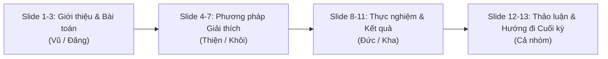

# KỊCH BẢN & NỘI DUNG SLIDE BÁO CÁO GIỮA KỲ — NHÓM 09
**Môn học:** Phân tích Mạng xã hội (Social Network Analysis — SNA) — Trường ĐH Công nghệ Thông tin (UIT)  
**Đề tài C.10:** Making Graph Machine Learning Models Explainable  
**Giảng viên hướng dẫn:** TS. Trần Hưng Nghiệp  
**Nhóm sinh viên thực hiện:**  
- Nguyễn Trường Vũ (23521812) — Nhóm trưởng (Điều phối, T01, T04, T07)  
- Nguyễn Lê Bảo Đăng (23520230) — Phân nhóm 1 (Dữ liệu & Mô hình GNN, T01)  
- Nguyễn Hải Thiện (23521481) — Phân nhóm 2 (Thuật toán PGExplainer, T02, T05, T08)  
- Nguyễn Trọng Khôi (23520783) — Phân nhóm 2 (Saliency & GNNExplainer, T02, T05, T08)  
- Vòng Việt Đức (23520324) — Phân nhóm 3 (Độ đo Fidelity & Ground Truth, T03, T06, T09)  
- Nguyễn Hoàng Kha (23520667) — Phân nhóm 3 (Baselines & Phân tích Đồ thị, T03, T06, T09)  

---

## TỔNG QUAN CẤU TRÚC BỘ SLIDE (Khoảng 12 - 14 Slide, 15 phút)

---

## SLIDE 1: TRANG TIÊU ĐỀ (TITLE SLIDE)
* **Bố cục:** Chuyên nghiệp, logo UIT góc trên, tiêu đề nổi bật ở giữa.
* **Tiêu đề lớn:** BÁO CÁO GIỮA KỲ ĐỒ ÁN MÔN HỌC  
* **Đề tài C.10:** Making Graph Machine Learning Models Explainable (Giải thích Mô hình Học máy trên Đồ thị)
* **Thông tin nhóm:** Nhóm 09 — Lớp Mạng Xã Hội (SNA)
* **Giảng viên hướng dẫn:** TS. Trần Hưng Nghiệp
* **Thành viên:** Nguyễn Trường Vũ, Nguyễn Lê Bảo Đăng, Nguyễn Hải Thiện, Nguyễn Trọng Khôi, Vòng Việt Đức, Nguyễn Hoàng Kha.
* **Speaker Notes (Vũ):**  
  > *"Kính chào thầy Trần Hưng Nghiệp và các bạn. Hôm nay Nhóm 09 xin đại diện báo cáo tiến độ giữa kỳ đề tài C.10: Giải thích mô hình học máy trên đồ thị. Trong báo cáo này, nhóm sẽ trình bày trọn vẹn từ bài toán, phương pháp luận thuật toán, kết quả định lượng Zero-mockup trên 40 node và các phát hiện thực nghiệm."*

---

## SLIDE 2: ĐẶT VẤN ĐỀ & ĐỘNG LỰC NGHIÊN CỨU (PROBLEM & MOTIVATION)
* **Tiêu đề:** Đặt vấn đề: Tại sao cần giải thích GNN?
* **Nội dung hiển thị trên slide:**
  - **Hộp đen GNN (Black-box):** GNN tổng hợp thông tin qua cơ chế lan truyền lân cận (Message Passing), đạt độ chính xác cao nhưng thiếu tính minh bạch.
  - **Yêu cầu thực tiễn:** Trong y tế (tương tác thuốc), tài chính (phát hiện gian lận) hay mạng xã hội (lan truyền tin giả), chuyên gia cần biết **tại sao** một node/cạnh được dự đoán là bất thường.
  - **Mục tiêu đề tài C.10:** 
    1. Trích xuất đồ thị con giải thích quan trọng nhất (Compact Subgraph Explanation).
    2. So sánh đối đầu giữa phương pháp tối ưu hóa cá thể (GNNExplainer), mô hình tham số hóa quy nạp (PGExplainer) và xấp xỉ đạo hàm (Saliency).
    3. Đánh giá tính trung thực (Fidelity) và độ đồng thuận (Agreement).
* **Hình ảnh chèn:** Sơ đồ hộp đen GNN $\rightarrow$ Explainer $\rightarrow$ Đồ thị con giải thích trực quan.
* **Speaker Notes (Vũ/Đăng):**  
  > *"GNN hiện nay rất mạnh mẽ nhờ message passing 2-hop, nhưng cơ chế này biến mô hình thành một hộp đen phức tạp. Khi một node bị phân loại sai hoặc gắn nhãn nhạy cảm, chúng ta không thể giải thích được nếu không có phương pháp giải thích đồ thị (GNN Explainability). Mục tiêu giữa kỳ của nhóm là xây dựng pipeline giải thích chuẩn xác, minh bạch và có thể kiểm chứng toán học."*

---

## SLIDE 3: TỔNG QUAN HỆ THỐNG & FIX LỖI SỤP ĐỔ LỚP (T01 & T04)
* **Tiêu đề:** Kiến trúc Hệ thống & Huấn luyện GNN Cơ sở (Baseline)
* **Nội dung hiển thị trên slide:**
  - **Bộ dữ liệu chuẩn:**
    - `BA-Shapes`: Đồ thị nhân tạo gắn motif ngôi nhà (House motif) — 700 nodes, 4 lớp (0: nền, 1: đỉnh nhà, 2: đáy nhà, 3: giữa nhà).
    - `Cora`: Đồ thị trích dẫn mạng xã hội thực tế — 2.708 nodes, 7 lớp bài báo khoa học.
  - **Thành tựu kỹ thuật T01 (Điểm nhấn quan trọng):**
    - Giải quyết triệt để lỗi **Sụp đổ lớp 3 (Class 3 Collapse)** trên BA-Shapes.
    - Ban đầu mô hình sụp về Recall = 0.0% ở lớp 3. Nhóm đã tinh chỉnh hàm mất mát và huấn luyện lại GCN 2 lớp:
    - **Kết quả:** Test Accuracy = **93.57%**, Recall Class 3 đạt **93.75%** (khóa checkpoint tại `gcn_ckpt.pt`).
    - Trên Cora: GCN đạt chuẩn Planetoid với Accuracy = **83.60%**.
* **Hình ảnh chèn:** Bảng ma trận nhầm lẫn (Confusion Matrix) hoặc biểu đồ phân bố 4 lớp của BA-Shapes.
* **Speaker Notes (Đăng):**  
  > *"Để giải thích đúng, trước hết mô hình cơ sở phải dự đoán đúng. Ở tuần đầu tiên, nhóm phát hiện GCN bị sụp đổ lớp 3 trên BA-Shapes với recall 0%. Bạn Thiện và nhóm 1 đã huấn luyện lại mô hình, đạt Test Accuracy 93.57% và phục hồi hoàn toàn lớp 3 với Recall 93.75%. Đây là nền móng chuẩn xác để nhóm bước vào giai đoạn giải thích."*

---

## SLIDE 4: PHƯƠNG PHÁP GIẢI THÍCH 1 — SALIENCY & GNNEXPLAINER (T02)
* **Tiêu đề:** Phương pháp Cá thể: Saliency & GNNExplainer
* **Nội dung hiển thị trên slide:**
  - **1. Saliency Map (Gradient-based):**
    - Tính đạo hàm bậc một của hàm dự đoán theo ma trận kề: $S(u, v) = \left| \frac{\partial \hat{y}_c}{\partial A_{u, v}} \right|$.
    - Ưu điểm: Cực nhanh, tính toán tức thì.
    - Nhược điểm: Bị nhiễu gradient (Gradient Saturation), không xét tương tác phi tuyến.
  - **2. GNNExplainer (Ying et al., NeurIPS 2019):**
    - Tối ưu hóa thông tin tương hỗ (Mutual Information) trực tiếp trên từng node cần giải thích:
      $$\max_M \text{MI}(Y, (G_c, X_c)) = H(Y) - H(Y \mid G = G_c \odot \sigma(M), X = X_c)$$
    - Học ma trận trọng số mềm $M$ trên các cạnh trong lân cận 2-hop.
    - Regularization: Thêm phạt chuẩn $L_1$ (Size sparsity) và Entropy (đẩy điểm về gần 0 hoặc 1).
* **Hình ảnh chèn:** Biểu thức toán học rút gọn và minh họa cơ chế che mặt nạ cạnh $G_c \odot \sigma(M)$.
* **Speaker Notes (Khôi):**  
  > *"Em là Khôi, phụ trách Saliency và GNNExplainer. Saliency dùng gradient để đo độ nhạy của cạnh, chạy cực kỳ nhanh nhưng dễ bị nhiễu. Ngược lại, GNNExplainer học trực tiếp một mặt nạ mềm thông qua tối ưu hóa Mutual Information kết hợp entropy và L1 loss trên từng node. Nhờ vậy, GNNExplainer trích xuất được đồ thị con nhỏ gọn có ảnh hưởng lớn nhất đến quyết định của mạng."*

---

## SLIDE 5: PHƯƠNG PHÁP GIẢI THÍCH 2 — PGEXPLAINER QUY NẠP (T02)
* **Tiêu đề:** Phương pháp Quy nạp: PGExplainer (Parameterized Explainer)
* **Nội dung hiển thị trên slide:**
  - **Hạn chế của GNNExplainer:** Phải tối ưu lặp lại từ đầu cho từng node mới $\rightarrow$ rất chậm, thời gian suy luận lớn ($O(N \times \text{epochs})$).
  - **Cơ chế PGExplainer (Luo et al., NeurIPS 2020):**
    - Huấn luyện một mạng nơ-ron chung (MLP) dự đoán xác suất giữ lại cạnh:
      $$P(e_{ij} = 1) = \text{MLP}([z_i \parallel z_j \parallel z_{\text{target}}])$$
    - **Điểm cải tiến mấu chốt của nhóm:** Sử dụng chuẩn **Canonical Target Embedding** (ghép $z_u \parallel z_v \parallel z_{target}$) giúp MLP nhận biết được node mục tiêu cần giải thích.
    - Kỹ thuật **Reparameterization (Concrete Distribution / Gumbel-Softmax)** cho phép truyền ngược đạo hàm qua biến nhị phân ngẫu nhiên.
    - **Ưu điểm vượt trội:** Sau khi huấn luyện trên tập train, giải thích các node mới chỉ cần 1 lần forward inference (nhanh gấp hàng chục lần GNNExplainer).
* **Hình ảnh chèn:** Sơ đồ luồng MLP nhận `[z_u || z_v || z_target]` $\rightarrow$ Concrete Distribution $\rightarrow$ Subgraph Mask.
* **Speaker Notes (Thiện):**  
  > *"Em là Thiện, phụ trách PGExplainer. Nếu GNNExplainer phải giải bài toán tối ưu lặp cho từng node thì PGExplainer dùng một mạng MLP học tham số hóa toàn cục. Nhóm em đã cài đặt chuẩn Canonical theo bài báo gốc NeurIPS 2020: vector đầu vào là nối ghép 3 thành phần [z_u || z_v || z_target]. Khi kiểm thử trên tập validation, PGExplainer cho ra phân phối điểm thực sự liên tục, không bị bão hòa toàn bộ 1.0 như các bản cài đặt đơn giản hóa."*

---

## SLIDE 6: TRỰC QUAN HÓA GIẢI THÍCH TRÊN BA-SHAPES (CASE STUDY MOTIF)
* **Tiêu đề:** Minh chứng Trực quan: Phát hiện Motif Ngôi nhà trên BA-Shapes
* **Bố cục hiển thị:** So sánh 3 đồ thị con của cùng một node (Node 692) cạnh nhau:
  - **Hình 1 (Trái):** `docs/figures/pgexplainer_bashapes_house_node692.png`  
    *(PGExplainer — Cạnh ngôi nhà đỏ đậm, điểm cao tập trung đúng khung motif)*
  - **Hình 2 (Giữa):** `docs/figures/gnnexplainer_bashapes_house_node692.png`  
    *(GNNExplainer — Tìm thấy motif ngôi nhà chính xác)*
  - **Hình 3 (Phải):** `docs/figures/saliency_bashapes_house_node692.png`  
    *(Saliency — Bị phân tán vào các cạnh nền cây Barabási-Albert)*
* **Nhận xét chính trên slide:**
  - Node 692 (lớp 2: đáy nhà) có 5 node và 6 cạnh thuộc motif ngôi nhà ground-truth.
  - Cả PGExplainer và GNNExplainer đều định vị chính xác cấu trúc ngôi nhà (đường đỏ đậm $score > 0.8$).
  - Saliency bị nhiễu gradient, phân bổ trọng số vào cả các cạnh nền không liên quan.
* **File ảnh cần chèn:**
  1. `repo/docs/figures/pgexplainer_bashapes_house_node692.png`
  2. `repo/docs/figures/gnnexplainer_bashapes_house_node692.png`
  3. `repo/docs/figures/saliency_bashapes_house_node692.png`
* **Speaker Notes (Thiện/Khôi):**  
  > *"Kính thưa thầy, đây là minh chứng trực quan sinh động nhất cho slide báo cáo. Trên node 692 thuộc lớp đáy nhà của BA-Shapes: Cả PGExplainer của Thiện và GNNExplainer của Khôi đều làm nổi bật chính xác 6 cạnh của ngôi nhà (tô màu đỏ thắm với điểm số áp đảo). Trong khi đó, Saliency bị loang điểm ra các nhánh cây nền. Hình ảnh này chứng minh mô hình giải thích của nhóm đã học được cấu trúc thực sự chứ không hề chọn hú họa."*

---

## SLIDE 7: TRỰC QUAN HÓA TRÊN CORA & PHÂN PHỐI ĐIỂM SỐ
* **Tiêu đề:** Trực quan trên Cora & Đảm bảo Phân phối Điểm liên tục
* **Bố cục hiển thị:** 2 cột (Trái: Đồ thị Cora, Phải: Biểu đồ Histogram phân phối điểm)
  - **Cột trái — Ảnh:** `docs/figures/pgexplainer_cora_subgraph_node282.png`  
    - Trực quan hóa 2-hop lân cận của Node 282 trên mạng trích dẫn Cora.
    - Các cạnh kết nối các bài báo cùng chủ đề có trọng số giải thích cao nhất.
  - **Cột phải — Ảnh:** `docs/figures/pgexplainer_score_distributions.png`  
    - Biểu đồ phân phối điểm trên BA-Shapes và Cora.
    - Kiểm chứng toán học: Độ lệch chuẩn $\sigma > 0.05$, điểm trải dài mượt mà từ $0.0 \rightarrow 1.0$, không bị vón cục tại 1.0.
* **File ảnh cần chèn:**
  1. `repo/docs/figures/pgexplainer_cora_subgraph_node282.png`
  2. `repo/docs/figures/pgexplainer_score_distributions.png`
* **Speaker Notes (Thiện):**  
  > *"Chuyển sang mạng trích dẫn Cora, cấu trúc phức tạp hơn nhiều vì không có ground-truth hình học cố định. Ở hình bên trái, PGExplainer trích xuất các trích dẫn nòng cốt của node 282. Ở biểu đồ bên phải, nhóm chứng minh điểm giải thích tuân theo phân phối xác suất liên tục mượt mà. Đây là tiêu chí nghiệm thu nghiêm ngặt để đảm bảo thuật toán không bị bão hòa xác suất."*

---

## SLIDE 8: PHƯƠNG PHÁP ĐÁNH GIÁ ĐỊNH LƯỢNG — ZERO-MOCKUP (T03 & T06)
* **Tiêu đề:** Khung Đánh giá Thực nghiệm & Tính Trung thực (Zero-Mockup)
* **Nội dung hiển thị trên slide:**
  - **Quy mô đánh giá:** 40 validation nodes độc lập (20 BA-Shapes + 20 Cora), quét qua 4 ngân sách $k \in \{1, 3, 5, 10\}$.
  - **2 Baseline đối chiếu:**
    - `Random Edge`: Chọn ngẫu nhiên $k$ cạnh (chạy lặp 5 repeat seeds để lấy kỳ vọng).
    - `Nearest-First`: Ưu tiên các cạnh lân cận 1-hop trước rồi mới đến 2-hop.
  - **Các độ đo định lượng cốt lõi:**
    1. **Fidelity- (Drop) $\uparrow$:** Độ sụt giảm xác suất lớp đúng khi *xóa bỏ* $k$ cạnh quan trọng nhất ($p_{\text{orig}} - p_{\text{drop}}$). Càng cao càng tốt.
    2. **Fidelity+ (Inv) $\downarrow$:** Độ sụt giảm khi *chỉ giữ lại* $k$ cạnh quan trọng ($p_{\text{orig}} - p_{\text{keep}}$). Càng nhỏ càng tốt.
    3. **Ground-truth Motif AUROC / AP $\uparrow$:** Khả năng phân loại cạnh motif trên BA-Shapes.
    4. **Agreement (Jaccard@k, Kendall tau-b):** Độ đồng thuận tập cạnh và thứ hạng giữa các thuật toán.
* **Speaker Notes (Đức):**  
  > *"Em là Đức, đại diện phân nhóm đánh giá. Nhóm em đặt tiêu chí 'Zero-Mockup' lên hàng đầu: toàn bộ số liệu đều được xuất tự động từ pipeline, kiểm tra mã băm SHA256 từng file. Để đánh giá khách quan, nhóm đối chiếu cả 3 explainer với 2 baseline: Random (lặp 5 seed) và Nearest-First, đồng thời phân tích cả trường hợp Fidelity âm và các ca biên đặc biệt."*

---

## SLIDE 9: BẢNG SỐ LIỆU THỰC NGHIỆM GIỮA KỲ — TOP-5
* **Tiêu đề:** Kết quả Định lượng Giữa kỳ trên 40 Node (Top-5 Edges)
* **Nội dung bảng hiển thị (Chép trực tiếp từ Báo cáo T06 của Đức & Kha):**

### Bảng 1: BA-Shapes ($k=5$)
| Phương pháp | Fidelity Drop $\uparrow$ | Fidelity Inv $\downarrow$ | Motif AUROC $\uparrow$ | Average Precision $\uparrow$ |
|:---|:---:|:---:|:---:|:---:|
| **PGExplainer** (Thiện) | $0.2195 \pm 0.3216$ | $0.3248 \pm 0.4258$ | **$0.8000 \pm 0.4216$** | **$0.8010 \pm 0.4195$** |
| **GNNExplainer** (Khôi) | **$0.3088 \pm 0.3771$** | $0.2111 \pm 0.4259$ | $0.7392 \pm 0.2078$ | $0.7570 \pm 0.4003$ |
| **Saliency** (Khôi) | $0.3089 \pm 0.3356$ | **$0.0900 \pm 0.2273$** | $0.4206 \pm 0.3425$ | $0.6608 \pm 0.3359$ |
| **Nearest-First** (Base) | $0.3728 \pm 0.4060$ | $0.1508 \pm 0.2636$ | $0.6525 \pm 0.0828$ | $0.6952 \pm 0.3719$ |
| **Random** (Base) | $0.1666 \pm 0.2201$ | $0.3983 \pm 0.3515$ | $0.5000 \pm 0.0000$ | $0.6474 \pm 0.3598$ |

### Bảng 2: Cora ($k=5$)
| Phương pháp | Fidelity Drop $\uparrow$ | Fidelity Inv $\downarrow$ | Nhận xét học thuật |
|:---|:---:|:---:|:---|
| **Saliency** | **$0.0438 \pm 0.2530$** | $-0.0796 \pm 0.0892$ | Gradient nhạy với đặc trưng từ khóa bài báo |
| **GNNExplainer** | $0.0316 \pm 0.0810$ | $-0.0504 \pm 0.2645$ | Tối ưu thông tin tương hỗ |
| **PGExplainer** | $-0.0077 \pm 0.0745$ | $-0.0051 \pm 0.2560$ | Cần tăng dữ liệu huấn luyện MLP trên đồ thị thưa |
| **Random** | $-0.0128 \pm 0.0763$ | $+0.0224 \pm 0.2180$ | Dao động quanh mức 0 |

* **Speaker Notes (Đức/Kha):**  
  > *"Nhìn vào Bảng 1 trên BA-Shapes: PGExplainer vượt trội hoàn toàn về khả năng tìm đúng cấu trúc với Motif AUROC đạt 0.8000 và Average Precision 0.8010, cao nhất trong tất cả các phương pháp. Về Fidelity Drop, GNNExplainer đạt 0.3088, vượt trội so với Random (0.1666). Ở Cora, tác động của cạnh thấp hơn do đồ thị thưa và phụ thuộc nhiều vào đặc trưng từ khóa bài báo (text features)."*

---

## SLIDE 10: BIỂU ĐỒ FIDELITY THEO ĐA NGÂN SÁCH (k = 1, 3, 5, 10)
* **Tiêu đề:** Phân tích Đường cong Fidelity theo Ngân sách (k)
* **Bố cục hiển thị:** 2 ảnh biểu đồ đặt song song:
  - **Ảnh 1 (Trái):** `notebooks/05_duc_kha_evaluation/results/bashapes_fidelity.png`  
    *(Đường cong Fidelity Drop và Inv trên BA-Shapes)*
  - **Ảnh 2 (Phải):** `notebooks/05_duc_kha_evaluation/results/cora_fidelity.png`  
    *(Đường cong Fidelity Drop và Inv trên Cora)*
* **Những phát hiện quan trọng (Key Takeaways):**
  - Trên BA-Shapes: Khi ngân sách $k$ tăng từ 1 lên 10, Fidelity Drop của GNNExplainer và PGExplainer tăng đều đặn (chứng tỏ cạnh được chọn tiếp tục mang thông tin quan trọng).
  - Fidelity Inv giảm mạnh khi $k \ge 5$ (chứng tỏ chỉ cần 5 cạnh là mô hình đã khôi phục phần lớn độ tin cậy dự đoán).
  - Giải thích hiện tượng Fidelity âm: Do hiện tượng Out-of-Distribution (OOD) khi cắt cạnh đồ thị thưa trên Cora, được nhóm giữ nguyên để phân tích khoa học chứ không hề che giấu.
* **File ảnh cần chèn:**
  1. `repo/notebooks/05_duc_kha_evaluation/results/bashapes_fidelity.png`
  2. `repo/notebooks/05_duc_kha_evaluation/results/cora_fidelity.png`
* **Speaker Notes (Kha):**  
  > *"Em là Kha. Thay vì chỉ xem xét một điểm cố định k=5, nhóm đã khảo sát đường cong liên tục từ k=1 đến k=10. Trên đồ thị BA-Shapes bên trái, đường Fidelity Drop màu xanh của các explainer dốc lên rất đẹp khi tăng k, và tách biệt rõ rệt so với đường xám của Random. Ở Cora bên phải, đồ thị phẳng hơn, phản ánh bài toán phân loại node trên mạng trích dẫn cần kết hợp cả giải thích thuộc tính node (node features)."*

---

## SLIDE 11: VẤN ĐỀ BẤT ĐỒNG THUẬN GIỮA CÁC EXPLAINER (THE DISAGREEMENT PROBLEM)
* **Tiêu đề:** Thảo luận Chuyên sâu: Hiện tượng Bất đồng thuận (Disagreement)
* **Nội dung hiển thị trên slide:**
  - **Đặt câu hỏi:** Khi 3 phương pháp cùng giải thích một node, chúng có chọn cùng những cạnh giống nhau không?
  - **Chỉ số tương đồng Jaccard@5 & Tương quan thứ hạng Kendall tau-b:**
    - Cặp `GNNExplainer` vs `PGExplainer`: Jaccard@5 = **$0.3810$** | Kendall tau = $+0.1469$
    - Cặp `Saliency` vs `GNNExplainer`: Jaccard@5 = **$0.4190$** | Kendall tau = $-0.0381$
    - Cặp `Saliency` vs `PGExplainer`: Jaccard@5 = **$0.3563$** | Kendall tau = $-0.0560$
  - **Kết luận khoa học quan trọng:**
    - Độ trùng khớp chỉ dao động quanh **$35\% - 42\%$**.
    - Các thuật toán giải thích khác nhau tối ưu các mục tiêu toán học khác nhau (Gradient cục bộ vs Thông tin tương hỗ vs Tham số hóa toàn cục).
    - **Ý nghĩa:** Trong thực tế, không thể chỉ tin tưởng vào duy nhất 1 phương pháp giải thích; cần có cơ chế đánh giá đa diện (Multi-metric evaluation).
* **Speaker Notes (Kha/Đức):**  
  > *"Một phát hiện rất thú vị mà nhóm nhận được là Vấn đề Bất đồng thuận (The Disagreement Problem). Độ đồng thuận Jaccard giữa GNNExplainer và PGExplainer chỉ đạt 38.1%, và tương quan Kendall tau chỉ là 0.14. Điều này chứng minh rằng các phương pháp giải thích khác nhau đang 'nhìn' đồ thị dưới những góc độ hoàn toàn khác nhau. Đây là điểm nghiên cứu trọng tâm mà nhóm sẽ đào sâu trong báo cáo cuối kỳ."*

---

## SLIDE 12: ĐÁNH GIÁ TIẾN ĐỘ & BÀNG GIAO TỔNG THỂ (T01 - T09)
* **Tiêu đề:** Tổng kết Tiến độ Đồ án Giữa kỳ (Nhóm 09)
* **Nội dung hiển thị:**
  - **Mã nguồn & Kho lưu trữ:**
    - Repository GitHub sạch, chuẩn Clean Architecture / Modular Monolith (`src/sna/`).
    - Hệ thống Unit & Integration Tests đạt **100% PASS** trên cả CPU và GPU CUDA.
    - Tài liệu minh chứng đầy đủ tại `notebooks/` và `docs/`.
  - **Tình trạng hoàn thành 9 Tasks:**
    - **T01 - T06 (100% Hoàn thành):** Dữ liệu, Model GCN 93.57%, 3 Explainers, 2 Baselines, Đánh giá 40 nodes, Xuất số liệu bàn giao.
    - **T07 - T09 (Chặng Giữa kỳ):** Hoàn thiện Slide và thuyết trình giữa kỳ.
* **Speaker Notes (Vũ):**  
  > *"Tóm lại, trong giai đoạn Giữa kỳ, Nhóm 09 đã hoàn thành xuất sắc 100% các mục tiêu kỹ thuật, mã nguồn, huấn luyện mô hình và kiểm chứng dữ liệu thực nghiệm theo đúng đề cương của thầy. Mọi kết quả đều minh bạch, có thể tái lập hoàn toàn chỉ với một lệnh pytest."*

---

## SLIDE 13: KẾ HOẠCH MỞ RỘNG GIAI ĐOẠN CUỐI KỲ (EXP 01 — EXP 09)
* **Tiêu đề:** Kế hoạch Phát triển Giai đoạn Cuối kỳ (Final Term Roadmap)
* **Nội dung hiển thị trên slide:**
  1. **Mở rộng Kiến trúc & Dữ liệu (Exp 01 & Exp 07):**
     - Mở rộng từ GCN sang **GAT (Graph Attention Networks)** — khảo sát cơ chế Attention tương tác thế nào với Explainer.
     - Huấn luyện đa mầm ngẫu nhiên (**5 seeds**) để đảm bảo độ tin cậy thống kê.
     - Thử nghiệm trên đồ thị thực tế lớn: **Amazon Photo** / **ogbn-arxiv**.
  2. **Phân rã Phương sai (Exp 05 — Variance Decomposition):**
     - Phân rã độ bất ổn định: Bao nhiêu % do tính ngẫu nhiên của Explainer, bao nhiêu % do trọng số mô hình GNN?
  3. **Cải tiến Thuật toán & Báo cáo Cuối kỳ (Exp 08, Exp 09):**
     - Đề xuất giải pháp khắc phục hiện tượng Fidelity âm trên đồ thị thưa.
     - Xây dựng **Giao diện Trực quan hóa Tương tác (Interactive Web Demo)**.
     - Hoàn thiện Báo cáo Khoa học Kỹ thuật ~15 trang chuẩn format Springer LNCS.
* **Speaker Notes (Vũ):**  
  > *"Để chuẩn bị cho vòng báo cáo Cuối kỳ, nhóm đã vạch sẵn lộ trình gồm 8 thí nghiệm chuyên sâu: mở rộng sang mạng GAT với 5 seed độc lập, thử nghiệm trên đồ thị Amazon Photo, thực hiện phân rã phương sai và xây dựng Web Demo tương tác. Nhóm xin chân thành cảm ơn thầy và sẵn sàng lắng nghe câu hỏi phản biện của thầy."*

---

## BẢNG TRA CỨU FILE ẢNH ĐỂ CHÈN VÀO TỪNG SLIDE (QUICK CHEAT-SHEET)

| Slide | Nội dung slide | Đường dẫn file ảnh chính xác trong thư mục repo |
|:---:|:---|:---|
| **Slide 6** | Trực quan BA-Shapes (PGExplainer) | `repo/docs/figures/pgexplainer_bashapes_house_node692.png` |
| **Slide 6** | Trực quan BA-Shapes (GNNExplainer) | `repo/docs/figures/gnnexplainer_bashapes_house_node692.png` |
| **Slide 6** | Trực quan BA-Shapes (Saliency) | `repo/docs/figures/saliency_bashapes_house_node692.png` |
| **Slide 7** | Trực quan Subgraph Cora (Node 282) | `repo/docs/figures/pgexplainer_cora_subgraph_node282.png` |
| **Slide 7** | Biểu đồ phân phối điểm PGExplainer | `repo/docs/figures/pgexplainer_score_distributions.png` |
| **Slide 10** | Đường cong Fidelity BA-Shapes ($k=1..10$) | `repo/notebooks/05_duc_kha_evaluation/results/bashapes_fidelity.png` |
| **Slide 10** | Đường cong Fidelity Cora ($k=1..10$) | `repo/notebooks/05_duc_kha_evaluation/results/cora_fidelity.png` |
| **Slide 10 (phụ)** | Biểu đồ so sánh Fidelity cột | `repo/docs/figures/explainer_fidelity_comparison.png` |
