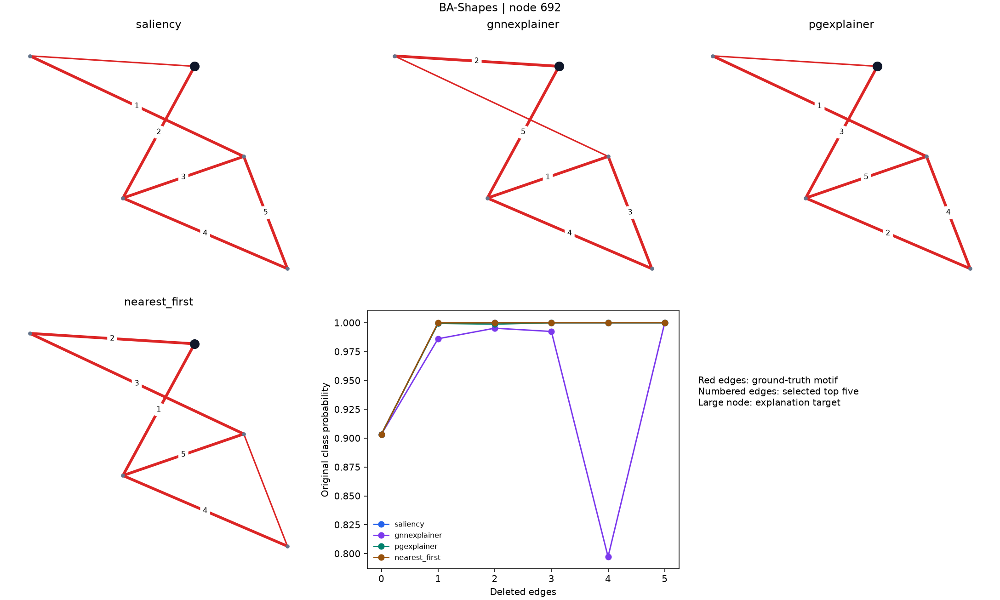

# FB-3 — Phân tích mâu thuẫn giữa Fidelity và Motif AUROC

**Phụ trách Nguyễn Hoàng Kha · Nhóm 09 · C.10**

## Đối chiếu GATE 0

Chạy lại T06 trên 20 node validation BA-Shapes và 20 node validation Cora với dữ liệu và checkpoint có SHA-256 khớp bản giữa kỳ. Lượt chạy tạo 2.080 dòng metric và 6.080 dòng agreement, với 0 lỗi. Cả 240 dòng tổng hợp metric và 160 dòng tổng hợp agreement khớp trung bình, độ lệch chuẩn đến bốn chữ số thập phân, đồng thời có cùng số node hợp lệ và tổng số node. [Biên bản GATE 0](GATE0_TAI_LAP_GIUA_KY.md) · [Đối chiếu của Kha](../results/gate0/kha_t06_comparison.json)

## Bằng chứng giữa kỳ trên BA-Shapes

| Phương pháp | Fidelity Drop@5, n = 20 | Motif AUROC, n = 10 |
| --- | ---: | ---: |
| Saliency | 0,3089 | 0,4206 |
| GNNExplainer | 0,3088 | 0,7392 |
| PGExplainer | 0,2195 | 0,8000 |
| Nearest-First | 0,3728 | 0,6525 |

Ở lượt tái lập T06, PGExplainer đứng đầu về Motif AUROC và Nearest-First đứng đầu về Fidelity Drop@5 trong bốn phương pháp của A3. AUROC xác định trên những node có cả cạnh motif và cạnh nền. Fidelity Drop@5 đo chênh lệch xác suất của lớp GCN dự đoán trước và sau khi xóa năm cạnh đầu. [Bảng T06](../notebooks/05_duc_kha_evaluation/results/summary.csv)

Khi phá hòa lại với năm seed trên **cùng** điểm thô giữa kỳ, hai phương pháp đứng đầu vẫn khác nhau ở cả năm lượt. Ở cấp node, tập phương pháp đồng hạng tốt nhất theo hai metric rời nhau trên 4/10 node có AUROC. Đây là kết quả validation của một checkpoint với điểm giải thích lưu từ giữa kỳ. [Xếp hạng theo seed phá hòa](../results/analysis/a3_midterm/a3_0_conflicts.csv) · [Mâu thuẫn theo node](../results/analysis/a3_midterm/a3_1_node_conflicts.csv)

- **T1 — Cạnh trực tiếp.** Trong top-5, tỷ lệ cạnh nối trực tiếp node đích trung bình là 69,0% với Nearest-First và 26,6% với PGExplainer. Tương quan Spearman giữa tỷ lệ này và Drop@5 của PGExplainer là 0,499 trên 20 node, và −0,400 trên 4 node mâu thuẫn. Quan hệ trong nhóm nhỏ này cần kiểm tra tiếp trên test. [Bảng cơ chế](../results/analysis/a3_midterm/a3_2_mechanisms.csv)
- **T4 — Phá hòa.** PGExplainer có điểm thứ 5 bằng điểm thứ 6 ở 7/20 node. Trong nhóm mâu thuẫn, tỷ lệ là 2/4. Biên độ Drop@5 lớn nhất qua năm seed phá hòa của PGExplainer là 0,846 trên toàn tập validation và 0,224 trong nhóm mâu thuẫn. [Độ nhạy phá hòa](../results/analysis/a3_midterm/t4_tie_sensitivity.csv)
- **T5 — Fidelity âm.** PGExplainer có ít nhất một lượt Drop@5 âm trên 7/20 node, trong đó có 2/4 node mâu thuẫn. Drop âm nghĩa là xác suất của lớp ban đầu tăng sau khi xóa cạnh. Bảng chi tiết lưu lớp ở hai đầu cạnh bị xóa và thay đổi bậc của node đích. [Fidelity âm](../results/analysis/a3_midterm/t5_negative_fidelity.csv) · [Cạnh bị xóa](../results/analysis/a3_midterm/t5_deleted_edges.csv)

### Case study giữa kỳ — node 692

Cả sáu cạnh ứng viên đều thuộc motif, nên Motif AUROC là NaN và precision@5 bằng 1 ở cả bốn phương pháp. Khi xóa top-5, xác suất lớp 2 tăng từ 0,9034 lên gần 1,0000 ở cả bốn phương pháp, tương ứng Drop@5 = −0,0966. Với GNNExplainer, đường xác suất giảm xuống 0,7973 sau bốn cạnh rồi tăng trở lại sau cạnh thứ năm. Case này minh họa Fidelity âm và tác động của việc chọn ngân sách cạnh. [Metric node 692](../results/analysis/a3_midterm/case_metrics.csv) · [Top-5 cạnh](../results/analysis/a3_midterm/case_top_edges.csv) · [Đường xác suất](../results/analysis/a3_midterm/case_deletion_curves.csv)

Trên node này, xóa toàn bộ sáu cạnh motif và xóa cả hai cạnh nối trực tiếp cho cùng Drop khi giữ nguyên đặc trưng. Tính lại bậc và căn bậc chỉ làm chênh lệch khoảng 1,2 × 10⁻⁷ trong hai can thiệp, nên phân tích độ nhạy ở node này chưa cho thấy tác động đáng kể của đặc trưng bậc tĩnh. [T2–T3 node 692](../results/analysis/a3_midterm/case_t2_t3.csv)



## A3 cuối kỳ trên tập test

Cần đối chiếu giả thuyết trên toàn bộ 140 node test với 25 cấu hình GNN × explainer. Năm checkpoint BA-Shapes, điểm PGExplainer và điểm Saliency đã có. Các bảng so sánh đầy đủ và case test đang chờ điểm GNNExplainer. Đầu ra T2–T3 của Đăng đã có trong repo. [Bàn giao PN1](PN1_HANDOFF.md) · [Đầu ra T2–T3](../results/analysis/a3_t2_t3/manifest.json)

Từ thư mục gốc repo, sau khi cài các thư viện và package `sna`, đặt dữ liệu và checkpoint theo H1, rồi đặt điểm theo H2. Kiểm tra H2 bằng `scripts/check_scores.py` của PN2 trước khi chạy:

```bash
python scripts/error_analysis.py --dataset bashapes --out results/analysis/a3_bashapes_test
```

| Đầu ra | Nội dung |
| --- | --- |
| `a3_0_metrics.csv`, `a3_0_conflicts.csv` | Trung bình, CI bootstrap 95%, số node hợp lệ, phương pháp đứng đầu theo từng metric và độ nhạy theo seed phá hòa. Hai tập phương pháp đồng hạng phải rời nhau mới tính là mâu thuẫn. |
| `a3_1_counts.csv`, `a3_1_by_node.csv`, `a3_1_node_conflicts.csv` | Bốn góc phần tư theo ba cặp ngưỡng, node có AUROC không xác định và mâu thuẫn theo node–checkpoint. |
| `a3_2_mechanisms.csv`, `a3_2_t2_t3.csv` | T1, T4, T5 trên toàn tập và trên nhóm mâu thuẫn, cùng T2–T3 ghép theo node và checkpoint. Hai can thiệp T2 dùng số cạnh khác nhau. |
| `t4_tie_sensitivity.csv`, `t5_negative_fidelity.csv`, `t5_deleted_edges.csv` | Dao động Drop qua năm lần phá hòa và chi tiết các trường hợp Drop âm. |
| `case_*.csv`, `a3_node_*.png` | Cạnh top-5, đường xác suất từ k = 0 đến 5, T2–T3 và hình riêng của từng node. |
| `manifest.json` | Danh sách node, seed, phiên bản môi trường, thông tin commit và SHA-256 đầu vào/đầu ra. |

Khi chọn case test, dùng PGExplainer trên GNN seed 1000 để gán góc phần tư từ metric trung bình qua các lần chạy. Trong từng góc có dữ liệu, chọn node gần trung vị theo khoảng cách Euclid trong mặt phẳng Drop và AUROC, ưu tiên phủ các lớp thật 1–3 khi chọn node bổ sung. Hình sử dụng explainer seed 0 và seed phá hòa 0. Node 692 thuộc validation và được vẽ riêng từ dữ liệu giữa kỳ:

```bash
python scripts/error_analysis.py --midterm results/test-assets/kha/data/bashapes --out results/analysis/a3_midterm
```

Khi so sánh kết quả, đọc tỷ lệ cấu hình có mâu thuẫn từ các dòng `tie_seed=average` và dùng năm dòng còn lại mỗi cấu hình để kiểm tra độ nhạy. Khi trình bày cơ chế, báo số node hợp lệ, phân biệt tương quan T1 với can thiệp T2–T3, rồi chọn 3–4 hình để đưa vào báo cáo chính.

## Kết quả sơ bộ trên tập test từ H2 của PGExplainer

Gói H2 của Thiện cung cấp đủ 25 cấu hình PGExplainer và điểm cạnh trên 140 node test BA-Shapes. Script đối chiếu SHA-256 với gói và log, kiểm tra cạnh ứng viên từ đồ thị gốc, rồi tính AUROC và AP từ điểm thô. Precision@5 và tỷ lệ cạnh nối trực tiếp được tính qua năm lần phá hòa trên mỗi cặp node–cấu hình. Log có thể dùng hash bản LF hoặc CRLF khi thứ tự node vẫn khớp.

- **Motif AUROC** xác định ở 71/140 node mỗi cấu hình. Giá trị trung bình theo cấu hình dao động từ **0,1578 đến 0,8599**.
- **Điểm hòa tại ranh giới top-5** xuất hiện ở **676/3.500 cặp node–cấu hình (19,3%)**. Precision@5 giữ nguyên qua cả năm seed phá hòa ở mọi cặp. Có một cặp có AUROC ≥ 0,75 và precision@5 < 0,5.
- **Tỷ lệ cạnh nối trực tiếp** trung bình theo cấu hình nằm trong khoảng **19,3%–26,5%**. Cần checkpoint để đo Fidelity và kiểm tra quan hệ giữa tỷ lệ này với Fidelity.

[Bảng theo cấu hình](../results/analysis/a3_pgexplainer_preliminary/by_configuration.csv) · [Chi tiết theo node](../results/analysis/a3_pgexplainer_preliminary/by_node.csv) · [Manifest](../results/analysis/a3_pgexplainer_preliminary/manifest.json)

Chạy lại từ thư mục gốc repo:

```bash
python scripts/analyze_pgexplainer_h2.py path/to/PN2_H2_pgexplainer_scores_20261122.zip
```

Phân tích riêng từ điểm cạnh được bổ sung bằng phép đo Fidelity với checkpoint chính thức ở mục sau.

## Kết quả Fidelity của PGExplainer với checkpoint chính thức

Đã nạp đủ năm checkpoint BA-Shapes từ GitHub `7aeeba9`, đối chiếu SHA-256 với metadata và H2, rồi xác nhận lớp đích trong CSV khớp dự đoán checkpoint. Đánh giá 140 node test × 25 cấu hình × 5 seed phá hòa. Trung bình qua năm lần phá hòa trước khi tính trung bình theo node.

| Chỉ số | Kết quả trên BA-Shapes |
| --- | --- |
| Fidelity Drop@5 trung bình | 0,1885 qua 25 cấu hình, dao động 0,1283–0,2353 theo cấu hình |
| T1 — Cạnh nối trực tiếp và Drop@5 | Spearman dương ở cả 25 cấu hình, dao động 0,3850–0,6504. Đây là tương quan qua các node trong từng cấu hình. |
| T4 — Độ nhạy khi phá hòa | Drop@5 đổi hơn 10⁻⁶ ở 476/3.500 cặp node–cấu hình (13,6%). Chênh lệch lớn nhất giữa hai lần phá hòa trong cùng một cặp là 0,9986, dù precision@5 giữ nguyên qua năm seed. |
| T5 — Drop@5 âm | 6.809/17.500 lượt có Drop@5 < 0, trong đó 4.949 lượt có Drop@5 < −10⁻⁶. Có 1.386/3.500 cặp node–cấu hình có ít nhất một lượt âm. Giữ nguyên các giá trị âm trong CSV. |

[Bảng Fidelity theo cấu hình](../results/analysis/a3_pgexplainer_fidelity/fidelity_by_configuration.csv) · [Các lượt Fidelity âm và cạnh được xóa](../results/analysis/a3_pgexplainer_fidelity/negative_fidelity.csv) · [Manifest](../results/analysis/a3_pgexplainer_fidelity/manifest.json)

```bash
python scripts/analyze_pgexplainer_h2.py path/to/PN2_H2_pgexplainer_scores_20261122.zip --fidelity --out results/analysis/a3_pgexplainer_fidelity
```

## Saliency và các tệp còn thiếu

Đã chạy Saliency trên CPU bằng `scripts/run_explainers.py` tại commit `7aeeba9`, với đúng năm checkpoint BA-Shapes và 140 node test. Có 6 CSV, mỗi CSV 23.880 dòng, và 5 log trong `results/test-assets/kha/saliency/bashapes/`. Điểm cạnh từ `saliency_e0.csv` và `saliency_e1.csv` của GNN seed 1000 giống nhau trên từng dòng điểm. Các CSV điểm của Saliency được lưu cục bộ cùng log để dùng khi ghép H2.

| Nguồn | Tệp cần nhận để chạy A3 đầy đủ |
| --- | --- |
| Khôi, H2 GNNExplainer | 25 CSV `results/scores/bashapes/gcn_s{1000..1004}/gnnexplainer_e{0..4}.csv` cùng 5 `run_log.json` tương ứng, với hash checkpoint và CSV cùng thiết lập chạy. |

Cần giữ đúng cấu hình GNNExplainer đã được nhóm chốt khi nhận hoặc sinh lại điểm, đặc biệt là `size_loss_mode` (`mean` hoặc `sum`). Sau khi đủ dữ liệu, chạy lại bảng A3 trên bốn phương pháp và chọn case test chính thức.

## So sánh trên tập test với ba phương pháp đã có

Đã sinh bảng A3-0 đến A3-2 cho **Saliency, PGExplainer và Nearest-First** trên 140 node test và 25 cấu hình. Đã ghép 1.400 dòng can thiệp T2–T3 theo seed GNN, node và SHA-256 checkpoint.

Sau khi lấy trung bình qua năm lần phá hòa trên từng node, **Nearest-First dẫn về Fidelity Drop@5 ở cả 25 cấu hình**. Motif AUROC cao nhất thuộc về **PGExplainer ở 16 cấu hình** và **Nearest-First ở 9 cấu hình**. Hai thước đo chọn phương pháp đứng đầu khác nhau ở **16/25 cấu hình (64%)** trong phạm vi ba phương pháp này. Cần bổ sung GNNExplainer trước khi chốt kết quả so sánh cuối kỳ.

**Ví dụ T4 — node 317.** Với GNN seed 1004 và PGExplainer seed 1, AUROC và precision@5 đều bằng 1. Xác suất lớp ban đầu là 0,8942. Sau khi xóa top-5, xác suất là 1,0000 ở bốn lần phá hòa và 0,0014 ở lần còn lại. Drop@5 đổi từ −0,1058 đến 0,8928. Đây là cặp có biên độ lớn nhất của lượt phân tích PGExplainer, dùng để minh họa độ nhạy khi điểm hòa. Danh sách case cuối kỳ vẫn sẽ được chọn theo quy tắc góc phần tư sau khi có đủ phương pháp.

[Bảng A3-0](../results/analysis/a3_partial_test/a3_0_conflicts.csv) · [Bảng cơ chế T1, T4, T5](../results/analysis/a3_partial_test/a3_2_mechanisms.csv) · [T2–T3 đã ghép](../results/analysis/a3_partial_test/a3_2_t2_t3.csv) · [Manifest](../results/analysis/a3_partial_test/manifest.json)

```bash
python scripts/error_analysis.py --scores results/test-assets/kha/pg_h2/bashapes --saliency-scores results/test-assets/kha/saliency/bashapes --out results/analysis/a3_partial_test
```
