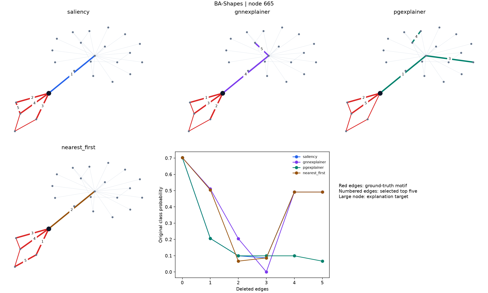
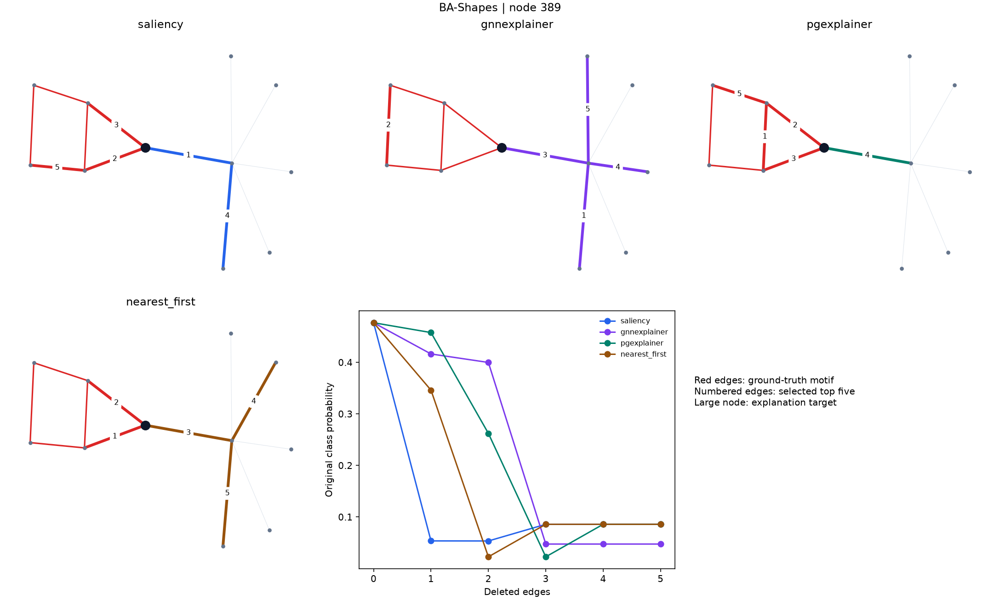
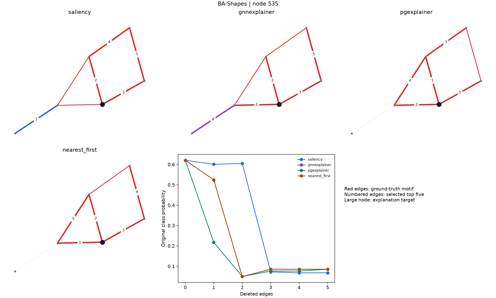
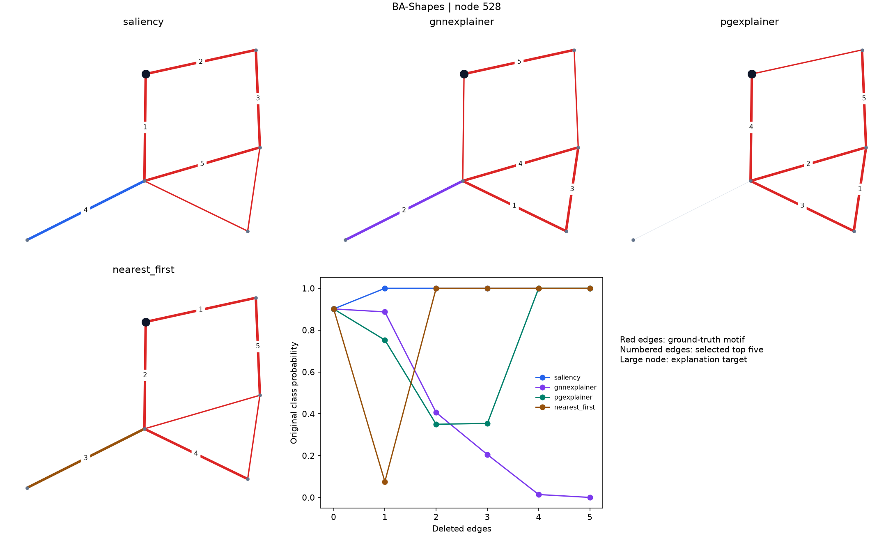

# FB-3 — Phân tích mâu thuẫn giữa Fidelity và Motif AUROC (bản cuối kỳ)

**Nhóm 09 · C.10 · Phụ trách Nguyễn Hoàng Kha (A3), T2/T3 do Đăng, điểm GNNExplainer/PGExplainer do Khôi/Thiện**

Câu hỏi của thầy: vì sao Fidelity và Motif AUROC không thống nhất khi xếp hạng explainer? Nguyên tắc của kế hoạch (`KE_HOACH_CUOI_KY_FINAL.md`, Mục 8): không đoán trước nguyên nhân, chỉ kết luận sau khi có số, giả thuyết không được số ủng hộ thì báo cáo đúng như vậy.

## 0. Phạm vi, quy ước và cách sinh lại

- **Dữ liệu:** BA-Shapes, GCN, 140 nút test, 5 GNN seed (1000–1004) × 5 seed explainer (0–4) = 25 cấu hình; 4 phương pháp: Saliency, GNNExplainer (`size_loss` dạng sum), PGExplainer, Nearest-First. Saliency và Nearest-First tất định, nên giá trị của chúng lặp lại qua 5 seed explainer. Mọi Fidelity là **Drop@5** (giữ đặc trưng nút cố định); trung bình qua 5 seed phá hòa trước khi lấy trung bình theo nút.
- **Một "cặp nút–GNN"** là một nút test trên một checkpoint. Các cặp này **không độc lập** (cùng 140 nút, 5 checkpoint cùng kiến trúc và dữ liệu), nên các tử/mẫu dưới đây là số đếm mô tả, không phải kiểm định.
- **AUROC chỉ xác định ở 71/140 nút** mỗi cấu hình (nút có cả cạnh motif lẫn cạnh nền trong 2-hop), tức 355/700 cặp nút–GNN. Các số "mâu thuẫn theo nút" chỉ tính trên 355 cặp này.
- **Mâu thuẫn:** tập phương pháp đồng hạng tốt nhất theo Drop@5 và tập đồng hạng tốt nhất theo AUROC **rời nhau** (dung sai 1e-12), theo `winners()` trong `scripts/error_analysis.py`.
- **Nguồn:** thư mục `results/analysis/a3_final/` (commit sinh: `fdeccfc`, `git_dirty=false`, xem `manifest.json`). Điểm cạnh thô nằm ngoài Git (đường dẫn `../final_scores/bashapes` trong manifest). Các bảng rất lớn (`metrics_by_run.csv`, `t5_*.csv`) không có trong repo; số T5 lấy từ `a3_2_mechanisms.csv`.

Sinh lại (cần `results/checkpoints`, `results/data` và CSV điểm theo hợp đồng H2):

```bash
python scripts/error_analysis.py --scores results/scores/bashapes \
  --t2-t3 results/analysis/a3_t2_t3/t2_t3_by_node.csv --out results/analysis/a3_final
```

Bảng T2/T3 gốc của Đăng: `results/analysis/a3_t2_t3/` (sinh bằng `scripts/analyze_degree_mechanisms.py`). Một số con số suy ra thêm (đánh dấu **[tính thêm]**) được tính trực tiếp từ các CSV trong `a3_final/` bằng đoạn pandas ở Mục 6.

## 1. Bảng A3-0: xác minh lại mâu thuẫn trên tập test

Trung bình theo nút, rồi trung bình qua 25 cấu hình; khoảng trong ngoặc là min–max giữa các cấu hình (CI bootstrap trên nút của từng cấu hình có trong `a3_0_metrics.csv`).

| Phương pháp | Drop@5 (140/140 nút) | CI 95% trung bình các cận | AUROC (71/140 nút) | CI 95% trung bình các cận |
|---|---:|---:|---:|---:|
| Saliency | 0,248 (0,225–0,285) | 0,193–0,304 | 0,527 (0,511–0,545) | 0,458–0,596 |
| GNNExplainer | 0,270 (0,247–0,303) | 0,216–0,326 | 0,631 (0,554–0,698) | 0,574–0,687 |
| PGExplainer | 0,185 (0,128–0,226) | 0,137–0,235 | 0,731 (0,488–0,944) | 0,648–0,809 |
| Nearest-First | 0,291 (0,286–0,299) | 0,230–0,354 | 0,668 (hằng số) | 0,649–0,688 |

Các giá trị Drop@5 trùng bảng chính `results/analysis/main/main_by_method_budget.csv` (ví dụ GNNExplainer 0,2702, PGExplainer 0,1853).

| Kết quả đếm trên 25 cấu hình | Số liệu |
|---|---|
| Cấu hình có mâu thuẫn (phương pháp đứng đầu Drop@5 khác phương pháp đứng đầu AUROC) | **17/25 (68%)** |
| Đứng đầu Drop@5 | Nearest-First 20, GNNExplainer 5 |
| Đứng đầu AUROC | PGExplainer 17, Nearest-First 8 |
| Cặp (đầu Drop@5, đầu AUROC) | (Nearest-First, PGExplainer) 12; (GNNExplainer, PGExplainer) 5; (Nearest-First, Nearest-First) 8 |
| Mâu thuẫn theo GNN seed 1000/1001/1002/1003/1004 | 2/3/3/4/5 trên 5 cấu hình mỗi seed |
| Độ nhạy với seed phá hòa 0–4 | **17/25 ở cả 5 seed**, cùng người thắng |

Nguồn: `a3_0_metrics.csv`, `a3_0_conflicts.csv` (dòng `tie_seed=average` cho kết quả chính, 5 dòng còn lại cho độ nhạy).

**Diễn giải (chỉ theo số).** Mâu thuẫn **không biến mất** sau khi tăng mẫu (25 cấu hình, 140 nút) và không phụ thuộc vào cách phá hòa. Nó có hình dạng nhất quán: PGExplainer có AUROC trung bình cao nhất nhưng Drop@5 thấp nhất; Nearest-First có Drop@5 cao nhất nhưng AUROC không bằng PGExplainer ở 17/25 cấu hình. AUROC của PGExplainer dao động mạnh theo GNN seed (độ lệch chuẩn giữa cấu hình 0,109; trung bình theo GNN seed ở explainer seed 0 là 0,68/0,94/0,64/0,79/0,81), nên số cấu hình mâu thuẫn mỗi GNN seed khác nhau (2 đến 5/5). Ở 8 cấu hình Nearest-First thắng cả hai metric, AUROC của PGExplainer nằm trong 0,488–0,668 (không vượt AUROC 0,668 của Nearest-First); ở 17 cấu hình mâu thuẫn nó nằm trong 0,677–0,944.

## 2. Bảng A3-1: quét nút và bốn góc phần tư

Ngưỡng khóa trước: Drop@5 ≥ 0,10 là "ảnh hưởng dự đoán", AUROC ≥ 0,75 là "khớp motif". Đếm trên 355 cặp nút–GNN có AUROC (345 cặp "undefined" ở mỗi phương pháp là nút không có AUROC).

| Phương pháp | Q1 (Fid cao, AUROC cao) | Q2 (Fid cao, AUROC thấp) | Q3 (Fid thấp, AUROC cao) | Q4 (cả hai thấp) |
|---|---:|---:|---:|---:|
| Saliency | 56 (15,8%) | 169 (47,6%) | 66 (18,6%) | 64 (18,0%) |
| GNNExplainer | 128 (36,1%) | 156 (43,9%) | 0 | 71 (20,0%) |
| PGExplainer | 212 (59,7%) | 19 (5,4%) | 43 (12,1%) | 81 (22,8%) |
| Nearest-First | 115 (32,4%) | 125 (35,2%) | 20 (5,6%) | 95 (26,8%) |

**Độ nhạy ngưỡng (Q1% / Q2%, mẫu số 355):**

| Phương pháp | (0,05; 0,70) | (0,10; 0,75) | (0,20; 0,80) |
|---|---:|---:|---:|
| Saliency | 19,4 / 45,4 | 15,8 / 47,6 | 11,0 / 48,7 |
| GNNExplainer | 38,0 / 42,0 | 36,1 / 43,9 | 32,1 / 47,6 |
| PGExplainer | 62,5 / 3,1 | 59,7 / 5,4 | 56,9 / 7,6 |
| Nearest-First | 35,2 / 33,5 | 32,4 / 35,2 | **1,4 / 63,9** |

Thứ tự định tính (PGExplainer chủ yếu ở Q1; Saliency và GNNExplainer chủ yếu ở Q2; GNNExplainer không có Q3) bền với cả ba cặp ngưỡng. **Ngoại lệ:** Nearest-First nhạy với ngưỡng (Q1 từ 32,4% xuống 1,4% ở (0,20; 0,80)), nên không nên đọc vị trí góc phần tư của Nearest-First như một kết luận về chất lượng.

**Mâu thuẫn theo nút:** 208/355 cặp nút–GNN (58,6%); theo GNN seed 37/36/35/43/57 trên 71. Các cặp (đầu Drop@5 / đầu AUROC) phổ biến nhất: GNNExplainer/PGExplainer 71; {GNNExplainer, Nearest-First, Saliency}/PGExplainer 62; Nearest-First/Saliency 42 (còn lại 33). (`a3_1_node_conflicts.csv`.) Lưu ý: ở nhiều nút Drop@5 của 3–4 phương pháp bằng nhau; tập đồng hạng lớn thì khó rời nhau với tập thắng AUROC, nên số 58,6% không bị đồng hạng làm tăng.

**Spearman giữa Drop@5 và AUROC trên các nút** (riêng từng phương pháp, n = 71 mỗi GNN seed; trung bình 5 GNN seed, khoảng min–max): GNNExplainer 0,20 (0,15–0,29); Nearest-First 0,07 (0,02–0,20); PGExplainer 0,31 (0,18–0,53); **Saliency −0,53 (−0,65 đến −0,37)**. Tương quan yếu hoặc dương nhẹ ở ba phương pháp, và **âm rõ ở Saliency**: nút nào Saliency khớp motif tốt thì xóa top-5 lại ít ảnh hưởng hơn. (`a3_2_mechanisms.csv`, cột `motif_fid_spearman`, `cohort=all`; tính lại độc lập từ `a3_1_by_node.csv` cho cùng kết quả.)

Nguồn: `a3_1_counts.csv`, `a3_1_by_node.csv`, `a3_1_node_conflicts.csv`.

## 3. Bảng A3-2: kiểm định cơ chế T1–T5

Mẫu số "nút mâu thuẫn" là 208 cặp nút–GNN (Mục 2). Các số theo phương pháp cộng qua 5 GNN seed.

| Mã | Giả thuyết | Kết quả trên nút mâu thuẫn | Kết luận |
|:-:|---|---|---|
| **T2** | Mô hình không thực sự dựa vào motif | Xóa toàn bộ cạnh motif trong 2-hop cho Drop < 0,01 ở **95/208 (45,7%)** nút mâu thuẫn, so với 30/147 (20,4%) nút có AUROC nhưng không mâu thuẫn **[tính thêm]**. Drop trung bình 0,281 (CI bootstrap tham khảo 0,236–0,327) so với 0,546 (0,497–0,596) | **Được ủng hộ** |
| **T3** | Đặc trưng bậc tĩnh che hiệu ứng | Tính lại bậc sau khi xóa: Drop của can thiệp 1-hop tăng 0,274 → 0,521 (+0,248); can thiệp motif 0,281 → 0,303 (+0,021). Hiệu ứng có ở **mọi** nhóm nút | **Được ủng hộ như tính chất của metric, không đặc thù cho mâu thuẫn** |
| **T1** | Cạnh 1-hop làm dự đoán đổi mạnh hơn | Ở nút mâu thuẫn, tỷ lệ cạnh 1-hop của phương pháp thắng Drop@5 là 0,531 so với 0,537 của phương pháp thắng AUROC | **Không được ủng hộ** làm nguyên nhân mâu thuẫn theo nút |
| **T4** | Phạm vi metric và điểm hòa | Xem Mục 3.4 | Ủng hộ một phần; không đổi kết quả cấp cấu hình |
| **T5** | Fidelity âm / ngoài phân phối | Xem Mục 3.5 | Ủng hộ một phần; có nhiễu số học trong đếm |

### 3.1. T1: vị trí cạnh

Định nghĩa trong script: `one_hop_fraction` = số cạnh nối trực tiếp nút đích trong top-5 chia 5; Spearman tính **giữa các nút**, riêng từng phương pháp, từng GNN seed (`a3_2_mechanisms.csv`, `t1_*`).

| Phương pháp | Tỷ lệ 1-hop trung bình | Spearman với Drop@5, toàn bộ nút (min–max qua 5 GNN seed) | Spearman, nút mâu thuẫn |
|---|---:|---:|---:|
| Saliency | 0,673 | 0,10 (0,02–0,18) | 0,00 |
| GNNExplainer | 0,329 | 0,53 (0,43–0,58) | 0,17 |
| PGExplainer | 0,240 | 0,59 (0,56–0,64) | 0,69 |
| Nearest-First | 0,724 | 0,13 (0,11–0,13) | 0,13 |

(Spearman của nhóm mâu thuẫn là trung bình 5 GNN seed, cột `t1_spearman`; Nearest-First có tỷ lệ 1-hop xác định bởi bậc nút, nên Spearman thấp là hệ quả của định nghĩa.)

- Ở mức **phương pháp**, PGExplainer chọn ít cạnh 1-hop nhất (0,24) và có Drop@5 thấp nhất; Nearest-First chọn nhiều nhất (0,72) và có Drop@5 cao nhất. Thứ tự này không nhất quán: Saliency chọn nhiều cạnh 1-hop hơn GNNExplainer (0,67 so với 0,33) nhưng có Drop@5 thấp hơn (0,248 so với 0,270).
- Ở mức **nút bên trong một phương pháp**, quan hệ dương rõ ở PGExplainer và GNNExplainer (khoảng 0,5–0,6), gần 0 ở Saliency và Nearest-First.
- Phép thử trực tiếp cho **mâu thuẫn** **[tính thêm]**: trên 208 nút mâu thuẫn, tỷ lệ 1-hop của phương pháp thắng Drop@5 lớn hơn của phương pháp thắng AUROC ở 77 nút, bằng ở 59 nút, nhỏ hơn ở 72 nút. Hai nhóm có cùng mức (0,531 và 0,537). Vị trí cạnh 1-hop không giải thích được việc hai metric chọn người thắng khác nhau. **Giả thuyết T1 không được ủng hộ ở vai trò này**, dù nó có liên quan đến Drop@5 bên trong PGExplainer và GNNExplainer.

### 3.2. T2: mô hình có dựa vào motif không

Xóa **đúng toàn bộ cạnh motif trong 2-hop** của nút (Fid_motif, giữ nguyên đặc trưng), so với xóa toàn bộ cạnh 1-hop (Fid_1hop). Hai can thiệp có số cạnh khác nhau (trung bình 5,36 cạnh motif trong nhóm mâu thuẫn; 5,94 cạnh 1-hop trên 140 nút).

| Nhóm nút (cặp nút–GNN) | n | Fid_motif trung bình | Fid_motif < 0,01 | Fid_1hop (đặc trưng cố định) |
|---|---:|---:|---:|---:|
| Mâu thuẫn | 208 | 0,281 | 95 (45,7%) | 0,274 |
| Có AUROC, không mâu thuẫn | 147 | 0,546 | 30 (20,4%) | 0,445 |
| Không có AUROC | 345 | 0,042 (chỉ 120 nút có cạnh motif) | không áp dụng | 0,335 |

**[tính thêm]** từ `t2_t3_conflict_cohort.csv` ghép `a3_1_node_conflicts.csv`.

Trong 95 nút có Fid_motif < 0,01 của nhóm mâu thuẫn: 45 nút có lớp dự đoán 0 (xác suất gốc ≥ 0,99 nên không còn gì để giảm) và 50 nút có lớp dự đoán 2, ở đó xóa cạnh motif làm **tăng** xác suất lớp 2 (Drop trung bình −0,132 trên nhóm lớp 2). Nút lớp dự đoán 1 (102) và 3 (11) đều có Fid_motif ≥ 0,01. Ngoài ra, **89/90** nút mâu thuẫn mà phương pháp thắng AUROC có Drop@5 < 0,10 nằm trong nhóm 95 nút này; trong 113 nút còn lại, phương pháp thắng AUROC có Drop@5 < 0,10 chỉ ở 1 nút.

Vậy mâu thuẫn trong nhóm mâu thuẫn tách thành hai loại: (i) 95 nút mà mô hình hầu như không dựa vào motif (hoặc đã bão hòa), nên phương pháp chọn đúng motif vẫn có Drop thấp; (ii) 113 nút mà mô hình có dựa vào motif và cả hai phương pháp đều vượt ngưỡng Drop, hai metric chỉ chọn người thắng khác nhau trong số các phương pháp đều "đủ tốt". T2 chỉ giải thích loại (i).

### 3.3. T3: đặc trưng bậc tĩnh

Nguồn: `a3_2_t2_t3.csv` (nhóm mâu thuẫn và nhóm còn lại, từng GNN seed) và `a3_t2_t3/t2_t3_summary.csv` (140 nút).

| Can thiệp | Drop, đặc trưng cố định | Drop, tính lại bậc | Chênh lệch (khoảng qua 5 GNN seed, 140 nút) |
|---|---:|---:|---:|
| Xóa cạnh 1-hop (toàn bộ) | 0,289–0,381 | 0,646–0,674 | **+0,26 đến +0,39** |
| Xóa cạnh motif trong 2-hop | 0,207–0,234 | 0,213–0,241 | −0,006 đến +0,014 |

Nhóm mâu thuẫn (gộp 5 GNN seed, 208 cặp): 1-hop 0,274 → 0,521 (+0,248), motif 0,281 → 0,303 (+0,021). Nhóm có AUROC không mâu thuẫn (147 cặp): 1-hop 0,445 → 0,762 (+0,317), motif −0,004; nhóm không có AUROC (345 cặp): 1-hop +0,364 **[tính thêm]**.

Hiểu đúng: xóa toàn bộ cạnh 1-hop cô lập nút (bậc sau xóa bằng 0), nhưng đặc trưng `[deg, √deg]` giữ nguyên làm mô hình vẫn "thấy" bậc cũ; khi tính lại, tác động tăng gấp khoảng 2 lần. Hiệu ứng có ở mọi nhóm nút (+0,25 đến +0,36), nên nó **không phải nguyên nhân riêng của mâu thuẫn**; nó là một giới hạn của Fidelity với đặc trưng cố định (ví dụ node 665 ở Mục 4). T3 là phân tích độ nhạy, không đổi metric chính.

### 3.4. T4: phạm vi metric và điểm hòa

| Phương pháp | AUROC ≥ 0,75 nhưng precision@5 < 0,5 | Khoảng cách điểm thứ 5 và 6 bằng 0 (nút–GNN, mẫu số 700) | Biên độ Drop@5 qua 5 seed phá hòa > 0,10 (nút–GNN–seed explainer) | Biên độ lớn nhất |
|---|---:|---:|---:|---:|
| Saliency | 71/122 (58%) | 83 (11,9%) | 1/700 | 0,136 |
| GNNExplainer | 1/128 | 0 | 0/3.500 | 0 |
| PGExplainer | 0/255 | 267 (38,1%) | 304/3.500 (8,7%) | 0,999 |
| Nearest-First | 20/135 (15%) | 530 (75,7%) | 55/700 (7,9%) | 0,999 |

Trong nhóm mâu thuẫn (208): khoảng cách bằng 0 ở PGExplainer 126 (61%), Nearest-First 208 (100%), Saliency 57 (27%), GNNExplainer 0; biên độ > 0,10 ở PGExplainer 199/1.040 (19%), Nearest-First 14/208 (7%), Saliency 0. Saliency có 41/61 nút AUROC cao mà precision@5 thấp trong nhóm mâu thuẫn (`a3_2_mechanisms.csv`, `t4_*`; `t4_tie_sensitivity.csv`).

- **Hai phạm vi metric khác nhau:** chỉ có Saliency và Nearest-First cho nút "AUROC cao, precision@5 thấp" với tần suất đáng kể; PGExplainer gần như không (0/255), nên với PGExplainer, "AUROC xét cả thứ hạng còn Fid@5 chỉ xét top-5" không phải lý do chính.
- **Điểm hòa:** gây dao động lớn ở một số cặp (biên độ lên tới 0,999, ví dụ node 290 với Nearest-First và node 402/413 với PGExplainer), nhưng độ lệch chuẩn trung bình nhỏ (PGExplainer 0,016; Nearest-First 0,020 trên toàn bộ), và **người thắng cấp cấu hình không đổi qua 5 seed phá hòa (17/25 mỗi seed)**. Vậy điểm hòa làm nhiễu từng nút, không tạo ra mâu thuẫn ở cấp cấu hình.

### 3.5. T5: Fidelity âm

Số lượt (nút, GNN seed, seed explainer, seed phá hòa) có Drop@5 < 0, trên 5 GNN seed (`a3_2_mechanisms.csv`, `t5_*`):

| Phương pháp | Toàn bộ nút: lượt âm / tổng | Nhóm mâu thuẫn: lượt âm / tổng | Nhóm mâu thuẫn: nút có ít nhất một lượt âm |
|---|---:|---:|---:|
| Saliency | 675/3.500 (19,3%) | 260/1.040 (25,0%) | 52/208 |
| GNNExplainer | 3.435/17.500 (19,6%) | 350/5.200 (6,7%) | 23/208 |
| PGExplainer | 6.727/17.500 (38,4%) | 1.849/5.200 (35,6%) | 82/208 |
| Nearest-First | 685/3.500 (19,6%) | 267/1.040 (25,7%) | 59/208 |

Trung bình mỗi GNN seed (chia 5) khớp các số 1.345 (PGExplainer), 687 (GNNExplainer), 137 (Nearest-First), 135 (Saliency). Ở 41/208 nút mâu thuẫn, phương pháp thắng AUROC có Drop@5 trung bình âm **[tính thêm]**. Lưu ý: đếm dùng ngưỡng nghiêm `< 0`, gồm cả giá trị âm trong sai số số học (ví dụ −4,8e-8 ở node 106); không tách được phần có độ lớn đáng kể vì các bảng `t5_*` không có trong repo. Bảng chi tiết lớp hai đầu cạnh bị xóa và thay đổi bậc nút đích (`t5_deleted_edges.csv`) cũng không có trong repo, nên **phần "cạnh bị xóa nối tới nút lớp nào" của T5 chưa được báo cáo**. Chỉ có bằng chứng ở mức nút: các nút lớp dự đoán 2 ở T2 có Drop âm hệ thống (Mục 3.2).

### 3.6. Tóm tắt trả lời FB-3

Trên 208 cặp nút–GNN mâu thuẫn: T2 giải thích 95/208 (45,7%) (mô hình không dựa vào motif hoặc đã bão hòa); T1 không giải thích được (hai nhóm thắng có cùng tỷ lệ 1-hop); T4 (điểm hòa) làm nhiễu từng nút nhưng không đổi kết quả cấp cấu hình; T5 góp phần ở PGExplainer (35,6% lượt âm, tính cả nhiễu số học); T3 là giới hạn chung của metric. **Phần còn lại (113/208) chưa có cơ chế T1–T5 nào giải thích**: ở đó mô hình dựa vào motif và hai metric chỉ xếp các phương pháp "đủ tốt" theo thứ tự khác nhau.

## 4. Case study theo quy tắc định trước

**Quy tắc** (`manifest.json`: `cases`, `case_rule`): GNN seed cố định 1000, dùng metric PGExplainer trung bình qua 5 seed explainer và 5 seed phá hòa; gán góc phần tư ở (0,10; 0,75); trong mỗi góc lấy nút có (Drop, AUROC) gần trung vị của góc nhất (khoảng cách Euclid), rồi bổ sung nút ưu tiên phủ nhãn thật 1–3, tối đa 2 nút/góc. Trung vị: Q1 (0,459; 0,867; 39 nút), Q2 (0,539; 0,633; 7 nút), Q3 (−0,059; 0,867; 9 nút), Q4 (0,000; 0,004; 16 nút). Kết quả: **665 (Q1), 596 (Q2), 342 (Q3), 106 (Q4)** và bổ sung **389 (Q1, nhãn thật 3), 535 (Q2), 528 (Q3)**. Cộng node 692 (tập validation, giữa kỳ) ở Mục 4.5. Hình dùng explainer seed 0, phá hòa 0 (`a3_node_*.png`); đường xác suất là xác suất lớp đã dự đoán khi xóa top-k cạnh. Nguồn: `case_metrics.csv`, `case_top_edges.csv`, `case_deletion_curves.csv`, `case_t2_t3.csv`.

| Nút | Nhãn / lớp dự đoán, bậc, xác suất gốc | Góc (PGExplainer) | Drop@5: Sal / GNNExp / PG / NF | AUROC: Sal / GNNExp / PG / NF |
|---|---|:-:|---|---|
| 665 | 1 / 1, bậc 4, 0,703 | Q1 | 0,212 / 0,212 / **0,480** / 0,212 | 0,951 / 0,963 / 0,862 / 0,806 |
| 596 | 1 / 1, bậc 3, 0,615 | Q2 | 0,529 / 0,529 / 0,525 / 0,529 | 0,000 / 0,633 / 0,633 / 0,750 |
| 342 | 2 / 2, bậc 2, 0,928 | Q3 | −0,072 / **0,928** / −0,033 / −0,072 | 0,500 / 0,467 / **0,867** / 0,583 |
| 106 | 0 / 0, bậc 9, 1,000 | Q4 | 0,000 / 0,000 / −0,000 / 0,002 | 0,756 / 0,476 / 0,005 / 0,629 |

Tất cả bốn nút trên là nút bậc nhỏ; nhãn lớp dự đoán trùng nhãn thật.

### 4.1. Node 665 (Q1): đường xác suất không đơn điệu



Nút có 4 cạnh (3 cạnh motif và 1 cạnh nối tới nút trung tâm). Top-5 của Saliency, GNNExplainer, Nearest-First chứa cả 4 cạnh trực tiếp (xóa là cô lập nút): xác suất giảm xuống mức thấp nhất 0,000–0,087 (k = 2–3) rồi **tăng lại 0,491 ở k = 4** và giữ nguyên ở k = 5, nên Drop@5 chỉ còn 0,212 dù Drop@3 lớn hơn nhiều. PGExplainer chọn 3 trong 4 cạnh trực tiếp (không cô lập nút), xác suất giữ ở 0,067–0,099 từ k = 2 nên Drop@5 trung bình là 0,480. (Drop trong bảng là trung bình qua 5 seed explainer và 5 seed phá hòa; đường cong là explainer seed 0, phá hòa 0.) Phép T2/T3 riêng của nút: xóa 1-hop cho Drop 0,212 (cố định) và 0,703 (tính lại bậc), còn xóa motif cho 0,702 và 0,692. Đây là minh họa trực tiếp cho T3: khi nút bị cô lập, đặc trưng bậc tĩnh vẫn giữ xác suất 0,49. Fid@k không đơn điệu theo k, nên mọi so sánh Drop@5 giữa các phương pháp phụ thuộc vào việc top-5 có cô lập nút hay không. PGExplainer thắng Drop@5 và GNNExplainer thắng AUROC (0,963 so với 0,862): đây là một nút mâu thuẫn mà cả hai phương pháp đều ở Q1.

### 4.2. Node 342 (Q3): AUROC cao, xóa không làm giảm xác suất


PGExplainer chọn 5 cạnh motif (precision@5 0,96, AUROC 0,867) nhưng Drop@5 = −0,033: xác suất giảm xuống 0,462 ở k = 2 rồi tăng lên 0,996–1,000 ở k = 4–5. T2 riêng của nút: xóa toàn bộ 6 cạnh motif cho Drop −0,072, tức xác suất lớp 2 tăng 0,928 → 1,000 (cũng đúng với xóa 2 cạnh 1-hop). Nearest-First giảm xuống 0,129 ở k = 1 rồi vọt lên 1,000 ở k = 2; Saliency tăng lên 1,000 ngay ở k = 1. GNNExplainer có Drop@5 = 0,928 (xác suất về 0,000) dù AUROC chỉ 0,467 và chỉ 1 cạnh 1-hop; đó là kết quả của một tổ hợp cạnh cụ thể, không phải bằng chứng GNNExplainer tìm ra motif. Nút này minh họa T2 và T5: mô hình ở nút lớp 2 không dựa vào motif (xóa motif làm tăng xác suất), nên phương pháp bám motif đúng có Drop âm.

### 4.3. Node 596 (Q2): Fidelity bằng nhau, AUROC khác nhau


Bốn phương pháp có Drop@5 trong khoảng 0,525–0,529 nhưng AUROC từ 0,000 (Saliency) đến 0,750 (Nearest-First). Nút có bậc 3 và k = 5 lớn hơn bậc, nên top-5 của Saliency, GNNExplainer và Nearest-First chứa cả 3 cạnh trực tiếp (PGExplainer chứa 2 ở lần hiển thị, đường xác suất vẫn xuống 0,061), kết quả bằng xóa toàn bộ 1-hop (0,529 ở cả T2 và T3 của nút; tính lại bậc: xác suất về 0). Fidelity không phân biệt được các phương pháp ở nút này, còn AUROC thì có. Đây là quan sát bổ sung ngoài T1–T5: ngân sách k = 5 lớn hơn hoặc bằng bậc nút ở 94/140 nút test **[tính thêm, từ `target_degree_before`]**; tỷ lệ này tương tự ở nhóm mâu thuẫn (163/208) và nhóm không mâu thuẫn có AUROC (117/147), nên không đặc thù cho mâu thuẫn.

### 4.4. Node 106 (Q4): bão hòa


Xác suất gốc 1,000 (lớp 0, bậc 9); xóa top-5 của mọi phương pháp (kể cả xóa toàn bộ motif: Drop −0,000) không làm xác suất đổi (≥ 0,997). AUROC thay đổi từ 0,005 (PGExplainer) đến 0,756 (Saliency) mà không có phương pháp nào ảnh hưởng đến dự đoán. Mọi khác biệt AUROC ở nút này không có hệ quả lên mô hình; nút này thuộc nhóm lớp 0 bão hòa trong T2 (45 cặp nút–GNN).

### 4.5. Node 692 (validation, giữa kỳ)

Cả sáu cạnh ứng viên đều thuộc motif, nên Motif AUROC là NaN và precision@5 bằng 1 ở cả bốn phương pháp. Khi xóa top-5, xác suất lớp 2 tăng từ 0,9034 lên gần 1,0000 ở cả bốn phương pháp, tương ứng Drop@5 = −0,0966. Với GNNExplainer, đường xác suất giảm xuống 0,7973 sau bốn cạnh rồi tăng trở lại sau cạnh thứ năm. Trên node này, xóa toàn bộ sáu cạnh motif và xóa cả hai cạnh nối trực tiếp cho cùng Drop khi giữ nguyên đặc trưng; tính lại bậc chỉ làm chênh lệch khoảng 1,2 × 10⁻⁷. Kết quả cuối kỳ khớp: nút lớp 2 trên tập test (342, 528) có cùng hiện tượng Drop âm khi xóa motif (Mục 3.2: 50/52 cặp nút–GNN lớp 2 có AUROC đều là nút mâu thuẫn **[tính thêm]**). [Metric](../results/analysis/a3_midterm/case_metrics.csv) · [Top-5](../results/analysis/a3_midterm/case_top_edges.csv) · [Đường xác suất](../results/analysis/a3_midterm/case_deletion_curves.csv) · [T2–T3](../results/analysis/a3_midterm/case_t2_t3.csv)


### 4.6. Phụ lục: các nút còn lại (389, 535, 528)

| Nút | Nhãn / dự đoán, bậc, xác suất gốc | Góc | Drop@5 (Sal / GNNExp / PG / NF) | AUROC (Sal / GNNExp / PG / NF) | Ghi chú |
|---|---|:-:|---|---|---|
| 389 | 3 / 1, bậc 3, 0,477 | Q1 | 0,391 / 0,429 / 0,404 / 0,391 | 0,583 / 0,217 / 0,878 / 0,514 | Dự đoán sai lớp (nhãn 3). Saliency, PGExplainer, Nearest-First xóa cả 3 cạnh trực tiếp, GNNExplainer chỉ 1; xác suất ở k = 5 là 0,05–0,09 |
| 535 | 1 / 1, bậc 3, 0,621 | Q2 | 0,552 / 0,535 / 0,539 / 0,535 | 0,000 / 0,500 / 0,667 / 0,750 | Cùng kiểu với 596 (Drop gần bằng nhau, AUROC khác nhau) |
| 528 | 2 / 2, bậc 2, 0,901 | Q3 | −0,099 / 0,901 / −0,059 / −0,099 | 0,500 / 0,433 / 0,900 / 0,583 | Cùng kiểu với 342: PGExplainer precision@5 = 1,0 nhưng Drop âm; xóa motif cho −0,099 |





## 5. Kết luận và giới hạn

**Kết luận (theo số).**

1. Mâu thuẫn là thật và bền: 17/25 cấu hình (68%), cùng kết quả với 5 seed phá hòa; ở cấp nút 208/355 cặp nút–GNN (58,6%). Fidelity chọn Nearest-First (20/25) hoặc GNNExplainer (5/25); AUROC chọn PGExplainer (17/25).
2. Cơ chế được ủng hộ mạnh nhất là **T2**: ở 95/208 nút mâu thuẫn (45,7%), xóa toàn bộ motif gần như không làm giảm xác suất (Drop < 0,01), và đó gần như toàn bộ các nút mà phương pháp thắng AUROC có Drop thấp (89/90). Phương pháp chọn đúng motif vẫn có Drop thấp vì mô hình không dựa vào motif ở những nút đó (lớp 0 bão hòa; lớp 2, xóa motif làm tăng xác suất).
3. **T1 không được ủng hộ** như nguyên nhân mâu thuẫn theo nút. T4 và T5 làm nhiễu và có thể thổi phồng số Drop âm, nhưng không đổi kết quả cấp cấu hình. T3 cho thấy Fidelity với đặc trưng cố định đánh giá thấp tác động của cạnh 1-hop (khoảng gấp đôi khi tính lại bậc), nhưng hiệu ứng này có ở mọi nhóm nút.
4. 113/208 nút mâu thuẫn **chưa được giải thích bởi cơ chế T1–T5 nào**; ở đó mô hình dựa vào motif và hai metric chỉ xếp các phương pháp cùng đạt ngưỡng theo thứ tự khác nhau.
5. **Khuyến nghị: không chọn explainer theo một metric duy nhất.** Số liệu ủng hộ lập luận: Fidelity đo tác động lên mô hình (kể cả khi mô hình dựa vào shortcut hoặc bão hòa), còn AUROC đo độ khớp với motif do người thiết kế; chúng đồng ý ở nút mà mô hình dựa vào motif và tách nhau ở nút mà mô hình không dựa vào motif. Ở nhóm mâu thuẫn, phương pháp thắng AUROC có AUROC trung bình 0,907 nhưng Drop@5 chỉ 0,232, còn phương pháp thắng Drop@5 có Drop@5 trung bình 0,523 nhưng AUROC 0,540 **[tính thêm]**.

**Giới hạn.**

- Chỉ BA-Shapes có ground truth; Cora không có nên không nằm trong phân tích này.
- Chỉ GCN 2 lớp; không suy ra cho GAT hay kiến trúc khác.
- Chỉ 71/140 nút (355/700 cặp nút–GNN) có AUROC xác định; kết luận mâu thuẫn theo nút chỉ nói về nhóm này.
- Kết quả đúng với 5 GNN seed cụ thể (1000–1004) và 5 seed explainer; các cặp nút–GNN không độc lập, các CI bootstrap [tính thêm] chỉ tham khảo.
- Đếm T5 dùng ngưỡng `< 0` có lẫn nhiễu số học; phần lớp nút đầu cạnh bị xóa chưa báo cáo vì thiếu bảng `t5_*`.
- T2 và T3 dùng can thiệp có số cạnh khác nhau (xóa toàn bộ cạnh 1-hop cô lập nút); các phân tích "tính thêm" là quan sát sau khi xem số, không phải phép thử định trước.
- AUROC của Nearest-First là hằng số (xác định bởi cấu trúc đồ thị), nên so sánh AUROC với phương pháp này phản ánh biến thiên của PGExplainer.

## 6. Cách tính các số **[tính thêm]**

Chạy từ gốc worktree, chỉ đọc `results/analysis/a3_final/`:

```python
import pandas as pd, numpy as np
d = "results/analysis/a3_final/"
nc = pd.read_csv(d + "a3_1_node_conflicts.csv")           # conflict, fid_winners, auc_winners
t = pd.read_csv(d + "t2_t3_conflict_cohort.csv")          # T2/T3 + cờ conflict
m = t[t.intervention == "motif_2hop"].merge(
    nc[["gnn_seed", "node_id", "auc_winners"]], on=["gnn_seed", "node_id"], how="left")
m["defined"] = m.auc_winners.notna()
conflict = m[m.conflict == True]
print((conflict.fid_drop_fixed < .01).sum(), len(conflict))           # T2: 95/208
print(((m.conflict == False) & m.defined & (m.fid_drop_fixed < .01)).sum())  # 30/147
b = pd.read_csv(d + "a3_1_by_node.csv")
b = b[(b.fid_threshold == .10) & (b.auc_threshold == .75) & (b.conflict == True)]
# T1: với mỗi (gnn_seed, node) mâu thuẫn, so one_hop_fraction trung bình của
# các phương pháp trong fid_winners với auc_winners (tách chuỗi theo "|")
```

Mọi số "tính thêm" khác (CI bootstrap 2.000 lần trên cặp nút–GNN, số nút theo lớp, 89/90) đều tính từ cùng ba CSV trên bằng ghép khóa (`gnn_seed`, `node_id`).
